# Lodestar — design

Lodestar is a first-person infiltration game that runs in a browser tab, on a desk or on a phone.
You are **Wraith**, a lone operator put into **Site Hollow Nine** at night: a uranium enrichment facility that is
on no map, cut into the root of a mountain and guarded entirely by machines. You come in under the rock by a
drainage adit, go quietly or loudly, shut down every guard, hang a demolition charge on each of the four cascades
of centrifuges and blow them from the control room, stand a homing beacon — the _lodestar_ — on the pad under the
exhaust shaft (the one place inside that can see the sky), and get out by the road tunnel before the strike it
calls in (**Hammerfall**) arrives.

Everything here is fiction: the site, the names, the machines. Nothing in the game describes how a real facility
or a real weapon works.

Nearly everything is made in code: models are built from primitives, sounds are synthesised, and most surfaces
are painted on canvases. **Ten surfaces are pictures** — rock, concrete, asphalt, dirt, two floors, two walls, a
door and a layer of grime — made once with an image model, kept in the repository and tiled by a tool (section
3, "Pictures"); every one of them has a painted stand-in, so the game still starts without them.

> **Decision, 12 November 2026.** The owner: _"… the level of assets i want you to reach including lights that
> are shining have you use nano banana to generate high quality assests for me … also there's a bug where i fire
> at transparent objects but they get bullet markes, the game is slighly too easy make it a bit harder and make
> the weponds more versatile, also i don't [want] it to be a plant but rather uranium enrichment facility and i
> want to blow up the centrefuges"_. Six things followed, each written down where it lives: pictures and shining lamps (section 3),
> rounds that stop on what is drawn (section 4), the difficulty table (section 5), four charges and the blast
> (sections 1 and 6), three guns and a grenade (section 7), and the word _plant_ — which is gone from the game:
> `test/unit/wording.test.mjs` holds every file under `src/` to that. Until this decision the first paragraph of
> this document ended "Everything is made in code. There are no image, model or sound files"; that sentence was
> true and is not any more, by request.

> **Decision, 16 November 2026 — the wild branch.** The owner: _"i like this version lock it in and use this
> branch … just go wild and make it maximum fun of a game and maximum creative don't holdback … but allow me to
> rollback if i wouldn't like it"_. The game this document describes is locked as the tag `lodestar-v8`. On a branch
> of its own an **experiment** is added to it behind a switch. With the switch off the game is this document's
> game, and every suite named in section 9 holds it to that (`test/helpers/harness.mjs` opens their pages with
> `wild=0`). What the experiment is, what it changed in the game's own files, and how it is tested is a document
> of its own: **`docs/WILD.md`**.

> **Decision, 17 November 2026 — the wild build is the game.** The owner: _"i like the go wild example make it
> the main"_. The game this document
> describes is what its switch gives back (`?wild=0`, or the foot of the title), and the suites of section 9
> still hold it to that. `docs/WILD.md` is the design of the wild build.

> **Decision, 18 November 2026 — no longer an experiment, and a database.** The owner, of the experiment: _"… i
> like it"_, and _"add a score board feature and save it to a shared database …"_. The title's switch is gone (the address still has one: `?wild=0`, which is how the suites of
> section 9 go on holding this document's game). Two places in the game's own files were opened for the wild
> build that round, each asked through a hook and each a no-op without it: how much a round counts where it
> struck a machine (`weapon.js`, `hooks.plate`), and where a machine in a fight goes (`enemies/index.js`,
> `hooks.squad`). And section 10 is no longer the whole truth: the app has a database.

---

## 1. The loop of play

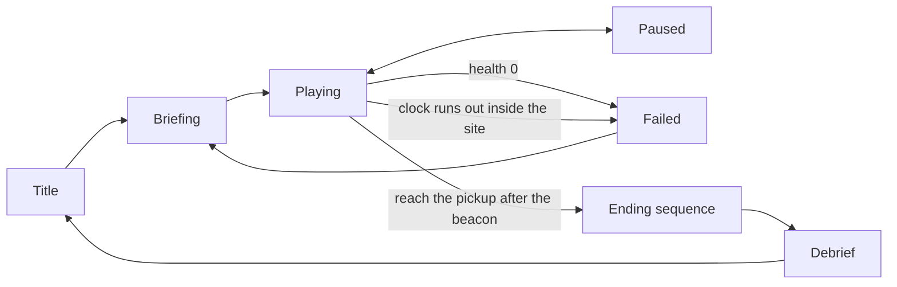

Three things have to be done before the beacon will arm. The first two can be done in any order; the third needs
the second:

1. **Clear** — every sentry and drone on the site is down.
2. **Rig** — a charge on the end casing of each of the four cascades in the cascade hall, each at a different
   end of the hall: rigging them is a walk through it.
3. **Blow** — hold USE at the firing point, in the control room at its window on the hall. It can be done as soon
   as all four charges are set, guards or no guards: that is the loud way, and the whole site comes for you.
4. Then **mark** — stand the beacon on the pad under the exhaust shaft. That starts the clock: 80 seconds on
   Recruit, 60 on Operator, 50 on Ghost. (Walking the route from the pad to the pickup unopposed takes about 18.)
5. **Get out** — through the road tunnel, the only way out, to the pickup in the forecourt outside the portal,
   before the clock runs out.

Stealth is a choice, not a rule. Guards notice you sooner in light, close up, standing and moving; a guard that has
seen you calls the alarm unless it is put down first.

**Checkpoints.** Each charge that goes on is a checkpoint, and so is the blast. If you go down after one, RETRY
puts you back beside that charge — or in the control room, with the cascades down — with health full, everything
you carried then (every gun's rounds, the grenades, the gun in hand, the caches you had emptied by then still
empty), and every machine you had shut down by then still down; whatever happened after it is undone, and the
mission clock carries on from where it stood (a retry is never a faster run). Coming back to the blast, the
drones that answered it answer it again; the alarm it raised is not raised a second time. RESTART in the pause
menu, and PLAY AGAIN after a win, always begin again from the adit. A checkpoint remembers machines by name, so
it still holds if the setting is changed from the pause menu before the retry: the machines of the new setting
are fielded, and those among them that had been shut down stay down.

---

## 2. Parts

```mermaid
flowchart TB
  subgraph pure[Pure logic — no browser needed, unit tested]
    map[world/map.js<br/>the site as data]
    mountain[world/mountain.js<br/>the rock: roof, ground outside,<br/>where the cameras stand]
    grid[world/grid.js<br/>cells, sight, paths]
    collide[world/collide.js]
    ai[enemies/ai.js<br/>guard state machine]
    mission[mission.js<br/>mission state machine]
    settings[settings.js]
    dynres[gfx/dynres.js<br/>picture-size controller]
    shade[gfx/shade.js<br/>light sum, bevels, when to finish]
    bearing[bearing.js<br/>compass points, contacts]
    difficulty[difficulty.js<br/>what each setting changes]
    arms[arms.js<br/>three guns, a grenade, a knife:<br/>the rules of what is carried]
    blast[world/blast.js<br/>the cascades going up, as numbers]
    sight[enemies/sight.js<br/>how much of you a guard sees]
    tone[audio/tone.js<br/>how much of a sound is a note:<br/>a hum, a bleep, a note that is held]
    air[audio/air.js<br/>what the air of a place sounds like]
    lamps[world/lamps.js<br/>lamps that go out: shot, tripped,<br/>what a round meets, what an EMP reaches]
    lights[enemies/lights.js<br/>how far a machine is drawn,<br/>a drone's running lights]
    reload[reload.js<br/>what a reload looks like,<br/>moment by moment, and its sounds]
    score[audio/score.js<br/>the score: what is played<br/>on each sixteenth of each scene]
    bodies[enemies/bodies.js<br/>the fallen: who sees a wreck,<br/>when it is found, dragging one]
    wave[enemies/wave.js<br/>what a charge brings,<br/>and by which door]
    spin[world/spin.js<br/>the casings turn: what is skin,<br/>its marks, how the turning runs down]
  end
  subgraph draw[Drawing]
    materials[gfx/materials.js<br/>four shader programs]
    post[gfx/post.js<br/>bloom, grade, grain]
    build[world/build.js<br/>meshes + baked light,<br/>the shapes rounds stop on,<br/>the cascade and its wreck]
    models[gfx/models.js · sidearms.js · propModels.js]
    textures[gfx/textures.js · art.js · sky.js]
    fx[gfx/fx.js · billboards.js<br/>particles, tracers, lights]
    renderer[gfx/renderer.js]
  end
  subgraph play[Play]
    input[input.js<br/>keys, mouse, touch]
    player[player.js]
    weapon[weapon.js]
    enemies[enemies/index.js]
    markers[markers.js<br/>charges, beacon, pickup]
    hud[ui/hud.js]
    menus[ui/menus.js]
    audio[audio/audio.js]
  end
  main[main.js<br/>owns the frame loop and the game state]
  map --> grid --> build
  mountain --> map & build & main
  grid --> collide --> player
  grid --> enemies
  ai --> enemies
  mission --> main
  bearing --> hud & main
  difficulty --> enemies & main
  arms --> weapon & main
  blast --> build & audio & main
  sight --> enemies
  tone --> audio
  air --> main
  lamps --> build & main
  lights --> enemies
  reload --> weapon
  score --> audio
  bodies --> enemies & main
  wave --> enemies & main
  spin --> build & materials
  input --> main --> player & weapon & enemies & markers & hud & menus & audio & fx
  materials --> build & models & fx & textures
  build --> renderer
```

`main.js` is the only module that knows about all the others. The pure modules never import `three` or touch the
DOM, which is what lets `node --test` exercise them directly.

### The frame, in order

1. read input into one `intent` object (move, look, fire, aim, lean, knife, grab, which gun, the selector, throw, …)
2. step the player (movement, collision, stance, where the head is)
3. step what is in the hands (the trigger, recoil, reloading, changing guns, the knife, a grenade in the air; may
   hit enemies or walls)
4. step enemies (sense → think → move → shoot; a machine held as a shield is carried instead, one stopped by an
   EMP does nothing; a wreck in the player's hand is hauled after it; and ten times a second every machine that
   can see looks about it for the fallen)
5. step the mission (objectives, clock) and interactions (hold to set a charge — which brings the alarm and a
   wave — to fire them, to raise the beacon; take down, take as a shield, drag a wreck, caches) — and the
   cascades: their skins turn, and if they are coming down they come down
6. step effects, doors, audio; update the HUD
7. draw

The step is `min(frame time, 50 ms)`: a long stall (a turned phone, a hidden tab) never becomes a long jump.

---

## 3. How the picture is made

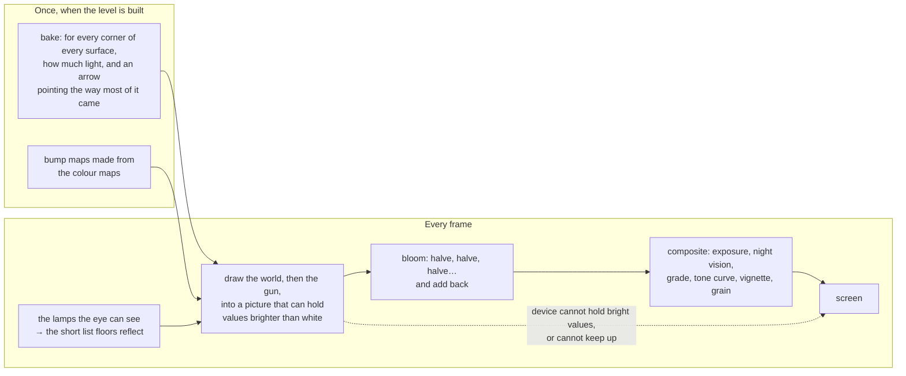

The site is drawn by four small shader programs (`src/gfx/materials.js`):

| Program                | Used for                                | Where its light comes from                                  |
| ---------------------- | --------------------------------------- | ----------------------------------------------------------- |
| `lit({ baked: true })` | floors, walls, ceilings, static props   | worked out once per vertex when the level is built          |
| `lit()`                | guards, drones, the weapon, doors       | the light of the spot it stands on (its _probe_), per model |
| `glow()`               | lamp faces, eyes, screens, flares, fire | gives off its own                                           |
| `beam()`               | the haze under a lamp                   | a cone of faint light, added to the picture                 |

**How much light there is, is worked out once. What it looks like, is worked out per pixel.**

- **Baked light.** `world/build.js` cuts every surface into one-metre squares and, for each corner, adds up every
  lamp that can reach it (distance, angle, and a sight check through the grid so that walls cast shadows). What
  else there is depends on the **air** the surface is in, of which there are three: under the **sky** (the
  forecourt, the mountain's outside, the last metres of the shaft) the moon and the sky's own light; in a **room**
  with a built ceiling a trace of light from nowhere; in the **cavern** a little more of the same, so that rock a
  lamp does not reach is dark and not a hole in the picture. No moonlight gets inside the mountain. Two things
  are stored per corner: the sum (a colour), and **an arrow** — the direction most
  of that light came from, as long as the share of the light it stands for (0: from everywhere; 1: one lamp).
  Nothing about a lamp costs anything while playing. The sum is `createLightSum()` in `gfx/shade.js`.
- **Per pixel.** With the arrow, the shader can do what used to need the lamps themselves: tilt the surface by
  its **bump map** and re-aim the light at it (`relight()` in `shade.js` is the same arithmetic, written out so
  that it can be tested); put the **highlight** of the main lamp on steel and paint; let a **bevelled edge** catch
  the light. Every surface has a roughness and a metalness — from its bump map, from its `surf` attribute, or
  guessed from its paint (`surfaceOf()`).
- **Bump maps** are made at start from the colour maps (`gfx/detail.js`): dark lines — cracks, joints, seams — are
  taken to be grooves. Red and green tilt the surface, blue is how rough it is there.
- **Floors reflect the lamps.** A wet floor in the dark is mostly reflections. A floor's shader draws the reflection
  of up to ten lamps, each where a mirror would put it: drawn out into a streak on damp ground, a clean image in
  standing water. The list is the brightest, nearest lamps **that the eye can see** (`world.updateGlints`, a
  line-of-sight check a few times a second) — a lamp behind a wall has its reflection behind the wall too. Lamps
  fade into and out of the list rather than jump.
- **Water gets in.** The forecourt has been rained on, the cavern's floor seeps and the adit is a drain: all three
  are damp all over, with standing water in the hollows (a slow noise over the world, so the pools do not repeat
  with the texture). The floors of the facility's rooms, the drone bay and the road tunnel are dry.
- **The air under the lamps.** Every lamp with a man's height of air under it and to spare — the strip lights of
  the rooms as well as the ones under the high roofs — lights a cone of haze beneath it (`beam()`).
- **Lamps shine.** Each lamp is up to three pictures added to what is behind it (`SHINE` in `world/build.js`): a
  small **core** that is three or four times brighter than white, so that the bloom below spreads it; the soft
  **halo** round that; and, on wall lamps, posts and floodlights, the **glint** a lens makes of a point of light
  at night — a thin line across it (`glint` in `gfx/textures.js`). Until 12 November 2026 a lamp was one dim disc
  that never reached white, so nothing bloomed; the owner asked for "lights that are shining".
- **Geometry.** Every box a model is made of has its edges taken off (`chamferBox()` in `shade.js`: the same 24
  corners, 44 triangles, normals that turn smoothly across the bevel), and round things get more sides, by detail
  level (`gfx/geo.js`).
- **Probes.** The same sum, taken at chest height in every cell and without regard to angle, gives a light value
  and an arrow per cell. Moving things are lit by it — and so is the **player's visibility**: the light meter on
  the HUD and the guards' eyes both read the probe under your feet.
- **Short-lived lights** (muzzle flashes, blasts): up to four at once, added per vertex in the shader.

**The finishing passes** (`gfx/post.js`). The world and the gun are drawn into a picture that can hold values
brighter than white (half-float). Then **bloom** — whatever is brighter than white spills over what is beside it:
found at half size, halved up to six times, added back — and one **composite** pass: exposure, night vision, a
grade (cool shadows, warm lamps), the filmic tone curve, a darkening towards the corners, a touch of colour
fringing, film grain. Edges are smoothed by four samples a pixel where the detail level asks for them, by a pass
(FXAA) where it does not.

**When they are not used.** Whether the passes run is one decision, made at start (`postPlan()` in `shade.js`):
the detail level wants them, the device can draw into a half-float picture (checked by making one), and the
address does not say `?post=0`. Otherwise every material finishes itself — exposure, tone curve, sRGB, dither in
`lodeFinish` — exactly as the game was first built; a shared switch (`uPost`) tells the materials which.
And one loop watches a device that cannot keep up:

- entry: the passes are on and the picture is at its smallest size (the picture-size controller's floor);
- each frame there: a clock runs; any frame not at the floor sets it back to zero;
- at **six seconds**: the passes are switched off;
- it is **one way**. They never come back in the same visit, so this loop and the picture-size controller cannot
  chase each other.

**What is not drawn.** Level surfaces are merged into a few large tiles per material, so a frame is a couple of
hundred draw calls at most (between 53 and 193 at the nine places they were counted from) rather than thousands.
A guard machine is only drawn while some part of it is in the camera's line of
sight through the grid (asked eight times a second per machine, three lines each) — most of the garrison is behind
a wall most of the time. Sound and movement carry on regardless; a machine you cannot see is heard muffled.

**Words on the walls.** Room names over doors and the lettering outside are written once onto a canvas at start
(`site.signs` in the map) and drawn as lit squares like any other surface, so they sit in the same light.

### Pictures

Ten surfaces are not painted by `gfx/textures.js` but are **pictures**: `rock`, `concrete`, `asphalt`, `dirt`,
`floorConcrete`, `floorEpoxy`, `wallPanel`, `hallWall`, `door`, and `wear` — a layer of grime laid over the four
surfaces that keep their painted grid (tiles, deck plate, ceiling panels, the roof), because a picture of a grid
never lines up with the metre the world is cut in.

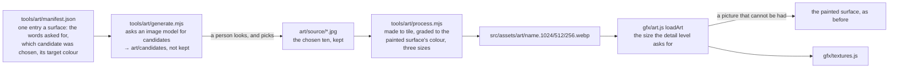

- **Where they come from.** `generate.mjs` sends each entry's words to an image model (Gemini's image models —
  "Nano Banana") and writes what comes back to `art/candidates/`, which is not kept. The key is read from a file
  named on the command line; it is never printed, written or committed, and a unit test reads the tool's own
  source for anything that looks like one. Twenty-six pictures were made on 12 November 2026 and ten chosen.
- **Made to tile.** `pixels.mjs` `seamless()` cuts a strip from the far edge of a picture and fades it over the
  near edge, so that the two edges of what is left are neighbours in the original; a wall picture is evened out
  across its width only, so that stains still run down it. (The first way tried — blending the picture with a
  copy of itself shifted by half — put every feature in it twice. A test now forbids that.)
- **Graded.** Each picture is brought to the mean colour of the painted surface it replaces, so that the baked
  light, the bump maps made from it and everything tuned by eye still hold.
- **What it costs.** A phone fetches the ten at 256 pixels (87 kB in all), a desk at 512 (341 kB); `high` asks
  for 1024. They are asked for together before the first frame, and the game does not wait for one that fails.
- **Without them** (`?art=0`, or a failed download — `?art=miss` plays that) every surface is painted as it was.

To make a new one: add an entry to the manifest, run `generate.mjs --key-file <file> --only <name>`, look at the
candidates, set `pick`, run `process.mjs`, and look at it in the game.

**Picture size.** The canvas follows its own box with a `ResizeObserver` (a phone that is turned re-shapes the page
without always sending a `resize` event). A small controller (`gfx/dynres.js`) lowers the drawing resolution when
frames run long and raises it again when they do not; after any re-shape it **holds for two seconds**, so the slow
frames of the turn itself are never mistaken for a slow device.

**Detail level.** `Auto` is decided **once**, at start, from the device (a touch screen or a small one gets `low`:
a lower pixel-ratio cap, 256-pixel textures, fewer particles, plain boxes without bevels, and FXAA instead of
extra samples; it keeps the bump maps, the wet ground, the reflections, the beams and the finishing passes). It
never changes while playing. Two things adapt while playing, and they cannot fight: the picture-size controller,
continuously, and the one-way switch above.

What is still simple, and why — **in the game as it is without `?look=2`** (the next section is about what that
switch changes): there are no shadow maps (shadows are those of the bake, a metre fine), no image
of the world in the puddles (only the lamps), and everything that stands or moves is built from primitives —
more of them than there were (a sentry is about six thousand triangles on a desk, three on a phone; section 9
holds each model to a ceiling), but painted, not textured: the grime of the pictures is on the walls and the
floors, not yet on the furniture or the guns. Nothing uses three.js lights or built-in materials.

### The second look

**Decision of 15 November 2026.** The owner had asked four times for a game that looks far better than it
did. On 13 November what is
drawn was counted: no object had a material — 14% of what is on
screen was bare paint, and the gun another 12% — nothing threw a real shadow, and metal had nothing to mirror. To the plan that came of
it — a material on every object, strong lamps that throw real shadows, the place captured for metal to mirror,
more shape where the eye rests, and **one view built all the way through first, behind a switch, for him to
judge** — he said: "go ahead".

So there is a second look, and it is behind a switch: `look=2` in the address. The one view is the first one a
player has — out of the drainage adit into the yard of containers (`src/look/stations.js`).

**Without the switch the game is what it was**: no material has a line of the second look's shader, no model
carries its attribute, none of its code or pictures is fetched, and every test of the game as it is passes
unchanged (`test/second/look.test.mjs` holds it to that). One thing is different, and it is this: the script
every player downloads is 24.8 kB larger — 863.5 kB where it was 838.7; 9.2 kB more as it is sent — because it
carries the second look's shader text and the world builder's hooks, fenced off. The same test holds it under
870 kB — 880 since 16 November 2026, when the game itself grew by 13.5 kB (lamps that go out, section 4; the
second look's share is what it was), and 905 since later that day, when it grew by 24.7 kB more (round eight:
section 9). The look's own code is a file of 56.6 kB (19.5 as sent) that is fetched
only with the switch.

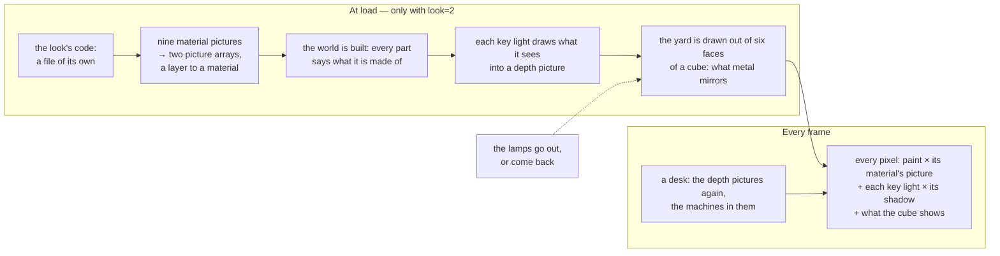

- **What things are made of.** There are eleven materials (`gfx/matter.js`): paint, steel, galvanised steel,
  rust, gunmetal, polymer, rubber, fabric, wood, concrete, glass. A part of a model says which —
  `paint(g, colour, { mat: 'rubber' })` — and one that does not is given one by rule, from its colour and how
  rough and how like metal it is (`matterOf`), so that nothing on the site is left bare. It travels as one more
  number at every corner, `mat`: the material's layer, and a half more on the triangles of a bevel or a corner
  (`merge()` finds them by how far their corners turn). The shader (`LODE_MATTER`) wraps that layer of the two
  picture arrays round the part from the three sides of the part's own space — no model has, or needs, a map of
  its own. The picture **multiplies the part's paint**: it is graded to a neutral grey and half of whatever
  colour it has left is taken out (`tools/art`, `chroma`), so an olive truck and a red container wear the same
  picture of painted steel and keep their colours. On the whole it multiplies the paint by **one**: the loader
  brings each picture to one middle grey, measured as light (`toNeutral`, `MATTER_MID`), and the shader divides
  by that same grey — a unit test holds the two to agreeing. (They did not, at first. The pictures are stored as
  pictures are, in which middle grey is the number one half; a shader is handed light, in which it is 0.214.
  The shader divided by one half, and everything with a material was drawn at 43% of its paint from near to and
  80% from far off: things grew darker as they were walked up to. Found on 15 November 2026 by reading the
  loader against the shader — not by looking: the pictures taken until then all had it in them, and none gave
  it away.) What the picture
  adds is grain, relief (a second array, made from the first as the level's bump maps are), and the way shine
  wanders over a real surface. On top: slow drifts of
  tone so that no two metres are the same, a band of grime where a thing meets the floor, and the finish rubbed
  through along edges — which triangles are edges is known from the model, not guessed from the picture, so it
  does not shimmer.
- **The pictures** are made as the surfaces' pictures are (`tools/art`, `--set matter`; section "Pictures"):
  nine of them, 28 requests to the image model on 15 November 2026 for 19 pictures, of which nine were chosen.
  A desk fetches them at 512 pixels (621 kB in all), a phone at 256 (120 kB) — only with the switch. Concrete
  reuses the picture the walls are made of; glass has none. One that cannot be fetched leaves its layer grey:
  the part is drawn in its paint, as before (`?mats=miss` plays that).
- **Key lights.** Two floods over the yard (`look/keys.js`): one on the cavern's south wall that lights what
  somebody coming out of the adit is looking at, and one on the building, further in, that is seen, edges the
  tops of things and throws its shadows towards the eye. The first plan was one lamp to a space, and it was the
  second of these alone; by that lamp alone every face in the view is in its own shade. A key light is not
  in the bake. It is added pixel by pixel: its beam, its fading with distance (`look/key.js`), the surface's own
  angle and shine — and its **shadow**. For each lamp the site is drawn once more from where the lamp hangs,
  into a picture of depths (2048 pixels across on a desk, 1024 on a phone), and each pixel asks that picture
  whether something is nearer the lamp than it is: at sixteen points round itself on a desk, four on a phone,
  turned by a different angle at every pixel, for a soft edge. Walls, props, door leaves and the cascades throw
  shadows; fences, lamp faces and anything that glows do not. On a desk the depth pictures are drawn again every
  frame with the machines in them, so a sentry walking through the beam throws its shadow as it goes; a phone
  draws them once, of what does not move. While the mountain comes down the key lights are out — the shader
  moves the ground then, and a depth picture knows nothing of that.
- **What the game counts.** A body standing in a key light can be seen. How much of each lamp reaches chest
  height in every cell — a sight line through the grid, as coarse as a guard's eye — is kept beside the probe
  (`world.keyAt`) and added to `world.visibility`, which is what the light meter and the guards read. The probe
  itself, by which moving things are shaded, is unchanged: the picture adds the key lights to them per pixel.
  Two things follow, and both are behind the switch only. The yard is brighter than it was: there is less dark
  to cross it in. And the shadow a _machine_ throws is in the picture and not in the count — standing in a
  sentry's shadow does not hide you.
- **What is in the hands** is drawn in a space of its own, not in the world, so neither sum above can be done
  for it. Its materials are told so (`setInHand`); the key lights reach it by a sight line from the eye to each
  lamp, as a round flies, eased over a fraction of a second so that stepping out of a shadow is not a switch
  (`weapon.js`); and it mirrors the captured place from where the eye is, by as much as the eye is inside it.
- **The mirror.** From one point in the yard the site is drawn out of the six faces of a cube (`look/mirror.js`:
  128 pixels a face on a desk, 64 on a phone; light kept as light, in half-floats, where the card can) — by the
  light of its lamps and with the key lights' shadows in it. What is in it is what **takes** light and stands
  still. Not the lamps themselves, nor anything else that gives off light: every surface already shows its
  lamps' highlights by the sums that know where each lamp is, and a lamp's face is so much brighter than what
  it lights (read back, 7 towards a flood where the floor under it is 0.3) that in the cube's smaller copies a
  few of them outweighed the place. Not machines or smoke, which move; nor the shine that turns to face the
  eye. Nor — since 16 November 2026, when the casings were made to turn (section 4) — the streaks on their
  skins: the casings are in it, they are what the hall is full of, but **plain**, as a drum looks wherever it
  has got to. A capture is kept; a streak in it stood still for good, in metal beside skins that turn (found in
  review the day the turning was built — the hall's capture is made two metres from the nearest row). So a
  capture is drawn in the casings' colours as they were before the streaks were put on (`cascade.still`), and
  the streaks are back before anything is drawn for the eye, also when the capture fails. Inside the box that
  goes with the capture every lit surface reads what it reflects out of that cube
  instead of out of the sum that stood in for it — sharply where it is smooth, out of the cube's smaller copies
  where it is rough — and outside the box the old sum still stands. The box is taken for the room: the ray is
  followed from where the surface is to the box's wall and the cube read towards where it lands, so that a
  reflection lies about where it belongs although the capture was made from somewhere else. (What is in the
  hands was at first left out of that correction. At the adit's mouth, fourteen metres from where the capture
  was made, one flank of a charcoal gun mirrored the lit wall that lies north of the capture, and was red —
  a tenth of its pixels. A test now counts them.) A floor keeps showing its lamps by the glints, and takes
  only the glow from the cube. It is captured again when the lamps go out or come back, and never otherwise.
  A capture is six draws of the site in the middle of a frame; one that fails is said as a warning and tried
  again on the next frame, twice at most — then metal mirrors the sum that stood in before there was a capture,
  the gun included, until one is asked for again. The game is never stopped for it.
  Two tests ask the capture what it shows, by reading it back from the card: towards ground a key light
  reaches it must be bright and towards ground in that lamp's shadow dark — which a capture stored the wrong
  way round fails — and towards a lamp it must not show one.

- **More shape, for what is in the view** (`src/gfx/next/`, fetched with the rest of the look). Four things have
  been built again, each to the contract of the builder it stands in for (section 8), so that nothing that
  places, poses or animates them had to change: the carbine and the two gloved hands that hold it (36,150
  triangles on a desk where it had 8,376; 13,168 on a phone), the sentry (17,400; 5,586), the truck (12,704;
  7,024) and the container (6,922; 1,498). Every part of each names its material. A round stops on the new
  shapes, since it stops on what is drawn (section 4). What is written on them — the gun's rack number and
  serial, the sentry's designation, a container's line and its number with a check digit, a truck's unit number
  and plates — is drawn on a canvas, because an image model garbles text, and stands a hair off the surface as
  a lit square: on a prop through the world's own batch (`letters` in what its builder returns), on a moving
  thing as a child of the part it is written on (`gfx/next/lettering.js`). `shapes=0` plays the second look
  with the models as they were. These four were **pulled forward from step 4 of the plan, for this view only**:
  a view with every surface finished and ball hands in the middle of it would have told the owner nothing. The
  drone, the other two guns, the knife, the grenade and the other twenty-one kinds of prop are the models they
  were, with a material by the rule.
- **A sight is for looking through.** The first picture taken with the new carbine's sight raised had a dark
  lens in the middle of the screen, over whatever was aimed at. Its window is open now, as the old one's is,
  and a test follows five lines from the eye through the window of whichever gun is in the hands, in both
  looks, and fails if any part of the gun crosses one.

- **A phone under the switch** gets the plainer of everything above — 256-pixel material pictures, depth pictures
  half the size and drawn once, four points to a shadow's edge (nine if its graphics card does not blend
  neighbouring answers by itself, or could not be asked; `look/probe.js` asks it), a 64-pixel cube, and the new
  models thinned as the detail level thins every model. Drawn once means of the site as it stood when it was
  built: a door that slides open goes on throwing its shadow there. It is heavier than the game a phone has
  now: 259,748 triangles of world where there were 237,022, a gun of three times as many, and — what is likelier
  to matter — more work at every pixel. **None of this has been timed on a real phone.** That is what the test
  page is for.
- **What a desk pays.** Each frame the two depth pictures are drawn again: about half a million triangles on
  top of the picture's own. The machine this was built on holds the display's pace with room to spare; no
  other has been tried. Before more lamps are added, what stands still should be drawn into them once and only
  what moves again.
- **The phone test page** (`?bench=1`, `look/bench.js`) — as it first was; its second version is further down.
  It loaded the game five times — as it is; then the
  second look with materials only; with the key lights; with the mirror; and with materials laid on from one
  side instead of three — each time stands at the adit's mouth and counts frames while drawing the world once,
  twice and three times a frame. A screen takes sixty pictures a second: a set-up that still makes sixty drawing
  the world twice has room to spare, and one that does not make sixty drawing it once cannot be carried as it
  is. It ends on a table and one line to copy. Loop: one load to a set-up, in order, none twice; a game that
  has not started after 25 seconds is written down as failed and the run goes on. A shader that does not
  compile on a device draws nothing, and nothing is quick to draw: the page counts them for each set-up and
  says, in the table and in the line, that such a set-up's rates are too good.
- **To look at one piece alone**: `mats=0` (no materials on objects), `mats=cheap` (laid on from one side),
  `mats=miss` (pictures that cannot be fetched), `key=0` (no key lights), `env=0` (nothing captured),
  `shapes=0` (the models as they were).

#### The whole site (16 November 2026)

**Decision of 16 November 2026.** The owner looked at the one view, ran the test page on his iPhone, and wrote:
"I like the new graphics continue the implementation plan don't stop until you are done". The line his phone
gave was

`LODESTAR-BENCH 1 | iPhone 26.7.3; 402x874@3 | canvas 1005x1685 | q=high | Apple GPU | shadows blended | C 30/20.7/15 | D 29.7/19.7/16 | E 30/21/16.7`

and what it says, and does not, decided how the rest was built. With Detail at High the phone had been given the
desk's level — "a phone" had been taken to mean "Detail: Low" — and drew it at thirty frames a second, twenty
with the world drawn twice: there is nothing to spare. Its graphics card blends the answers of a depth
comparison by itself, so four points to a shadow's edge are enough there. And rows A and B are missing: the page
kept its rows in the browser's own store, and the browser had loaded the page afresh between two set-ups. So
what the second look costs that phone over the game as it is, is still not known.

Steps 2 to 5 of the plan were then built for the whole site, behind the same switch. **The switch has not been
turned on for everyone.** The plan's last box is "you look, then it ships", and that is the owner's: the address
without `look=2` is the game as it was, to the byte of every picture.

Where the paragraphs above say what the one view had, the site now has this.

- **Seventeen materials, and nobody's guess** (step 2). Six were added after the eleven, so that no layer a
  model already names changes its number: aluminium, brass (and, painted copper-red, copper), enamel, chequer
  plate, canvas, rock. Five have a picture of their own (10 requests to the image model, two candidates each,
  chosen from a contact sheet; 38 of the 80 requests agreed have been used); rock borrows the cavern wall's as
  concrete borrows the building's. "Everything has a material" had been true of a site nobody had named: a
  part that did not say what it is made of was given a material by the rule. A guess is now **marked as one** —
  an eighth added to the layer's number (`gfx/geo.js` `GUESSED`), which the shader does not see: it reads the
  whole number and the half that marks an edge — and counted (`guessedShare`, `world.stats.named`, and `named`
  beside each kind of furniture). The builders of the furniture that has not been built again say what a thing
  is made of by which paint they reach for; a table there (`MADE_OF` in `gfx/propModels.js`) says what each
  paint is on, and the few parts it would get wrong say so themselves. Of the corners of everything that
  stands on the site, none is a guess.
- **A key light in every space** (step 3): twenty-seven lamps (`look/keys.js`, a table) — four floods over the
  main cavern and one each over the dock, the west strip and the two ends of the north passage; the moon down
  the exhaust shaft and a flood in its cavern; the moon on the forecourt; a lamp in the road tunnel and in the
  adit; two in the cascade hall; one in every room, two in the corridor; one, red, in the drone bay. More than
  one colour of light: cold floods, a blue moon, sodium in the tunnel and on the dock, tungsten in the working
  rooms, the green-white of the hall's high bays, the control room the colour of its screens, the armoury and
  the drone bay on their red standing lights.
  **Not all of them burn at once.** The shader has room for six on a desk and four on a device held in the hand
  (`LODE_KEY`). Which lamps hold those slots is worked out from where the eye is (`look/slots.js`): each lamp
  has the pool of floor its light reaches and the doorways that light gets out of, both found beforehand from
  the map; how much it matters to the eye falls with distance from that pool, and through a doorway. A lamp
  comes up and goes down over about half a second, is only put out of its slot when it has gone dark, and is
  not displaced by one that is a little ahead of it — nothing flickers at a border. Nowhere on the site do more
  than six lamps ask to burn at once; with four slots and a shorter reach, a lamp left without one is never one
  the eye stands near. Loop: one slot's depth picture a frame, unless the eye has jumped — then all at once.
  **Depth pictures.** There are two, each a sheet of tiles, one tile to a slot. What stands still — walls,
  roofs, furniture, the cascades — is drawn into a lamp's tile **once**, when the lamp takes the slot (2048
  pixels across at Detail: High, 1536 at Medium, 1024 on what is held in the hand). What moves — machines and
  the leaves of doors — is drawn into a second, smaller sheet every frame, on a desk only; the two are asked
  together. (Until then each lamp's picture was of everything, drawn again every frame: half a million
  triangles a frame for two lamps.) A device held in the hand has no second sheet: a door that crosses half
  open marks the tiles it is in to be drawn again.
  **What the game counts.** Light is followed from a point to a lamp by a ray through the map
  (`look/key.js` `lightReaches`): walls to their own height, rock, built ceilings where the ray crosses their
  height, the cavern's roof, shut doors up to their lintel, and things by their box or — asked finely — by their
  true shape. Every lamp's picture is held against that ray, alone, in a browser: where the ray is blocked the
  ground must not brighten when the lamp is lit. (Holding all twenty-seven to it found six faults in the ray,
  not in the picture: a lamp above a low roof, a ray that stopped on a building's roof from above, a shut door
  that blocked rays passing over the building, the fence's wire, machines that were not drawn and so threw no
  shadow, and a lobby lit through its open doorway.) Under a built ceiling the light worked out beforehand is
  turned down to 0.55 of itself and is the fill beside the room's key light (`ROOM_FILL`). And **each space is
  as watchful as it was**: what a lamp adds to how well a body is seen is stopped down, zone by zone, until
  what a machine's attention is multiplied by, summed over that zone's floor, is what it is without the switch
  (`world/build.js` `watch`). Without that the main cavern was 1.65 times as watchful: the game is not to be
  made harder by being made to look better. A lit patch is still easier to be seen in than its shadow.
- **A captured place for every space**: nineteen of them (`MIRRORS`), each with its box. A capture is made the
  first time the eye is in its box — not before: it is of a place as it is lit, and a place's lamps burn only
  when the eye is near — and kept. The one mirrored is the one the eye is in; going from one into the next the
  old is faded out and the new in over a fifth of a second, and a jump is a cut.
- **The picture's exposure follows the place** (`look/exposure.js`): stopped down facing a flood, opened up in
  the dark, between 0.62 and 1.5 times, quickly down and slowly up, as an eye does. It is worked out from the
  light the game already knows of where the eye stands and along its view — not read off the picture — and
  multiplies the player's own brightness setting, which is kept.
- **More shape, for everything** (step 4, `src/gfx/next/`). Built again by helpers, each to the contract of the
  builder it stands in for, every part naming its material, each prop with something written on it: the drone
  (10,364 triangles on a desk); the sentry a second time — shaped shells on its limbs, a dome on knee and head,
  a back worth seeing (19,570); the forklift (9,496), the console (about 4,100), the switchgear (4,032); the
  crate (812), the tall crate (1,292), the barrel (1,110), the barrier (720), the pallet (664), the UF6
  cylinder in its cradle (2,652), the process tank (3,740), the overhead pipe run (about 800); the cascade's
  casing (478 where the eight-sided one had about 220 — there are 512 of them), the charge (2,676) and the
  beacon (4,138); the rack (about 2,200), the bank of lockers (3,256), the desk (1,856), the transformer (5,871)
  and the generator set (6,407); and what is held in the hands — the carbine again (35,956) with gloved hands
  of their own file, the pistol (18,012), the shotgun (22,120), the knife (6,622) and the grenade (2,602, and
  the fist that holds it). Still built as they were: the wall and ceiling lamps, the lamp posts, the towers,
  the vent stack, the roof units, the dish and the rocks.
  **The hands on the guns** were looked at again the same day (the owner: _"the hand holding the gun is slightly
  off"_). The support arm of the carbine and of the shotgun ran straight down from the hand — a post, on the
  screen; it now runs back, down and to the left to the shooter's own elbow, off the bottom of the picture, with
  the palm under the fore-end. Found on the way: the carbine's ten suppressor rings hung under its bore; the
  shotgun's pump stood upright through its barrel and its stock sat six centimetres adrift of the tang; and
  aimed, the pistol's suppressor grazed the line from the eye to the target. No triangle was added or removed.
  `test/unit/hands.test.mjs` holds all of it.
  A model that needs an outline pushed out into a solid uses `gfx/next/extrude.js`, not three's class for it:
  three is in the script every player downloads, and that class brings three's shapes, curves and triangulator
  with it — 28 kB that the lock on that script's size caught when the sentry's second pass came in.
  **What the world may weigh** was held under 700,000 triangles in either look. More shape is more triangles:
  the game as it is stays under that (360,654); the second look on a desk may be 900,000 (it is 824,382), and is
  held by the frames counted in the same test — the display's pace at the adit's mouth and in five other
  places. The look's own file is 203 kB (71 as sent), fetched only with the switch; the script every player
  downloads is 858.5 kB, under the same 870. (Later the same day, with lamps that go out: 204 kB, and 872.0 under
  880; and with round eight, the look's file 61 bytes more and the game's 896.7 under 905 — section 9
  says why the ceiling moved, both times.)
- **What is painted and spilt, and the dark under things** (step 5; `look/marks.js`, `look/marksheet.js`). A
  floor that has been worked on is not a clean sheet of one material. Worked out from the site alone, the same
  every time: a hazard band across every doorway, on each side where the floor was made (not on dirt); a yellow
  line round each cascade and its number at the west end; a white line round each lorry's bay, and its number;
  the road's broken line; oil under what has an engine, a lorry's tracks, damp where the rock seeps, cracks
  and patches in the asphalt, scuffs in front of doors; water down what was built in the cavern; the signs
  beside doors, which say what is behind the door (the trefoil at the hall's, the bolt at the switchgear's);
  and under everything that stands on a floor, and under the cascades, the dark where no light gets — which is
  what makes a thing stand on a floor. About 3,100 squares, each a square of ONE picture drawn on a canvas at
  the start, laid as lit squares in the order given: stains, paint over them, the dark over both. A mark
  mirrors nothing. They are drawn by code, not by the image model: a photographed stain would be richer.
- **The air under a lamp is lit** (step 5): a cone of haze from every lamp that hangs, along its beam, gone
  before the floor (`look/key.js` `shaftOf`), drawn as the site's own lamps' haze is, drifting; and the moon's
  light down the exhaust shaft is a column as wide as the shaft, from the cavern's roof to the patch it lights.
  On a desk only.
- **Tread plate** is laid at its real size in the second look (0.7 m to a repeat where it was 2): close to, its
  lozenges were the size of a hand.
- **A device held in the hand** is given the lean level whatever detail its owner chose (`look/index.js`
  `levelOf`: touch, or Detail: Low): four lamps at once and a shorter reach, 1024-pixel tiles, no picture of
  moving things, a 64-pixel capture, no lit air, the eight-sided casings, and of the furniture only what the
  one view had. It does get the marks, the exposure, the drone, the charge and the beacon. **None of it has
  been timed on a real phone.**
- **The phone test page, second version** (`look/bench.js`, `look/setups.js`). The rows travel in the address,
  where a fresh load cannot lose them. The screen's own rate is timed first, with nothing else going on, and
  written down — so thirty frames a second can be told from a screen that shows thirty. The level the device
  was given, and the detail it was at, are written down. And the set-ups are: A the game as it is; B the
  second look, all the device is given of it; then B with one thing changed — C no key lights, D no materials,
  E no captured places, F materials laid on from one side, G Detail: Medium — so that what a row gains over B
  is what that thing costs. Seven loads, two seconds a rate, about two minutes. The line begins
  `LODESTAR-BENCH 2`.
- **To look at one piece alone**, besides the switches above: `marks=0` (nothing painted or spilt, no dark under
  things), `shafts=0` (no lit air).

**What was cut, and what is not good.** The plan's "finer worked-out shadows" (splitting floor squares where the
light at their corners differs) was not built: it was first on the list of what to drop. Stains are drawn by
code. The truck did not get a second pass. Dust is the drift in the haze, not motes of its own. The drone bay is
one red lamp, and it reaches down the north passage. The rooms are evenly bright. What is in the hands is dark
in a dark place, and the pistol's hand sits two centimetres under its sights (its builder's own note); only the
carbine's line of sight is held by a lock. The casing, the charge and the beacon were built against numbers
alone — their builder ran out of time before drawing them once — and have been looked at in the game only: the
hall, one charge, the beacon. A crate has rope handles on two of its four sides.

**What has and has not been checked.** Every lock in section 9 passes on the machine this was built on, in a
headless browser; pictures of every lamp's station were looked at, at each stage. Nothing has been run on a real
phone since the owner's line above, which was of the one view. No other desk has been tried. Nobody has played
the mission through with the switch on.

---

## 4. The world

The site is a grid of **one-metre cells**, 128 across (X, east) by 96 deep (Z, south). `world/map.js` builds it
with a few drawing helpers (rectangles, rooms, doors, rows of props) and returns plain data:

- per cell: what it is (ground, floor, wall, fence, door, rock), how high its built ceiling is (`ceil`; 0 where
  it has none), what is over it (`sky`: rock, open sky, or the foot of the exhaust shaft), which floor it has,
  which zone it belongs to;
- lists: lamps, props, doors, guard posts and patrol routes, the four charge sites, the firing point and the
  window it stands at, the beacon pad, the start and the pickup.

`world/grid.js` answers the questions everything else asks of that data:

- `blocked(x, z, flying, feet)` — can a body stand here. `feet` is how high its feet are: something with a flat
  top stops a body only while its feet are below that top (see "What can be climbed" in section 7); guards and
  drones always ask with their feet on the ground;
- `floorUnder(x, z, radius, feet)` and `ceilingOver(x, z, radius)` — what a body's feet rest on and what its head
  would meet;
- `sight(ax, ay, az, bx, by, bz)` — is there a clear line (walls and closed doors stop it; low cover stops it only
  below its top; fences and thin props never do);
- `raycast(origin, dir, max)` — where does a bullet stop (see "What a round meets", below);
- `path(from, to, flying)` — A\* over the cells, eight directions, never cutting a corner.

**Doors** open by themselves for any body that comes near, so a _plan_ always treats a door as open ground — a
route is never refused because a door happened to be shut when it was asked for. _Sight_ and _bullets_ obey the
door as it is at that moment, and a body is only held up by it for the fraction of a second it takes to slide.

Directions: yaw 0 looks along −Z; forward is `(−sin yaw, 0, −cos yaw)`. Models face −Z.

### What a round meets

A thing that stands in a cell is smaller than the cell. Until 12 November 2026 a round stopped on the cell's box
up to the thing's height — so a round fired past a forklift's mast, between the shelves of a rack or beside a
casing left its mark hanging in the air. (The owner: _"i fire at transparent objects but they get bullet
markes"_.) Now:

- `world/build.js` keeps the **triangles** of every thing that blocks, exactly as it draws them, and hands the
  grid a `shapes` hook: `at(cell)` → which thing fills that cell, `ray(thing, …)` → where a ray meets it. A round
  stops on the thing itself, or flies on through the gap. A thing that fills several cells is asked about once a
  round.
- The **casings** of the cascade — two to a cell, 512 of them — are upright cylinders to a round, as wide as
  they are drawn. (`CASING` in `world/map.js` is where a charge hangs, `world.shapes.casing.radius` is what
  `build.js` measures off the model, and a smoke test holds both to the width of the triangles that are drawn.
  The first measurement took the widest corner at a chosen height, found none there, and fell back on a guess
  nine centimetres too thin; it now takes the tallest straight-sided part of the model, whatever that is.)
- **A door keeps no marks**: it slides away from under them. Nor does the **wreck** of the cascades: there a
  round stops on a low heap the size of the cell, which is not what is drawn, so it sparks and leaves nothing.
  Nor — since 16 November 2026 — does a **casing** that stands: its skin turns ("The casings turn", below), and
  a mark would stand still on it. A casing says what it is (`what: 'casing'`, where it used to say `'prop'`),
  sparks and rings like any metal, and is left clean. `gfx/fx.js keepsMark` is the whole rule.
- **Sight and movement are not changed.** A guard still sees, and a body is still stopped, by the cell and the
  thing's height: you cannot be seen through a rack that you can shoot through. That is deliberate — cover that
  hides you from one side and not the other would be worse than cover that is a little generous — and it is the
  one place where the three questions give different answers.

`test/unit/grid.test.mjs` pins the hook with a ball in a cell; the smoke test fires hundreds of lines through the
site with the shapes on and off, and asks that with them on not one stops in the air.

**Over an opening** (16 November 2026). A round that came to a low place — a doorway, the mouth of the road
tunnel — from a higher one, above the low place's ceiling, was said to have met that ceiling where it had passed
the ceiling's _height_: out in the open, up to metres in front of the lintel. Coming down from above, it flew on
through what is built over the door. It was found looking for which lamps a round can reach: the lamp over the
tunnel's mouth could not be hit from the forecourt. Now a round that enters a cell above its ceiling stops on
the face it came in through, as on a wall — which is what is drawn there. `test/unit/grid.test.mjs` pins it from
below, level and from above.

### The casings turn

Decision of 16 November 2026 — the owner: _"make the centrifuge spin"_. What turns is the **skin** of a casing —
its straight side, 0.14 m to 2.78 m up — between a foot and a head that stand still, as a drum turns in its
bearings. The pipes that leave the head, the bands and the valve do not move.

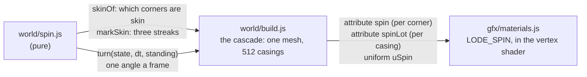

- **Where it is done.** The cascade is one mesh drawn in one go. Turning 512 casings on the processor would be
  512 matrices a frame, and the blast owns those matrices; so the turning is done where each corner is placed on
  the screen. A corner marked `spin` is turned about the casing's own axis, in the casing's own space — before it
  is stood in the hall, or thrown down in the wreck — by `uSpin` times the casing's own speed, plus the casing's
  own start. Its facing is turned with it, so the light on it is right. Cost to the processor: one number a
  frame.
- **Each casing its own.** `spinLot`, one number a casing, is drawn from where it stands: its speed is one of
  five (0.75 to 1.25 of 1.1 turns a second) and its start is anywhere. The lot is an attribute, not worked out in
  the shader from the casing's place: a casing going over in the blast changes its place every frame, and would
  have changed its speed with it.
- **So that it can be seen.** A plain metal cylinder that turns looks exactly like one that does not. The skin
  carries three streaks down its length — one darker by half, one lighter by a third, one darker by a third, at
  no even spacing — each on one line of corners, whatever the number of sides (8 in the first look; 11, 17 or 22
  in the second). In the second look the grain of the metal goes round too: it is wrapped by the corner as it
  was built. Measured in the built game, sixteen pixels at a time, from the aisle: a third of a second changes
  the skins by 4 to 5 of 255 and the heads above them by a quarter to a half of one.
- **The number does not grow.** `uSpin` comes round at eight turns — where each of the five speeds has made a
  whole number of its own turns — as `uTime` comes round at an hour: a number that only grew would lose its small
  change, and the skins would judder.
- **It runs down.** `cascade.spin(dt)` is called by the frame while the mission is played. Standing, the speed is
  1; once the charges are fired it falls to nothing over 2.5 s, and in the wreck — and on a retry from the blast's
  checkpoint — nothing turns. A new mission stands the cascade up and it turns again.
- **In a picture that is kept, no streaks.** Two things are drawn once and kept: the key lights' depth pictures,
  and what metal mirrors (both the second look's). A depth picture has only the shape in it, and the shape of a
  drum that turns is the shape of one that does not (to 9 mm: its sides are flat). What metal mirrors has colour
  in it — and is taken with the skins plain (`cascade.still`; "What metal mirrors", above). The grain of the
  metal, which goes round too, is still in it as it lay when it was taken. It is far fainter than a streak, and
  what stands in the hall is rough (the casings 0.36, more or less as their metal's picture has it; a floor
  takes only the glow) and so mirrors the place out of the cube's smaller copies, where grain is gone. That was
  reasoned, not measured: it is named here so that it is known.
- **What was left alone.** The shadow a casing throws in the second look is drawn from the casing as built: the
  difference is the difference between an eleven-sided prism at two angles, nine millimetres at most. A round
  meets a casing as it did (an upright cylinder). Loop contract: `speed` only falls while the cascade is down,
  is bounded to [0, 1], and `angle` stays inside its round.

`test/unit/spin.test.mjs` pins what is skin, the marks, the speeds, the wrap and the running down; a smoke test
holds the built game to turning, to being seen to turn, to stopping in the wreck, and to a casing keeping no
mark.

### Lamps that go out

Decision of 16 November 2026 — the owner, having played the second look: _"i want to have the ability to shoot at
the light to turn it off and turn on night goggles to use them also emp needs to turn of the light in a room"_.
Until then the light of the site's 97 lamps was worked out once, when the level was built, and nothing in the
game could change it. What was decided (nobody was asked; each is one number or one line):

| Rule                                                                                             | Where                                |
| ------------------------------------------------------------------------------------------------ | ------------------------------------ |
| A lamp that is **shot** is out for the rest of the mission. Its lens is what a round must hit.   | `world/lamps.js` `shoot`, `hit`      |
| It is heard: glass breaking carries **7 m** (a round on a wall carries 5, an EMP 10).            | `ARMS.lamp.noise`                    |
| An **EMP** puts out every lamp of the **room** it goes off in — the zone under a built ceiling.  | `world/lamps.js` `reach`             |
| In the open cavern it puts out the lamps that hang in the open within **14 m**.                  | `ARMS.grenades.dark.radius`          |
| They are out for **20 s** and come back by themselves, all at once.                              | `ARMS.grenades.dark.seconds`, `trip` |
| The **sky's glow** down the shaft — and the two moons of the second look — cannot be put out.    | `fixed`                              |
| A **checkpoint** keeps what had been shot. A retry brings back what was shot, or tripped, after. | `save`, `load`; `main.js`            |
| **Night vision** (N) is how you see in it. Machines see by the light on you, and there is less.  | section 5; `world.visibility`        |

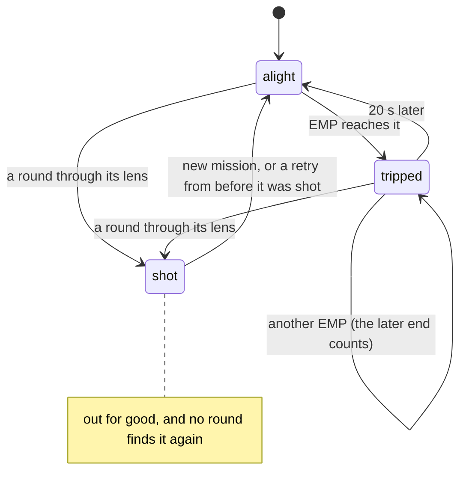

`world/lamps.js` is the rules and nothing else — no picture, no light, no three.js: which lamps are out, for how
long, what a round meets (`rayBox` against each lamp's box, the nearest), what an EMP reaches. One list holds the
site's lamps and, after them, the second look's key lights (`look/key.js` `keyLampsOf`: a key light is the lamp
of the first open ground along its beam, since it is fixed to a wall and a wall is in no room). `main.js` joins
the list to the game: `weapon.js` asks it about every round (`hooks.lamp`, after the wall and the machine have
been found, and a hand's breadth past the wall — `ARMS.lamp.proud` — because a fitting stands out from it) and
tells it of every EMP (`hooks.emp`); time is passed to it once a step; and whatever it says has changed is
handed to the two things that draw lamps.

**What a lamp going out does to the level** (`world/build.js`, "lamps that go out"). Nothing is kept of what
each lamp gave to each corner — that would be the memory the bake was written to do without. The light is worked
out again from what it was worked out _from_, with the lamps that are out left out of the sum:

- **at once**, in the same frame (`sync`): the light at chest height in every cell the lamp reaches — the
  probe, which is what machines see you by, what lights the gun and what the light meter reads; the casings of
  the cascade; the doors; the charges, the lodestar and the caches (`markers.relight`); the marks rounds and
  blasts have left, which took the light of their place once, when they were made (`fx.relight` — found in
  review: a pale bullet hole on a wall that had gone black); and the lamp's own shine —
  its lens (which becomes frosted glass in whatever light is left where it hangs), its flares, its glint, the
  haze under it;
- **in turn**, a few milliseconds a frame (`step`): the corners of every surface and thing within its reach.

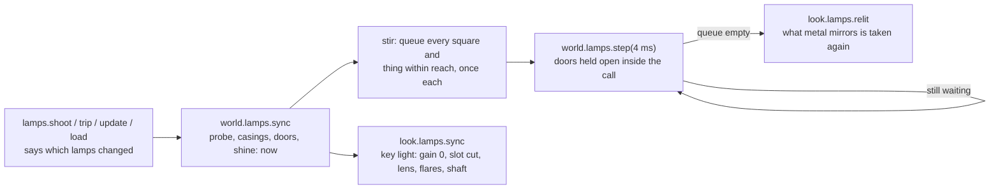

The loop's contract (`step`, once a frame from `main.js` `relightStep`): it is entered only while something
waits; each pass lights one square or one thing again and takes it off the queue, so the queue only shrinks
between changes; it stops for the frame when `RELIGHT_MS` (4) have gone, and for good when the queue is empty —
then, and only then, the second look is told which lamps it was, and the captures of the places their light
reaches are stale (`look/keys.js` `mirrorReached`: a lamp shot in the control room is no reason to capture the
yard again). A square or a thing is in the queue at most once
however many lamps reach it. It cannot fail to end: there is nothing in it that puts work back. `step(Infinity)`
finishes at once — a new mission, a retry and the tests use it. Measured (16 November 2026, M1): a ceiling lamp
is 3.6 ms at once and 27 ms in turn; an EMP in the open yard, six lamps, 8 ms at once and the level lit again
within eight frames, the worst of them 28 ms with the switch.

Three things had to be so for "worked out again" to come to what was built:

- **Doors.** Light is worked out with every door open (it leaks through doorways). Each call opens them and puts
  them back inside itself (`doorsOpen`, in a `finally`): no machine sees through a door by it, and none is drawn
  open.
- **The corners as the mesh keeps them.** A mesh keeps a corner in thirty-two bits. `quad` and `addModel` now
  work the light out from the corner so rounded, not as it was asked for — or a mark laid at a slant, whose
  corner grazes the corner of a wall, was lit by a lamp when built and not when lit again (found with the
  switch: one corner in a million and a half was 1.13 out). Lit again with nothing changed, every corner now
  comes to within 4.2 × 10⁻⁷ of what it was built with, which is the rounding of the light itself.
- **Which lens is whose.** A lamp is a point light is counted from; what is drawn of it is a fitting up to three
  metres away (a floodlight's is its tower). They are paired nearest first, each fitting to one lamp, by what
  kind of thing lights what kind of lamp (`FITTING`); the box round the lens, grown 12 cm, is what a round must
  enter. All 96 lamps that can be put out have one, and a smoke test finds a place to stand from which a round
  reaches each.

The mountain's outside is never lit again: no lamp of the site lights it, only the moon. And only the player's
rounds break a lamp: a machine's do not (they are aimed at you, and a site that shot its own lamps out would
do your work for you).

With the switch (section 3, "The second look") a key light that goes out has no gain wherever the eye is: its
slot is cut at once (`slots.cut` — a lamp that is shot does not fade), so it lights nothing and throws no shadow;
`world.setKeyOut` takes it out of what the game counts of the key lights (`keyAt`, and so how well a body is
seen and how the picture is exposed); its lens is dull, its flares and the lit air under it are gone. A room's
key light is tripped with the room. The moons are fixed.

### Inside the mountain

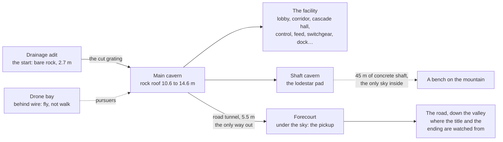

The land is solid rock, and the site is what has been cut out of it. `src/world/mountain.js` is the rock as
arithmetic — no drawing, no browser — and the one place its shapes are written down:

- `roofAt(x, z)` — the rock roof of the main cavern: given at the points of a two-metre lattice, straight between
  them, never under 10.5 m (the watchtowers are 9) and never over 15;
- `mountainAt(x, z)` — the ground outside, seen from above: 0 in the forecourt and down the road's valley, a
  cliff at the edge of that cut, then a ridge that climbs north over the facility, rough with hills, with one level
  bench where the shaft comes out (58 m). Over the cascade hall and the drone bay it stands up to 93 m above the
  floor. It uses whole-number hashing, so it is the same mountain on every machine;
- `FORECOURT`, `ROAD`, `SHAFT`, `ROOF`, `CRATER` — the shapes the map marks the grid from, and the hollow the
  strike leaves;
- `STATIONS.title / ending / debrief` — where the three pictures of the outside are taken from. Each is held by
  a test to stand in air, clear of the mountain.

**Two words for "what is overhead".** `ceil` kept the meaning it always had — the height of a _built_ ceiling, 0
for none — so nothing that moves had to change: collision, the guards, the height the drones fly at. What is new
is `sky`, and only light, drawing and sound read it:

| `sky` | Means                 | Where                                    | `ceil`         |
| ----- | --------------------- | ---------------------------------------- | -------------- |
| 0     | rock overhead         | everywhere inside                        | a room's, or 0 |
| 1     | open sky              | the forecourt and the road, nothing else | 0              |
| 2     | the foot of the shaft | the 7 × 7 m over the lodestar pad        | 0              |

A cell with `ceil` 0 and `sky` 0 is the cavern: its roof is up at `roofAt`. The adit, the drone bay and the road
tunnel are bored through the rock and have ceilings of their own (2.7 to 3 m, 5 m and 5.5 m), of rock or of
concrete.

**How it is drawn** (`world/build.js`). Walls and rock faces go up to whatever is over them — the cavern's roof
on the inside, the cliff's top under the sky — and meet it along an edge, because both are asked for at the same
grid corners. The **roof** is one square of rock over every cavern cell, tilted as `roofAt` says so that the
lamps under it pick its facets out. The **shaft** is four concrete walls from the roof to a collar that stands
proud of the bench, with rings of lamps up it (white work lights at the bottom, red every twelve metres above)
and nothing across the top but the sky. The **mountain's outside** is one mesh: eight-metre squares out to the
horizon, one-metre squares round the forecourt and the shaft's collar where things have to meet it, a hole at
the shaft, lit by the moon and the sky alone. It faces up, so nothing under it ever sees it; from inside there
is only rock.

**What tells you where you are.** The title is taken from the road outside: the portal, lit, at the foot of a
mountain. The briefing says what the site is and how you get in. You start in the adit, under 31 to 39 m of rock,
and the first thing Overwatch says is that you are inside the mountain. The screen names each place as you come
into it (`DRAINAGE ADIT`, `MAIN CAVERN`, `SHAFT CAVERN`, `ROAD TUNNEL`, `FORECOURT`). Signs on the walls give
the level and the ways out. There is no wind inside, and water drips (section 8.5). The lodestar goes up the one
shaft that reaches the sky; the way out is the one tunnel; and what the strike does, it does to the mountain.

What the briefing says of the depth is held to the arithmetic: "its cascade hall under at least fifty metres of
rock" — the hall has between 59 and 85 m over it (75 on average), the drone bay 72 to 88, the main cavern 31 on
average and least by the portal.

**The cascade hall and the control room.** The hall is 41 m by 25 under a 7 m ceiling. Four **cascades** run its
length, each a double row of casings in two banks of sixteen metres with an aisle across the middle: 512 casings
in all, two to a cell. A charge goes on the end casing of each, at a different end of the hall each time. East
of the hall is the control room, and in the wall between them a **window** six metres long: its sill stands a
metre high and its head is at 2.4 m, with nothing in it — an eye and a round go through, a body does not. The
**firing point** is at that window, just inside the sill; standing on it you look down the fourth cascade, five
metres off, and across the hall to the first, forty away. It is the one place the charges can be fired from.

> **Decision, 12 November 2026.** The owner: _"I want it clear that this is a hidden centrifuge site inside a
> mountain, underground, not just a hangar."_ Until then the site was a fenced compound under the night sky: the
> title looked down on a yard, you started on open ground outside the wire, the beacon went beside a vent stack,
> and the strike brought a building down in the open. All of that is replaced by the above. Three things in the
> tests changed with it, for this reason and no other: the smoke test of the start was renamed from "…puts you
> on the ground outside the wire" and now also asks for the adit, its roof and the briefing's words; the smoke
> test of the won ending was renamed from "…the building is brought down" and now asks that the mountain sinks
> (`uCraterGo` reaches 1) and that the plant is _not_ pulled down in the open (`uRuin` stays 0); and the titles
> and messages that said "the wire" of the way in say "the grating" or "the mountain". No assertion was removed. The map's own
> contracts (`test/unit/map.test.mjs`: its size, its closed edge but for the road, the start west of x = 14,
> everything reachable) hold unchanged, and `test/unit/mountain.test.mjs` and `test/unit/air.test.mjs` are new.
> The first briefing said "one cavern under eighty metres of rock"; the arithmetic did not bear that out, and the
> words were changed to what it does.

---

## 5. Guards

Two machines: the **sentry** (walks, hits hard, hears) and the **drone** (flies over low cover and fences, fragile,
quick). Both run the same brain, `enemies/ai.js`, a pure function of what the unit senses this tick.

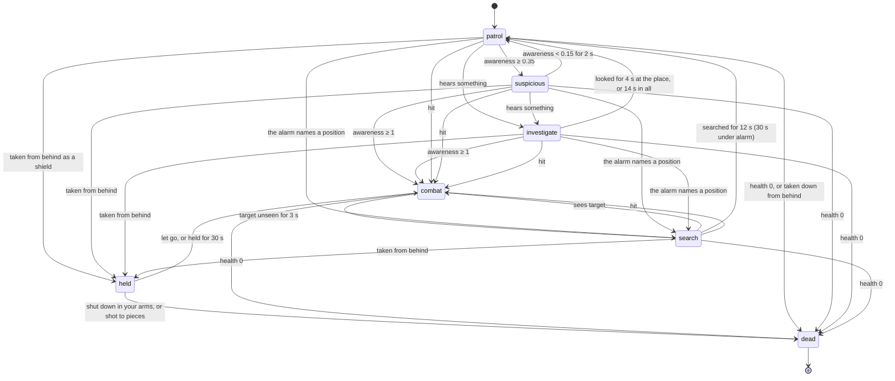

**Awareness** is a number from 0 to 1 per unit. While the unit has you in its cone of view with a clear line, it
rises at a rate set by distance, the light you stand in, your stance and your speed; otherwise it drains. Loop
contract: bounded to [0, 1]; reaches 1 → `combat`; drains to 0 → nothing left to do.

**How much of you it sees** (`enemies/sight.js`). A guard looks for your body: its middle, or its upper half over
low cover. If it can see neither but can see your head leaned out to one side (section 7), it sees a _peek_,
which counts for 45% of a body: awareness rises at 45% of the rate, a round aimed at you has half the chance and
goes for the head. Leaning does not make you invisible; it makes you a smaller thing to notice and to hit.

**Every state ends by the clock.** There is no state from which a unit cannot return to `patrol` except `dead`,
and none of the ways back depends on the unit getting anywhere: `investigate` gives up after 14 s whether or not it
reached the place, `search` after 12 s (30 s under alarm), and `combat` starts its "unseen for 3 s" clock the
moment it is entered, however it was entered. A unit that cannot find a route simply looks from where it stands.
`held` ends by the clock too: after 30 s in your arms a machine breaks free into `combat`, whatever you do.

**The shield.** A sentry that could be taken down by hand — within 2.1 m, its back to you, not fighting — can be
taken hold of instead (`held`). From then on it is carried 0.72 m ahead of you and 0.26 m to your left, facing
the way you face, as near to that as there is room for (it is never pushed into anything solid). It senses
nothing, tells nobody and is not a contact. While you hold it:

- a round that _would have hit you_ from within 65° of the way you face hits it instead, and you feel nothing.
  From further round than that — from your side, or behind — the round is yours. The guards' aim, turns and
  limits on who may fire are exactly what they were; the shield changes only who a hit lands on.
- your own rounds and your knife pass it as if it were not there;
- you walk at 2.4 m/s and cannot run, jump, crouch, lean or raise the sight; the carbine is in one hand, and its
  cone of fire is a little wider (0.008 rad);
- it ends one of six ways: you **shut it down** (a silent takedown, like any other); you **let it go** (it
  reels for 1.5 s and is then a machine in `combat` that knows where you are); its own side **shoots it to
  pieces** (its health is its own, and the bar under the prompt shows it); it **breaks free** after 30 s (half a
  second of reeling, then `combat`); **you go down**; or **the mission ends** — the clock runs out, or you are
  out — and it is nobody's.

Loop contract of the hold: entered only from behind an unaware sentry; one machine at a time; leaves by one of
the six ways above and by no other; never longer than 30 s. Drones cannot be held.

**The alarm.** A unit that has been in `combat` for 4 seconds in total calls it in. The alarm is site-wide: it
sends every living unit that is not already fighting to `search` at your last known position, lasts 45 seconds
past the last sighting, then stands down. Loop contract: every sighting re-arms the 45 s; with no sighting it
always ends. The site also sounds it for itself — each time a charge goes on a cascade ("What a charge brings",
below), when the cascades go up, and when the lodestar begins to call (`enemies.alert()`): those send every
machine to the place, and are **not counted**. The debrief's "Alarms raised" is how often a machine found you —
or found one of its own that you had left lying ("The fallen", below). (Until 12 November 2026 that line always
read 0: the count was taken after the ending had cleared the machines, and their alarm with them, away. It is
now taken as the ending begins.)

**The fallen** (`enemies/bodies.js`). Decision of 16 November 2026 — the owner: _"make the robots smarter, when
they see a friend of their that died they need to trigger the site alarm you can add a feature where you can drag
and hide the body so it won't be seen"_. Until then a machine that saw another go down came to look, and that was
all: a wreck lying across a patrol's round meant nothing to the patrol.

```mermaid
stateDiagram-v2
  [*] --> lying: a machine goes down while the site is quiet
  [*] --> known: it goes down while the alarm sounds, or in the blast
  lying --> watched: a machine has it in sight
  watched --> lying: a glance away (the second begins again)
  watched --> known: in sight for 1 s — the alarm is raised, AT THE WRECK, and counted
  watched --> known: in sight for 1 s while the alarm already sounds (no news: nothing is raised)
  lying --> dragged: G, within 1.9 m of its middle
  dragged --> lying: G again; it snags; you go down; the mission ends
  lying --> cleared: a retry from a checkpoint
  known --> [*]
  cleared --> [*]
```

- **Who sees it.** Every machine that can see: not one that is down, held as a shield, or stopped by an EMP.
  Ten times a second, as they look for you.
- **How.** As it sees you: within reach of its eye, inside its cone of view (its own 0.96 or 1.15 rad either
  side; 2.0 when it is fighting or searching, as for you), along a clear line from its eye to the wreck, 0.4 m
  off the floor. Nearer than 1.6 m it knows a wreck whichever way it faces: it is standing on it.
- **How far.** By the **light the wreck lies in** (`world.visibility`, the number the player's own light meter
  shows): 16 m under a lamp, 4 m in the pitch dark, in between in between; times 0.7 on Recruit and 1.3 on
  Ghost. So the dark hides a wreck as it hides you — and a lamp shot out, or a room an EMP has put in the dark,
  hides both.
- **How long.** One second in sight, unbroken. Then it is _found_: the alarm is raised at the wreck — a
  machine's alarm, which **counts** — every machine that is not fighting is sent there, and Overwatch says
  which machine you left and which way it lies. Once for each wreck.
- **What is no news.** A machine that goes down while the alarm is already sounding is known at once
  (`found`), and so is everything that lies fallen when the cascades go up (`enemies.known()`): a patrol that
  walks back through the hall an hour later raises nothing for wrecks the blast made. A wreck that is found
  while the alarm sounds is struck off without another alarm. And the wrecks a retry clears away
  (`enemies.remove`) are in the list still, unseen: they cannot be found at all.
- **What it does to the play.** A silent takedown is silent only until the wreck is walked into. A machine shot
  in front of another is found a second later — unless the other goes down inside that second. Loop contract:
  `noticeT` only rises while a machine has the wreck in sight and falls to nothing the tick none has; a wreck is
  found at most once; nothing here can raise an alarm while one sounds.

**Dragged.** A fallen machine — a sentry, or a drone's wreck once it has come to earth — can be taken hold of:
**G** (the second button on a phone, which says DRAG), within 1.9 m of its middle, facing it, with a clear line
to it. From then on:

- it follows like a load on a rope: the hand has it by the collar, and its feet — which is where a wreck "is" —
  stay within two metres (a drone's wreck, one). It is pulled along the floor round whatever is in the way,
  never through it (`world/collide.js`, as a body is moved), and its head comes round to the hand;
- one hand is full, exactly as it is with a shield: 2.4 m/s, no running, jumping, crouching, leaning or raising
  the sight; the carbine in one hand, the shotgun not at all, no knife and no grenade;
- the line under the crosshair says how far off it would be seen where it lies now —
  `DRAGGING — [G] LET GO · HERE IT IS SEEN FROM 6 m` — and, when a machine has it in sight, that it is being
  looked at, with the second filling as a bar (a phone has no such line — its buttons carry the words — so
  there the same thing is said as a note, each time the figure changes: walked into the dark, it is seen to
  fall);
- it is let go of by **G** again; by itself if it **snags** and the hand goes on (3.2 m from it); when **you go
  down**; and when **the mission ends**. It lies where it was left.

A wreck being dragged can be found like any other: it is the dark and the corner you are dragging it to that
hide it, not the dragging. F is not taken: a charge can be set with a wreck lying beside it, and the prompt
offers both. Loop contract: one wreck at a time, and not while a shield is held; `dragged` is only ever a
machine that is down and has not been cleared away; every way out of `dragged` ends in `lying`.

**What a charge brings** (`enemies/wave.js`). Decision of 16 November 2026 — the owner: _"every time you rig a
centrifuge fire an alarm with new guards and drones that are coming to you"_. Each charge that goes on a cascade
trips the site's alarm — its own, not counted — and brings a **wave**: machines that are not on the mission's
roll, sent to the charge.

- **How many** is the setting's (the table below): a guard on Recruit; a guard and a drone on Operator; two
  guards and a drone on Ghost. Every charge brings one — four charges, four waves — and nothing caps how many
  are about at once: the pace is the player's.
- **Where from.** The drones come up from the bay (`site.reinforcements`), a different part of it for each
  charge. The guards walk in by a door of the building — `site.entries`: the lobby, the two ends of the service
  corridor, the dock, the feed room, the east corridor; none is in the hall — chosen so that nobody sees a
  machine appear: the nearest door that is **out of sight** of where you stand and **at least 14 m** off. If no
  door is both, one that is far enough though in sight; if none is far enough, the farthest. There is always a
  way in, and if there are more guards than doors they share.
- **What they know.** Where the charge is, and that something is wrong (awareness 0.6): each sets off in
  `search` towards it, as the whole garrison does under the alarm.
- **They are not on the roll**: they are not among the machines "still running", shutting one down is not a
  kill in the debrief, and a checkpoint does not remember them.
- **A retry** from the checkpoint a charge keeps sends that charge's wave again — as a retry from the blast's
  sends the blast's drones again — from doors out of sight of where the retry begins; the alarm is not raised
  again. What earlier charges had brought is gone.

Loop contract: a wave is sent exactly once per charge set by hand, and once more per retry from that charge's
checkpoint; `debug.rig()` — the tests' shortcut for "the charges are on" — is the mission's book-keeping alone
and brings nothing.

**Stopped by an EMP.** `enemies.stun(x, y, z, radius, seconds, close)` stops every machine within seven metres of
the grenade for four seconds — unless something solid stands between them and it is more than three metres off —
and harms none. A stopped machine does not sense, turn, move or fire; it spits sparks so that it can be seen to
be stopped; a stopped **sentry** can be shut down by hand from any side, whatever it knew (`takedownTarget`); and
when it comes round the first thing it does is go and look at where the grenade went off. Loop contract: one
clock per machine (`empT`, part of `stunT`), counting down only, set again only by another grenade; the machine
held as a shield is passed over. The same grenade puts out the lamps of the room (section 4, "Lamps that go
out"): the machines are stopped for four seconds, and it is dark for twenty — the dark is what is left when they
start again.

**Found far off** (16 November 2026 — the owner: _"the drones sometimes get lost in the distance"_). Two things
were found by looking, with one drone held at 12 to 95 m down the cavern. A machine more than ninety metres from
the eye was not drawn at all, and the cavern is longer than that: now a machine is drawn to `FAR`, 150 m, which
is further than any two places on the site are apart. And from forty metres a drone is a line a pixel or two
high that the night haze then takes: so a drone carries **running lights** (`enemies/lights.js`, drawn by
`enemies/index.js` as flat pictures that face the eye) — its eye, in the colour of what it is thinking (the
table of colours its model's eye uses), and a white strobe on its back, a flash of 0.09 s every 1.3 s, each
drone at its own moment. They are never drawn smaller than 2% of the distance — nine pixels in a window 720
high, six at the widest field of view — and the haze never takes more than half of them. Nearer than eight
metres they add nothing (the drone itself is seen); from twenty-five they are whole. They are drawn only for a
drone the eye has a clear line to, and half a metre nearer the eye than the drone, so that its own body is never
in front of them. `test/unit/lights.test.mjs` pins the numbers; a smoke test holds a drone at 70 and at 95 m and
reads its light off the picture.

**Paths.** A unit re-plans at most four times a second and only when its goal cell changes. A plan that finds no
route leaves the unit where it is, facing its goal — it never retries in a tight loop — and the state's own clock
(above) moves it on.

**Who may shoot.** However many machines have you in their sights, only a few may be firing at the same moment —
one on Recruit, two on Operator, three on Ghost. A burst takes a turn and hands it back half a second after it
ends; a machine without a turn holds its fire and keeps closing in. Being seen by the whole cavern is then a fight
you can lose, not one that is over before you can move.

**How many.** The map holds twenty machines, each with a name and a _tier_ — the easiest setting it appears on.
`garrison(site, tier)` in `world/map.js` picks the ones for a setting; a harder setting keeps every machine of
the easier one and adds to it. A machine's number on the mission's roll is its place in that list, so the roll
differs between settings — which is why a checkpoint remembers machines by **name**.

| Setting  | Machines      | Who                                                                                  | May fire at once | A charge brings   | Answer the blast | Pursuers | Sees a wreck from | Clock | Radar |
| -------- | ------------- | ------------------------------------------------------------------------------------ | ---------------- | ----------------- | ---------------- | -------- | ----------------- | ----- | ----- |
| Recruit  | 10 (1 drone)  | gate, road, yardEast, corridor, hallLoop, control, feed, switchgear, dock, droneYard | 1                | 1 guard           | 0                | 2        | 11 m … 3 m        | 80 s  | yes   |
| Operator | 15 (2 drones) | + stackYard, lobby, eastCorridor, hallAisle, droneHall                               | 2                | 1 guard, 1 drone  | 2 drones         | 3        | 16 m … 4 m        | 60 s  | yes   |
| Ghost    | 20 (4 drones) | + yardWest, fenceWest, north, dronePerimeter, droneStack                             | 3                | 2 guards, 1 drone | 3 drones         | 4        | 21 m … 5 m        | 50 s  | no    |

"A charge brings" is each of the four charges, and those machines are not among the Machines of the first
column. "Sees a wreck from" is under a lamp … in the pitch dark.

How quickly a machine makes up its mind that it is you, and how hard it hits, by setting: Recruit 0.65 and 0.6
of the measure, Operator 1.1 and 1.1, Ghost 1.55 and 1.6. How much it can take (0.85 / 1 / 1.1) and how well
it shoots (0.8 / 1 / 1.15) are as they were.

On every setting the cascade hall — where all four charges now go — has a machine of its own, and below Ghost
nothing walks or flies within 20 m of the cut grating: the way in is quiet. The whole table of what a setting
changes is `src/difficulty.js`; nothing else in the game holds a number that depends on the setting.

> **Decision, 12 November 2026.** The owner, after playing: _"the game is too difficult, adjust the amount of
> enemies."_ Until then every setting fielded the same 26 machines, three could fire at once on Operator, and
> four drones came after you. The garrison was cut to 9 / 13 / 20 (six machines were removed from the map
> altogether), one fewer machine may fire at a time on every setting, and one fewer drone pursues. The contract
> tests that held the old numbers (`test/smoke.test.mjs`: "at least 16 machines", "no more than three firing",
> "at least three pursuers") were changed to the new ones for this reason and no other, and
> `test/unit/difficulty.test.mjs` now pins the table.
>
> **Second decision, later the same day.** The owner, after playing that: _"the game is slighly too easy make it
> a bit harder"_. A little was given back, and no more than a little: one more machine on Recruit (the dock's)
> and two on Operator (the lobby's and the east corridor's) — all three inside the building, so that the way to
> it across the cavern is exactly as it was; Operator's and Ghost's machines a tenth quicker to see you and a
> tenth harder hitting; five seconds off Operator's clock; and drones from the bay when the cascades are blown.
> Recruit's machines are as they were. Four assertions in `test/unit/difficulty.test.mjs` changed for this
> reason and no other — the three counts, the list of who is on Recruit and Operator, the clock, and "Operator is
> the measure" (gain and damage 1), which became the table above — and two were added: that what was added is
> inside the building, and that the drones that answer the blast have somewhere to come from.
>
> **Third decision, 16 November 2026.** The owner asked for two things that make the site harder, and neither is
> a number that was turned: _"when they see a friend of their that died they need to trigger the site alarm"_ and
> _"every time you rig a centrifuge fire an alarm with new guards and drones that are coming to you"_. So the
> table gained two columns and lost nothing: what a charge brings (`wave`), and how far off a wreck is seen
> (`bodies`). With them came the way to live with the first: a wreck can be dragged into the dark. What changed
> in tests that already stood, for this reason and no other: a round at a casing is told `'casing'` where it was
> told `'prop'`; the phone's second button offers DRAG, where it used to go, when a machine has been shut down
> at your feet; and the test of the charge's checkpoint tells the site of the three wrecks it sets its stage
> with (`enemies.known()`), so that the count of alarms it reads is the charge's and not theirs.

---

## 6. The mission

`mission.js` is a pure state machine; `main.js` feeds it events and reads back the phase and the objective list.

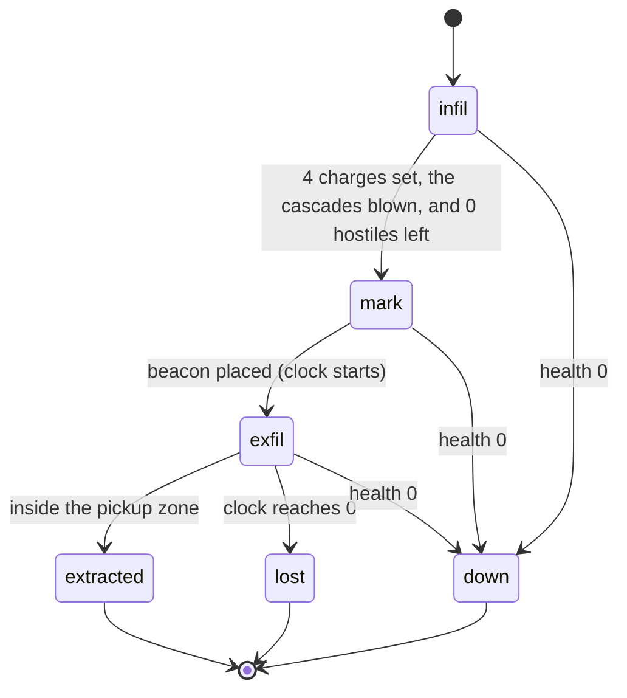

`blown` is a **flag**, not a phase: the charges may be fired before the site is clear, or after, and either way
the mission is still in `infil` until all three things are true. `canDetonate` is true in `infil`, with every
charge set, once.

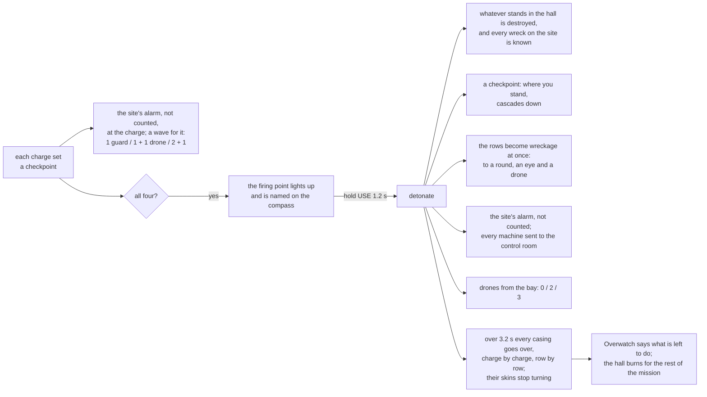

**A charge is felt** (16 November 2026). Setting a charge used to be the quiet part: hold F for two seconds, a
checkpoint, "Charge 2 is live." Now each one trips the site's alarm and brings a wave of machines for the charge
(section 5, "What a charge brings"): Overwatch says how many and from which way by the compass — _"Charge 2 is
live. WARDEN felt it go on — the alarm is up, and one guard and one drone are coming for it from the
south-east."_ The checkpoint is kept first, so a retry begins at the charge with that wave on its way again and
the alarm quiet.

**The cascades coming down** (`world/build.js` `cascade`, `world/blast.js`). The four charges go off 0.37 s apart
— the same numbers the sound is built from, so that what is heard is what is seen — and from each a wave runs
down its rows at 34 m/s. Every casing it reaches goes over: inwards, onto the rest of its own bank, and a little
towards the other row of its pair, so that the wreck lies where the cascade stood and nothing ends up across an
aisle, where it could be walked through (a smoke test holds every one of the 512 to that). One in eight is left
leaning; all are scorched; a few keep a dull heat. Where each ends up is worked out once from where it stood, so
the blast runs _towards_ the same wreck that a checkpoint puts back _at once_. Loop contract: one clock, started
by `detonate`, runs forward only to the last casing's rest (3.2 s) and stops; `begin()` and `wreck()` are the
only two ways into the blown state and `reset()` — a new mission, or the title — the only way out.

Contracts that tests pin:

- the beacon cannot be placed in `infil`, whatever else is true — and `infil` does not end until the cascades
  are blown, however clear and however rigged the site is;
- the charges cannot be fired until every one is set, and fire once;
- setting the same charge twice counts once; a kill counts once;
- the clock only runs in `exfil`, never goes below 0, and `lost` and `extracted` cannot both happen;
- when two endings fall in the same tick the order is fixed and does not depend on what `main.js` steps first:
  **`down` beats everything** (health 0 is final even on the pickup's edge), and **`extracted` beats `lost`**
  (reaching the pickup on the tick the clock hits zero counts as out);
- once in a final phase nothing changes it.

The drones that answer the blast, the waves the charges bring, and the reinforcements that arrive during `exfil`
are not on the roll: they are not added to the count that had to reach zero. The drones come out of the drone
bay on the north side of the cavern; a wave's guards walk in by the doors of the building.

**What the two ways of ending look like** (`main.js`):

- **`extracted`** — the picture cuts to a station down the valley (`STATIONS.ending`). The cascades went up
  while you were still inside; what is seen of that from out here is what the hall is still breathing out of
  the mountain's two mouths — smoke standing over the shaft, smoke and a dull glow at the portal. The weapon
  comes in over the mountain's shoulder and into the shaft; at 7.2 s `strikeOutside()` puts
  every lamp out (`world.setLamps(false)` — none may be left hanging in the air) and the ground over the facility
  sinks into a hollow over 3.4 s, fast at first and then settling. That is two shared numbers and the vertex
  shader: `uCrater` (where, how wide, how deep: 64 m from middle to rim, 27 m) and `uCraterGo` (0 → 1); the
  deeper into the hollow a point is, the more its floor is lit as fire. Fire and smoke are particles laid on that
  ground at so many a second, whatever the frame rate, and go on behind the debrief, which looks down into the
  hollow from `STATIONS.debrief`.
- **`lost`** — you were still inside: `strikeInside()` brings the facility down round you (`uRuin`, a box of
  rubble, as before) and the last thing you see is white. The mountain is not seen from outside, so the hollow
  is not made.

The two never mix: the won ending leaves `uRuin` at 0 (a box-shaped hole would show in the mountain's side), and
going back to the title or starting again puts `uCraterGo` back to 0 and the lamps back on. Tests pin all three.

> **Decision, 12 November 2026.** The owner: _"i want to blow up the centrefuges"_. Until then there were three
> charges — on a casing in the hall, a tank in the feed room and a cabinet in the switchgear — that were set and
> never seen to go off: the won ending showed three puffs at the mountain's mouths as you left. Now all four are
> on the cascades, you fire them yourself, from a window, and watch. `test/unit/mission.test.mjs` was rewritten
> for it (the rules above); the three smoke tests that set a charge in the feed room or the switchgear set one
> on a cascade instead; the walk of the whole mission has four charges and the firing point in it; and the won
> ending lost its "Charges." line.

---

## 7. Controls

| Action                    | Desk                                                       | Phone                                                        |
| ------------------------- | ---------------------------------------------------------- | ------------------------------------------------------------ |
| Move                      | W A S D                                                    | left thumb: stick appears where you touch                    |
| Look                      | mouse                                                      | right thumb: drag anywhere on the right                      |
| Fire                      | left button, or X                                          | FIRE on either side, or double tap and hold in the aim area  |
| Aim down the sight        | right button: hold it, or click to keep the sight up; Z    | AIM (toggle)                                                 |
| Lean left / right         | Q / E (hold)                                               | —                                                            |
| Jump                      | Space                                                      | JUMP                                                         |
| Reload                    | R                                                          | RELOAD                                                       |
| Change gun                | 1 carbine, 2 sidearm, 3 shotgun — or the mouse wheel       | the button that names the gun in hand: a tap takes the next  |
| The carbine: AUTO or SEMI | B                                                          | hold that same button                                        |
| EMP grenade               | T                                                          | EMP (it counts what is left, and goes with the last)         |
| Put a lamp out            | shoot its lens (section 4, "Lamps that go out")            | the same                                                     |
| Crouch                    | C or Ctrl (toggle)                                         | CROUCH (toggle)                                              |
| Run                       | Shift                                                      | push the stick to its edge                                   |
| Knife                     | V — and the trigger, once no gun has a round left          | USE says KNIFE in reach of a machine; FIRE, rounds gone      |
| Use                       | F: hold to set a charge, to fire them, to raise the beacon | the USE button, which appears when there is something to use |
| Take a sentry as a shield | G from behind it; then G lets go and F shuts it down       | SHIELD, beside USE; then LET GO or SHUT DOWN                 |
| Drag a fallen machine     | G beside it, facing it; G again lets go                    | DRAG, where SHIELD is; then LET GO                           |
| Night vision              | N — it is how you see in a room you have put in the dark   | NV                                                           |
| Map                       | Tab or M                                                   | tap the minimap                                              |
| Pause                     | Esc or P                                                   | the pause button                                             |

> **Decision, 12 November 2026.** The owner asked for four things that all land on the keyboard: _"when in
> aiming mode allow an option to fire on laptop, today it's not possible"_, _"add lean left and right with q and e
> keys around corners"_, _"add a knife"_, and _"take the robot hostage and use it as a shield"_. **E had been a
> second use key (E or F); it now leans, and F alone uses** — every prompt on screen names F, and the tests that
> pressed E to set a charge press F. The rest are new keys: Q leans left, V is the knife, G takes and lets go of
> a shield, Z keeps the sight up, X is a second trigger.

**Aiming and firing with one hand's worth of buttons.** A trackpad cannot hold one button down and press the
other, so on a laptop the sight could be raised or the carbine fired, not both. Three things fix that, and any
one is enough: a right **click** (pressed for less than a quarter of a second) leaves the sight up until the next
right press; **Z** does the same from the keyboard; and **X** is a trigger. Holding the right button still aims
for as long as it is held, exactly as before. A sight kept up this way comes down by itself when you run (Shift),
reload, take a shield or pause, and the screen says how to lower it the moment it goes up. A press of the trigger
that is over before the next frame is drawn — a tap — still fires its round.

**Leaning.** Q and E tip you to the left and right for as long as they are held. The head goes up to half a metre
to that side, and everything that reads where your eye is goes with it: the camera (which tips over by about
8.6°), the muzzle, the knife, and the line a guard looks along. The head is a ball 0.16 m in radius and stops
against anything solid at its own height — a wall, rock, the wire, a shut door, a prop taller than your eye — so
it can go out over a crate when you stand and not when you crouch. Your feet do not move: the body stays behind
the corner.
There is no leaning at a run, in the air, or with a machine in your arms. What a guard makes of a head leaned out
is in section 5.

**What is carried.** Three guns, a grenade and a knife, each for something (`src/arms.js`, pinned by
`test/unit/arms.test.mjs`):

| Key | What                            | In it | In reserve | A cache gives | What it is for                                                                                                          |
| --- | ------------------------------- | ----- | ---------- | ------------- | ----------------------------------------------------------------------------------------------------------------------- |
| 1   | **K9 carbine**, suppressed      | 30    | 90         | 30            | the one that keeps firing. **B** sets it to SEMI: one round a pull, steadier from the hip, half the bloom               |
| 2   | **P5 sidearm**, suppressed      | 12    | 36         | 12            | the quiet one: heard at 6 m where the carbine is heard at 12 — and it can be fired with a machine on the other arm      |
| 3   | **M7 breacher**, a pump shotgun | 6     | 18         | 6             | the loud one (34 m): eight pellets a shell, deadly at arm's length, a third as strong at 28 m; filled a shell at a time |
| T   | **EMP grenade**                 | 2     | —          | 1 (4 at most) | harms nothing; stops every machine within 7 m for 4 s, and a stopped sentry can be shut down from any side              |
| V   | **Knife**                       | —     | —          | —             | silent from behind; and all there is once no gun has a round left                                                       |

- **The trigger.** AUTO fires for as long as it is held. SEMI — the carbine set to it, the sidearm and the
  shotgun always — fires once for each pull; a pull that comes a moment too soon (the slide is still coming
  forward, the pump still going) is kept for a fifth of a second rather than lost.
- **Changing guns** takes under half a second: the one in hand goes down, the other comes up. One change at a
  time; a reload under way is given up; the sight comes down. The mouse wheel goes round the three — one notch,
  one gun, and the flood of small turns a trackpad sends for one stroke of two fingers is still one.
- **Running dry.** With no round left for the gun in hand, the next pull of the trigger — the pull, not every
  frame it stays down — brings the next gun that has something in it to hand, in the order carbine, sidearm,
  shotgun, and the screen says so. When none has, the trigger is the knife. A unit test walks every combination
  of empty guns and asks that this never goes round in circles.
- **The shotgun's tube** is filled one shell at a time, and goes on filling by itself; a fresh pull of the
  trigger, with a shell in it, stops that and fires. (A trigger merely still held from the last shot does not:
  the loading would never get started.)
- **A reload is seen, and heard** (`src/reload.js`; 16 November 2026 — the owner: _"make the reload animation
  more realistic and make a sound"_). Until then a reload sank the gun out of the picture for two seconds, the
  magazine moved below the frame, no hand did anything, and two blips of dull noise were played. How long a
  reload takes (2.1 s the carbine, 1.5 s the sidearm, half a second a shell) and when its rounds are counted
  — at the end — are `arms.js`'s business and did not change. What changed is what is done in that time:

  | When (of the reload) | The carbine                                                                 | Heard                  |
  | -------------------- | --------------------------------------------------------------------------- | ---------------------- |
  | 0 – 0.13             | brought **up** and rolled over, its underside to the eye                    |                        |
  | 0.08 – 0.20          | the support hand leaves the fore-end for the magazine                       |                        |
  | 0.20                 | the magazine comes out of the well, in the hand, and away                   | `reloadOut`            |
  | 0.40 – 0.50          | out of the picture, at the kit, for a fresh one                             | `kitRustle` 0.43       |
  | 0.62 – 0.655         | back under the well, and pushed home                                        | `magSlide`, `reloadIn` |
  | 0.79 — if it ran dry | the thumb goes up to the catch and the bolt, which stood open, goes forward | `boltRack`             |
  | to 1                 | the hand back to the fore-end, the gun back to the hip                      |                        |

  The **sidearm** is the same in little: its magazine drops free (it falls; nobody carries it away) and its
  slide is let go. The **shotgun** is held canted with its port to the eye for as long as shells go in; for each
  shell the hand goes from the port for one, comes up with it — the shell is seen in the hand — and pushes it
  forward into the tube at 0.82 of its half second (`shellIn`); reloaded from empty, the pump is worked once as
  the gun comes back (`shotgunPump`).
  - **Dry and not.** A magazine gun that has fired its last round stands with its bolt — its slide — open, and
    a reload from empty ends with it being let go. One with a round still chambered has nothing to let go, and
    nothing is heard there. Which it is, is fixed when the reload starts (`reloadHow`): by the time the bolt is
    due the magazine is full again.
  - **Cut short** — by a change of gun, the knife, a grenade, or the shotgun's trigger — nothing snaps back:
    what is left of the pose is let go of over a few tenths of a second, and a reload begun again meanwhile is
    simply added to it. The rounds are not counted, and what was not reached is not heard.
  - **With a machine on the other arm** there is no hand to show: the gun goes down and comes back, as a reload
    always did.
  - **On a phone held upright** the gun's middle is off the right-hand edge of the picture: there a reload is
    brought twice as far across (`RELOAD_SLIM`), so that the well, the butt and the port are in it.
  - The choreography is data — keys of position and turn in the gun's own space, on a clock from 0 to 1 — and
    a pure function of that clock, so it is the same in both looks, a tool can hold it still at any moment
    (`weapon.reloadHold`), and `test/unit/reload.test.mjs` can ask of it: that every part begins and ends at
    rest, that nothing jumps, that the gun stays in the picture, that the order is out → away → back → home →
    bolt, and that each sound falls on the motion it is the sound of. The support hand is one rigid piece, as it
    always was: it is carried about its palm and turned a little, and does not close round anything.

- **With a machine on your arm** the shotgun cannot be pumped: it is put away for the sidearm (or the carbine,
  if the sidearm is empty), and 3 is refused. A grenade cannot be thrown either — that arm is the one that is
  full.
- **The grenade** leaves the hand a quarter of a second after T, at 13 m/s along the line of the eye and a
  little up; it bounces off whatever is solid, and goes off 1.6 s later, wherever it has got to. Thrown level it
  lands about ten metres off and rolls on: look at the ground in front of what you want stopped.
- **On the screen**: the two big counts are the gun in hand's — **IN MAG**, what is left before the next reload,
  and **TOTAL LEFT**, that and its reserve together. Under them, its name and how it fires (`K9 CARBINE · AUTO`),
  and one line of everything else by the key that takes it: `1 CARBINE 120 2 SIDEARM 48 3 SHOTGUN 24 T EMP 2`,
  the gun in hand lit, an empty one struck out. The magazine count turns amber at a fifth of a magazine, the
  total at one magazine. On a phone that line is the two buttons instead.
- **Health** is across the screen from the rounds, bottom left, and as big: the number, the word **HEALTH**
  under it, and beside them the stance (`STAND` / `CROUCH`) over a bar ten pixels high with a mark at every
  quarter. It is amber at sixty and under, red and pulsing under thirty-five; the moment any of it goes the
  number flashes, and what was lost stays a moment on the bar, in red, before it goes after it. Decision of 18
  November 2026 — the owner: _"add a health hud for the player"_. Health had been on the screen all along: a bar
  six pixels high and a small number beside the stance word. Nothing said health, and nobody would have looked
  for it there. On a phone there is no room under the left FIRE for more than a row: the row says HEALTH, its
  bar is nine pixels high and its number the biggest thing in the panel; the stance is on the CROUCH button,
  which lights (`test/hud.test.mjs`; `test/phone.test.mjs`, where the overlap tests at seven shapes hold it
  clear of every button).
- **Caches.** The three on the site (armoury, loading dock, generator shed) each give a little for every gun
  and a grenade if there is room for one, **once**. Everything there is on the site: 210 carbine rounds, 84 for
  the sidearm, 42 shells. A cache you have emptied goes dark, leaves the maps, and stays empty for the rest of
  the mission (a checkpoint remembers which were). (The wild build, whose machines are plated since 18 November
  2026 and take twice the rounds, carries and finds twice the rounds: `docs/WILD.md`, "Armour". `createArms`
  and `takeCache` take how many times; asked for nothing, they give what is said here.)

> **Decision, 12 November 2026.** The owner: _"display two ammo counters: the number of bullets remaining until
> the next reload, and the total bullets you have left. It shouldn't be unlimited."_ Until then a cache topped
> the reserve back up to 120 every time you walked over it, so in practice there was no end to it, and the screen
> showed the magazine and the reserve.
>
> **Second decision, later the same day.** The owner: _"make the weponds more versatile"_ (and, of the game,
> _"a bit harder"_). One gun became three and a grenade. The carbine's reserve went from 120 to 90 and a cache
> gives it 30 where it gave 60: with everything, there are 336 rounds on the site where there were 330 — more
> kinds, not more. `test/unit/arms.test.mjs` was rewritten for it: the six tests of one gun's rounds hold with
> 120 for 150, and ten are new. Nothing here was measured against a person playing it.

**The knife.** V swings it; so does the trigger once no gun has a round left, when it is also
shown in the hand. A swing takes half a second and lands one blow, 0.14 s in, on the first machine within two
metres along the line of the eye: 65 damage to a body, three times that to a head — two blows for a sentry from
the front, one for a drone. It is not silent (a blow carries 4 m), and a sentry cut from the front turns on you.
**From behind a sentry that does not know you are there, the blow is the silent takedown** — the same thing F
does. A swing gives up a reload that was under way. On a phone there is no knife button: USE reads KNIFE whenever
a machine is in the blade's reach and there is nothing else to use.

Taking a sentry as a shield, and dragging one that is down out of the others' sight, are described with the
guards, in section 5.

**The jump.** One press takes you about 1.08 m up and keeps you 0.8 s in the air (5.4 m/s up, 13.5 m/s² down);
a running jump covers about five metres. A press up to 0.12 s before you land is remembered, and one up to 0.1 s
after you walk off an edge still counts. There is no second jump in the air. Jumping stands you up. In the air you
keep the speed you left the ground with and can only nudge it; your feet make no sound until they land, and the
landing is heard (3.5–9 m, by how hard). A ceiling stops your head (the body is 1.8 m tall).

**What can be climbed.** Things with a flat top — crates, tall crates, barrels, barriers, desks, containers
(`stand` in `world/props.js`) — stop you only from the side: once your feet are level with the top you can move
over it and stand on it. So a crate (1.0 m) is one jump; a tall crate (2.0 m) is a jump from a crate; a container
(2.6 m) is a jump from a tall crate, and nothing is higher than that. **Everything else stops you at any height**:
walls, rock, the wire, shut doors, poles, and every prop without a flat top. Guards never leave the ground and
never plan a route over anything; a machine cannot be taken down by hand from more than 1.2 m above it.
`player.eye` is always the height of the eye above the ground (feet + stance), and it is the only height the
camera, the weapon and the guards' eyes read.

### The map reference

Nothing here needs a key: it is on screen the whole time.

- **The small map** carries the four compass points on its rim; they turn with the map, and N is picked out. The
  big map (north always up) has them on its edges. The map reads like a page: north is −Z, east is +X.
- **Under the small map**, in words: the way you face (`FACING EAST`), the nearest thing to do
  (`◆ NE 62 m`), then the two nearest machines that are after you (`↗ E 18 m` — the arrow is where it is from the
  way you face, the letters are where it is on the map; red if it is fighting you) and a count of the rest.
- **Where they are coming from.** A _contact_ is a machine that is fighting, searching, coming to look or staring
  at you, and every pursuer. Each is marked three ways: a triangle on the compass strip at its bearing (held at
  the end of the strip if it is off it), a dot on the small map — or, if it is further off than the map shows, an
  arrowhead on the rim pointing the way it is coming from — and a line in the readout.
- **Overwatch says it too**, by compass point and distance: when a machine makes up its mind that it is you
  ("Contact — sentry to the east, 20 metres"), no more than once every six seconds and never for a machine you
  shot first; where the pursuing drones come from and where the pickup lies when the beacon goes up; and which
  way the cut grating is at the start.
- **Radar.** On Recruit and Operator the small map also shows every machine within 34 m, seen or not, and
  contacts are named wherever they are. On Ghost there is no radar: the map shows only what you can see, what is
  fighting you, and the last four — and a machine hunting you that you have never seen is not named.

All the arithmetic of directions is in `src/bearing.js` and is pinned by `test/unit/bearing.test.mjs`.

Phone rules, all pinned by tests: FIRE is on **both** sides unless the player picks one; sliding off the left FIRE
walks and off the right FIRE aims, without letting go of the trigger; a tap followed within 350 ms by a press in the
aiming area fires for as long as the press lasts and keeps aiming; the page never zooms or scrolls; no control
overlaps another at any of the phone shapes tested; nothing sits under the notch or the home bar; and rounds are
forgiving — on a touch screen a machine's hit volumes count as 1.4 times wider than they are, so a near miss
lands. On a desk they are exactly as wide as they are.

### What each finger becomes

Touch input is read from raw **touch events** (`touchstart` / `touchmove` / `touchend` / `touchcancel`), each
finger followed by its `identifier`. Touch events keep going to the element the finger first landed on, which is
exactly what "slide off the button" needs; pointer events would not without capture, so they are not used.

| A finger lands on…                         | …and becomes        | While it is down                                                                  | When it lifts                                   |
| ------------------------------------------ | ------------------- | --------------------------------------------------------------------------------- | ----------------------------------------------- |
| the left part of the view, no stick yet    | the **stick**       | offset from where it landed = walk; past the edge = run                           | walking stops                                   |
| anywhere else on the view, no look yet     | the **look** finger | movement turns the view                                                           | if ≤ 300 ms and ≤ 20 px: remembered as a _tap_  |
| the view, within 350 ms / 80 px of a _tap_ | a **firing press**  | fires, and movement still turns the view                                          | firing from this press stops; no tap remembered |
| a FIRE button                              | a **trigger**       | fires; sliding walks (left button) or turns the view (right)                      | firing from this button stops                   |
| AIM, CROUCH, NV                            | a toggle            | —                                                                                 | —                                               |
| JUMP, RELOAD, SHIELD / LET GO, EMP, pause  | one action          | —                                                                                 | —                                               |
| the button that names the gun in hand      | a tap or a hold     | held 0.38 s: the carbine's selector is worked, once                               | if it was not held that long: the next gun      |
| USE                                        | a hold              | the ring fills: a charge, the blast, the beacon (held, it is the shield's health) | the ring empties unless it had filled           |
| the view, with stick and look both taken   | nothing             | ignored                                                                           | —                                               |

The trigger is pulled while **any** of three things holds — left FIRE, right FIRE, a firing press — and is only
released when none does. `touchcancel` is treated as a lift that can never count as a tap. Losing focus, hiding the
tab or opening a menu lifts every finger.

**Sound and the first touch.** A phone only lets sound start from inside a touch or key handler. `main.js` owns
that: it listens for `pointerdown`, `touchend`, `mousedown` and `keydown` on `window` in the capture phase and
calls `audio.unlock()` straight away, in the same call, before anything asynchronous.

---

## 8. Contracts between modules

These are the shapes the drawing, sound and menu modules are written to. The code is the final word; this section
says what each piece is for.

### 8.1 `src/gfx/materials.js` and `src/gfx/geo.js`

`lit(opts)`, `glow(opts)`, `beam(opts)`, `shared`, `FINISH_GLSL`, `ownMaterials(root)`,
`setProbe(mats, color, arrow)`, `setEnvRotation(mats, matrix)`, `setInHand(mats, mirror)` — see the file.
`geo.js`: `paint`, `place`, `box`, `cyl`, `ball`, `merge` build painted geometry with four attributes: `position`,
`normal`, `color` (paint) and `surf` (roughness, metalness). The last argument of `box`, `cyl`, `ball` and `paint`
is an options object: `{ bottom, top, rough, metal, bevel, mat }`. Left out, `rough` and `metal` are guessed from
the colour, and a box's bevel is sized to the box. `setGeoDetail({ bevel, round, matter })` is called once, before
anything is built, from the detail level.

In the second look (`matter: true`) there is a fifth attribute, `mat`: what each triangle is made of — a layer of
`gfx/matter.js`, by the name given to `paint` or by rule — and a half more where the triangle is the edge of
something. A name that is not in the catalogue is an error wherever it is written, with the switch or without.
Without the switch the attribute is not made at all.

Rules for every model: no textures, no three.js built-in materials, no lights. Colour is vertex paint; glowing
parts are separate geometry drawn with `glow()`. Nothing random at build time unless it comes from
`makeRng(seed)`.

### 8.2 `src/gfx/models.js` — the moving things

All face −Z. A positive `rotation.x` on a limb swings its far end forward.

- `buildSentry()` → `{ root, parts }`. A two-legged guard machine 1.9 m tall, feet at y = 0.
  `parts`: `hips` (pivot at the pelvis), `torso` (pivot at the waist), `head` (pivot at the neck),
  `armL`, `armR` (pivot at the shoulder), `legL`, `legR` (pivot at the hip), `shinL`, `shinR` (pivot at the knee),
  `eye` (a `glow()` mesh — the visor), `muzzle` (an empty object at the gun's mouth, on the right arm).
- `buildDrone()` → `{ root, parts }`. A four-rotor drone about 0.9 m across, centred on its origin.
  `parts`: `body`, `rotors` (four meshes, each turning about its own Y), `eye` (glow), `muzzle`.
- `buildCarbine()` → `{ root, parts }`. The player's suppressed carbine seen from behind the sight, built along −Z
  with its origin at the grip. `parts`: `body`, `mag` (pivot at the magazine well), `bolt`, `armL`, `armR`,
  `muzzle` (empty, at the suppressor's mouth), `sight` (empty, where the eye lines up), `dot` (glow — the
  sight's dot).
- `buildCentrifugeGeometry()` → painted geometry: one casing 3.3 m tall and 0.42 m across on a foot, with a
  band or two round it, drawn 512 times. Its skin is its tallest straight-sided part: that is what a round
  finds (`world/build.js`) and where a charge hangs (`CASING` in `world/map.js`).
- `buildCharge()` → `{ root, parts: { led } }`. A demolition charge; its back lies in the plane z = 0.
- `buildBeacon()` → `{ root, parts: { lamp, dish } }`. The lodestar: a tripod marker about 1.1 m tall.
- `buildKnife()` (its own file, `src/gfx/knife.js`) → `{ root, parts: { knife } }`. The knife and the gloved left
  fist and forearm that hold it, one mesh, the blade along −Z from the guard. `weapon.js` draws it in the same
  little scene as the guns and moves it between three poses: out of the picture, low on the left, and the
  thrust.
- `src/gfx/sidearms.js` — the other things in the hands, built to the carbine's conventions (along −Z, origin at
  the grip, the same gloves and sleeves):
  `buildPistol()` → `{ root, parts: { body, bolt (the slide), mag, armL, armR, muzzle, sight } }`;
  `buildShotgun()` → `{ root, parts: { body, bolt (the pump — `armL` is its child and rides it), armL, armR,
muzzle, sight, shell, mag: null } }`;
  `buildGrenade()` → `{ root, parts: { grenade, band } }`, the canister in a gloved left fist;
  `buildGrenadeBody()` → `{ root, parts: { band } }`, the canister alone, which is what is thrown.
  `weapon.js` holds each gun in two poses worked out from its own `sight`, slides `bolt` back by a length that
  is the gun's own, and falls back on the carbine's model for a gun whose builder is missing.

Every model has a ceiling, in triangles, at the two levels of detail a player is given, and a smoke test holds
it to that (section 9): a sentry 3,200 on a phone and 9,000 on a desk, a drone 1,900 and 5,000, a casing 150
and 220, the carbine 4,400 and 10,000, the sidearm 3,300 and 6,500, the shotgun 4,300 and 8,500 — and the whole
world 260,000 and 400,000.

**In the second look** (`src/gfx/next/`, section 3) every builder of a moving thing has another of the same
name and exactly these return shapes — the same parts, with their pivots where they were — so that nothing that
poses or animates them knows the difference: `buildCarbine()`, `buildPistol()`, `buildShotgun()`,
`buildGrenade()`, `buildGrenadeBody()`, `buildKnife()`, `buildSentry()`, `buildDrone()`, `buildCharge()`,
`buildBeacon()` and `buildCentrifugeGeometry()`; and for sixteen kinds of furniture a `build<Kind>(variant)`
stands in for `buildProp`, returning `{ solid, glow, letters }` (`look/index.js` says which: `VIEW`, `SITE`).
The ceilings above are for the game without the switch. With it there are floors as well, held by
`test/second/look.test.mjs`: on a desk the carbine between 35,000 and 60,000 triangles, a sentry between 14,000
and 24,000, a drone 9,000 or more, a truck between 10,000 and 30,000, a container between 5,000 and 14,000,
the whole world at most 900,000 (700,000 without the switch); on a phone the carbine at most 16,000 —
provisional, until a phone has been timed. A part of any of them says what it is made of (`mat`); one that does
not is counted as a guess, and a model may be a twentieth guessed at most.

### 8.3 `src/gfx/propModels.js` — the furniture

`buildProp(kind, variant = 0)` → `{ solid, glow }` — painted geometry for every kind in `src/world/props.js`,
fitting the box given there, standing on y = 0, centred on its footprint, front towards −Z. `glow` (may be null)
holds the parts that shine, coloured by what they give off. Lights (`ceilingLight`, `wallLight`) are built around
their fixing point instead: the ceiling light hangs below y = 0, the wall light stands out towards −Z from z = 0.

### 8.4 `src/gfx/textures.js` and `src/gfx/sky.js`

`makeTextures({ size, anisotropy, art })` → named `CanvasTexture`s that tile, each with `userData.metres` saying
how much ground one repeat covers. `art` is the pictures `gfx/art.js` `loadArt({ size, enabled, address })` could
fetch, by name (section 3, "Pictures"); a surface whose picture is not there is painted. `createSky({ moonDir })`
→ `{ mesh, update(camera, time) }`, a dome that finishes through `lodeFinish` like everything else.

### 8.5 `src/audio/audio.js`

`createAudio({ enabled })` → an object with `init(onProgress)`, `unlock()`,
`setVolume({ master, music, ambience })`,
`setListener(x, y, z, yaw)`, `play(name, opts)`, `loop(name, opts)`, `music(state)`, `update(dt)`, `selfTest()`,
and a read-only `state` (`off`, `locked`, `running`). Every sound is synthesised and rendered once into a buffer
at start. With `enabled: false` it makes no audio context and every call does nothing. `unlock()` does all of its
work before it returns (see "Sound and the first touch" in section 7).

**A hush, not a hum.** Nothing that plays all the time may have a steady note in it. `src/audio/tone.js` measures
that: it averages the spectrum of a sound and reports how far the strongest steady note stands above the sound
around it, in decibels (noise of any colour: under 5; a hum, a whine or a buzz: 30 and up). The limit is 12 dB,
and it is applied

- by `selfTest()` to every loop marked `bed` (wind, the air of the facility, the cascade — the three that play
  through the **Ambience** volume, 60% unless the player moves it) and every loop marked `hush` (a drone's rotors,
  fire): a loop over the limit is a problem, and the game's own start-up check reports it;
- by `test/smoke.test.mjs` to those five loops, and to what the score plays all the time in each scene
  (`debugMusicBed`): nothing in a quiet scene, a breath of low noise once the guards stir.

The alarm and the heartbeat are notes on purpose (the alarm measures 44 dB), which is also how the test knows the
measure works.

**The score** (`src/audio/score.js`, `src/audio/music.js`). Decision of 16 November 2026 — the owner: _"some
background music that nice appropriate at the background"_. Four days before, the same owner had asked for the
humming to go, and the score had been cut down to that breath and a drum: a quiet site had no music at all. Both
are kept, by one rule: **a hum is a note that is held, and nothing in the score is.**

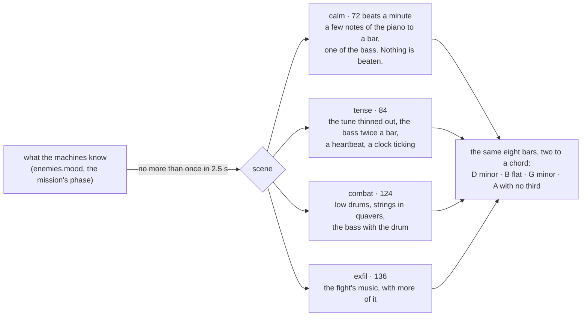

- **What is played** is data: `scoreAt(scene, step)` gives what starts on each sixteenth — a note (which voice,
  which pitch, how long it sounds, how loud) or a drum. Every scene is the same eight bars with the same
  harmony in the same place, so when the site wakes up the music does not start again: more of it is played.
  The round is never begun again on a change of scene; what was struck in the old scene dies away as it would
  have.
- **How it is played**: each note is a few short-lived oscillators through one filter and one envelope —
  struck, and gone inside `MAX_NOTE` (1.6 s, the whole life of the longest). A felted piano (the note, a little
  of its octave and twelfth, the hammer); a bass plucked with the finger, with enough over the note to be heard
  on a small speaker; strings bowed short, two players not quite in tune; a big low drum that falls in pitch as
  a skin does, a smaller dry one, a clock, a heartbeat. No pad, no drone, no organ point.
- **Where**: in a room — a second and a half of generated echo (`ConvolverNode`) on the score alone — which is
  what puts it behind the game instead of on top of it.
- **How loud**: background. Measured, a quiet site's tune is a fifth as loud as one round from the carbine, and
  a fight's about a quarter; both sit about where the beds of wind and air do. It goes through the **Music**
  volume, as before.
- **How it is held to not being a hum.** `tone.js heldFor` follows every note of a sound, a tenth of a second
  at a time, for as long as it neither falls 12 dB below the loudest it has been (it has died away) nor leaps
  up by 6 dB (it has been struck again), and reports the longest. A drone measures as long as it sounds; a
  faint pad under a tune is found; the same note struck twice a second is not held. The score measures 0.4 to
  0.65 s in every scene, and the smoke test's limit is one second. Loop contract of the sequencer: it schedules
  0.15 s ahead; a page that was out of sight does not play what it missed all at once; a step is one sixteenth
  of the scene that is on when it falls due.

`test/unit/score.test.mjs` pins what is written: the scale, that no note outlasts `MAX_NOTE`, that no note is
struck more than three times running, each voice's part of the keyboard, calm < tense < combat ≤ exfil in how
much is played and how fast, the eight bars coming round, one harmony for all four.

**Weight.** Decision of 16 November 2026 — the owner: _"make the sounds more serious"_. Measured, what the game
said to the player and what its machines said to each other were **bleeps** — a bare square or sine at one
pitch, or sliding between two — and its guns were a thirtieth of a second long with nothing after them.
`tone.js bareTone` is the measure: how much of a short sound is one bare note (the strongest partial and its
first two overtones, a fortieth of a second at a time, counted only as far as it stands above the sound either
side of it, and only above 250 Hz — under that a tone is the thump in the body of a knock).

| What                                            | Was (bareTone)     | Is     | Now made of                                                      |
| ----------------------------------------------- | ------------------ | ------ | ---------------------------------------------------------------- |
| a hit registered · a kill                       | 0.84 · 0.96        | 0.00   | a small dull knock · a knock and something heavy set down        |
| the menus · the radio's squelch                 | 0.76–0.83 · 0.70   | ≤ 0.10 | a switch thrown · the carrier and the key's click                |
| an objective done                               | 1.00               | 0.00   | one low struck note and the fifth over it, left to die away      |
| a sentry: suspicious · alert · lost             | 0.91 · 0.61 · 1.00 | ≤ 0.07 | a **growl**: two saws far down, driven, shaken, through a throat |
| a machine going down (sentry · drone · by hand) | 0.49 · 0.90 · 0.69 | ≤ 0.10 | what turns in it running down, its voice with it, and the fall   |
| a machine stopped by an EMP                     | 0.47               | 0.05   | its voice stuttering down, and a relay                           |
| a round on a machine · a sentry's footstep      | 0.66 · 0.87        | ≤ 0.04 | plate struck, sparks · weight coming down on a steel sole        |
| the drone's gun                                 | 0.47 (a zap)       | 0.07   | a dry small-bore crack                                           |
| the alarm's first instant                       | 0.00               | 0.02   | a slam, and a low blare with another a semitone off it           |

And the guns have a body, an action and a **room** — dull noise that swells for a moment and dies over a few
tenths of a second, after a slap off the nearest wall:

| Gun                 | Lasted | Lasts  | Loudest (rms of 20 ms) |
| ------------------- | ------ | ------ | ---------------------- |
| the carbine         | 0.03 s | 0.41 s | 0.10 → 0.17            |
| the sidearm         | 0.03 s | 0.28 s | 0.05 → 0.10            |
| the machines' rifle | 0.12 s | 0.90 s | 0.39 → 0.38            |
| the drone's gun     | 0.03 s | 0.23 s | 0.11 → 0.10            |

The **site's alarm** was a two-tone siren, 480 and 620 Hz turn about — a police car in a cartoon. It is a horn
under a mountain: one low blast every two seconds, two reeds a semitone apart with an octave over them, driven
hard, sagging as it ends, with silence between blasts. It sounds more often now (every charge), so it is also
quieter while it sounds than the siren was.

What may still beep: a **device** that beeps on purpose — the charge's keypad and its armed tone (quieter, and a
sine where it was a square), the lodestar's ping, the goggles — and what rings because it is struck: a round on
steel, a pin, a drip. The **working of a gun** (section 7, "A reload is seen, and heard") is made of the same
three things a knock is: `clack` — bright noise, a low body, two partials not in tune with each other — `rub`
and `thud`; a magazine going home and a bolt going forward are 0.7 of the carbine's own shot in loudness — the
two blips were a quarter of it as built, and were turned up 2.2 times to be heard at all — and a quarter to more
than a half of each is above 2 kHz, where 5% was.

`selfTest()` reports, for every one-shot, `bleep`, `low` and `high` (the shares under 250 Hz and above 2 kHz),
`lasts` and `loud`; `test/smoke.test.mjs` holds thirty-two sounds under 0.3, the four guns to a length and a
weight, their order of loudness, and the reload's sounds to being heard.

> **Nobody has heard any of this.** Every sound and every bar of the score was made and measured by a program:
> levels, lengths, spectra, that each renders. The measures say that a bleep is not a bleep any more and that a
> note is not held; they cannot say that a growl is frightening or that the tune is good. The round's report
> carries the sounds as they were and as they are, and the four scenes of the score, to be listened to.

**The air of a place** (`src/audio/air.js`, pure, pinned by `test/unit/air.test.mjs`). The site is inside a
mountain, and the ear is told so as well as the eye. `airOf({ sky, room, zone })` gives, for where the listener
is, how loud the wind and the facility's air are and whether water drips near:

| Where the listener is                           | Wind | The place's air | Water drips |
| ----------------------------------------------- | ---- | --------------- | ----------- |
| under the sky (the forecourt; a camera outside) | 0.55 | 0               | no          |
| the cavern                                      | 0.04 | 0.3             | yes         |
| the foot of the exhaust shaft                   | 0.2  | 0.3             | yes         |
| the adit, the road tunnel, the drone bay        | 0.04 | 0.2             | yes         |
| a lined room of the site, or a hut              | 0.04 | 0.5             | no          |

A drip is a one-shot (`drip`), played every 2.5 to 7.5 seconds from somewhere 5 to 14 m off, and only while
playing. It is the one sound here with a note in it that is meant to be heard as water, and it is not a loop.

**Round four's sounds** (`src/audio/sounds.js`, thirteen of them, each rendered once like the rest):
`pistolShot`, `shotgunShot`, `shotgunPump`, `shellIn`, `selector`, `weaponSwap`, `grenadePin`, `grenadeThrow`,
`grenadeBounce`, `empBurst`, `machineStun`, `detonator` and `cascadeBlast` — the last 5.6 seconds long and in
stereo: four heavy blasts, then metal tearing and casings ringing down under a long tail. Its four blasts are
placed by the same two numbers (`world/blast.js`) that fire the four charges in the picture. Like every sound
here they were made and measured by a program — levels, lengths, that each renders — and **nobody has heard
them**.

> **Decision, 12 November 2026.** The owner: _"change the annoying humming sounds."_ Measured in the build that
> was live: the plant's hum 61 dB (a 120 Hz sawtooth), the cascade 82 dB (five sine waves near 2200 Hz over a
> 42 Hz throb), a drone's rotors 70 dB (a sawtooth and a square) — and the score sat on a 55 Hz sine in every
> quiet moment. All four are now noise shaped by filters (3.8, 1.9 and 2.9 dB; the score's breath 2.6 dB), the
> score's pulse and bass are thuds, and the calm scene is silent but for a rare ring of metal. Nobody has
> **heard** the result: it was made and measured by a program, and the measure is the only judge it has had.
>
> **Decision, 16 November 2026.** The owner asked for music back — _"some background music that nice appropriate
> at the background"_ — and for the sounds to be _"more serious"_. The first is a change to what the test of
> 12 November said in so many words ("a quiet site has no music under it at all"), and it was changed for this
> reason and no other: every scene now has a score, the calm one included. What the humming taught is kept in
> the form that fits a tune — nothing that plays all the time has a note in it, and no note of the score is
> held — and the test now measures both ("The score", above). The second changed no test that stood: it added
> one.

`main.js` looks for this module rather than importing it outright, and uses `src/core/silence.js` — the same
shape with nothing behind it — if the module is missing or throws while starting. The game never has to ask
whether there is sound.

### 8.6 `src/ui/menus.js`

`createMenus({ root, settings, touch, on })` → `{ show(name, data), hide(), current() }` for the screens `title`,
`briefing`, `pause`, `settings`, `controls`, `failed`, `debrief`. It draws the settings screen from
`settings.SCHEMA` and never reaches into the game: everything it wants done goes out through `on`.

**Where the title stands** (16 November 2026 — the owner: _"center the start menu in pc to the center of the
screen"_). On a desk — whenever `touch` is false — the wordmark, the line under it and the three buttons stand
in the middle of the screen as one block, the foot under them, over a soft dark oval that puts the brightest part
of the picture back a little so that thin type can be read on it. Tracked type carries its spacing after its
last letter, which would put the letters half of that left of the middle; the same again in front of the first
puts them back, and the smoke test measures where the letters are, not where their boxes are. On a phone the
title is as it was: a column down the left-hand edge sideways (the middle is the picture's and the right is the
thumb's), the width of the screen upright.

---

## 9. Tests

`npm test` lints (ESLint for names that were never declared and code nobody uses, Prettier for layout), builds the
game, and runs every suite — the second look's last, and alone: it keeps three copies of the game drawing at
once for as long as it runs, and run beside the others it starved two of their tests of frames (15 November
2026; `test/unit/suites.test.mjs` holds the order, and that no test file is in a folder that is not run).

| Suite                           | What it locks                                                                  |
| ------------------------------- | ------------------------------------------------------------------------------ |
| `test/unit/map.test.mjs`        | the site is closed; every objective, and every post a guard can stand on or    |
|                                 | fly to, can be walked to from the start — so no machine is ever out of reach   |
| `test/unit/mountain.test.mjs`   | the site is inside a mountain (the decision of 12 November 2026, section 4):   |
|                                 | rock over every cell but the forecourt, the roof clear of everything under it, |
|                                 | the shaft straight over the pad, the start walled in by rock, the tunnel the   |
|                                 | only way out, the cameras outside standing in air, and the briefing's figure   |
| `test/unit/air.test.mjs`        | wind is for the outside, water drips only from bare rock (section 8.5)         |
| `test/unit/grid.test.mjs`       | sight, bullets and paths obey walls, low cover and fences; a plan goes through |
|                                 | a shut door, sight does not; a body never ends up inside a wall; a round stops |
|                                 | on a thing's own shape, not on the cell it stands in; and one that comes to a  |
|                                 | low place above its ceiling stops on the face over the opening (section 4)     |
| `test/unit/player.test.mjs`     | the jump (height, time in the air, no second jump, the remembered press), what |
|                                 | can be climbed and what stops you at any height, ceilings, the eye's height;   |
|                                 | leaning (how far, what stops the head, when you cannot); a machine in your     |
|                                 | arms; and that being pushed out of something solid is not speed                |
| `test/unit/arms.test.mjs`       | what is carried, and every number of it: three guns and what each is for, the  |
|                                 | carbine's 120 rounds, a cache that gives a little of everything once, shells   |
|                                 | one at a time, that running dry never goes round in circles, the grenade; the  |
|                                 | knife lands one blow a swing, at its moment, however long the frames are       |
| `test/unit/wording.test.mjs`    | the site is a uranium enrichment facility: the word "plant" is in no file      |
|                                 | under `src/`, and the briefing says what is to be done to the centrifuges      |
| `test/unit/pixels.test.mjs`     | making a picture tile: the two edges of what is left are neighbours in the     |
|                                 | original, nothing in it appears twice, a wall is evened across and not down;   |
|                                 | and taking a picture's own colour out without touching its light and dark      |
| `test/unit/art.test.mjs`        | the manifest of pictures is whole, every chosen one is in the repository at    |
|                                 | three sizes and under its weight, and nothing about the key that made them is  |
|                                 | written down in it; the fourteen material pictures of the second look          |
|                                 | likewise, at two sizes, each a tile graded to grey that keeps at most half its |
|                                 | own colour                                                                     |
| `test/unit/sight.test.mjs`      | what a guard sees of you: a body, a head leaned out (45%), or nothing          |
| `test/unit/tone.test.mjs`       | the measure of "how much of a sound is a note": noise is not, a hum is, a      |
|                                 | quiet hum under loud noise still is; a bleep — a bare tone, held or sliding —  |
|                                 | is one and a knock, a click and a growl are not; a hum holds its note and a    |
|                                 | struck one does not, however often it is struck; weight, length, loudness      |
| `test/unit/reload.test.mjs`     | what a reload looks like (section 7): it begins and ends at rest, nothing      |
|                                 | jumps, the gun stays in the picture, the magazine goes out, away, back and     |
|                                 | home — and only then the bolt; each sound on the motion it is the sound of     |
| `test/unit/score.test.mjs`      | the score as written (section 8.5): D minor, no note longer than `MAX_NOTE`,   |
|                                 | none struck more than three times running, the more the site knows the more is |
|                                 | played, eight bars that come round, one harmony for every scene                |
| `test/unit/spin.test.mjs`       | the casings turn (section 4): what is skin, the three marks, five speeds, the  |
|                                 | angle that comes round, the running down                                       |
| `test/unit/wave.test.mjs`       | what a charge brings (section 5): how many on each setting, the six doors —    |
|                                 | open floor, a walk from every charge, none in the hall — and that a wave comes |
|                                 | in out of sight, far enough off, and always has a way in                       |
| `test/unit/bodies.test.mjs`     | the fallen (section 5): how far off a wreck is seen for the light on it, who   |
|                                 | sees it, the second it takes, what cannot be found; a wreck dragged follows on |
|                                 | its rope, never through a wall, and is let go of if it snags                   |
| `test/unit/bearing.test.mjs`    | which way is which: compass points, the way you face, where a thing is from    |
|                                 | you, and which machines count as contacts                                      |
| `test/unit/difficulty.test.mjs` | how many machines each setting fields and which, who may fire, who answers the |
|                                 | blast, pursuers, the clock, the radar (both decisions of 12 November 2026,     |
|                                 | section 5)                                                                     |
| `test/unit/ai.test.mjs`         | every edge of the guard graph (the hold and its ways out among them), the      |
|                                 | awareness bounds, the alarm's end                                              |
| `test/unit/mission.test.mjs`    | every edge of the mission graph and its "cannot happen" rules: four charges,   |
|                                 | fired once and only when all are set, and no beacon until they have been       |
| `test/unit/controls.test.mjs`   | the picture-size controller steps down, steps up, and holds after a re-shape;  |
|                                 | settings: defaults, clamping, only chosen values are saved                     |
| `test/unit/shade.test.mjs`      | the arithmetic behind the picture: the light sum and its arrow, re-aiming it,  |
|                                 | what paint is made of, the bevelled box, the bloom's steps, when the finishing |
|                                 | passes are used                                                                |
| `test/smoke.test.mjs`           | the built game in a real browser: starts, the map reference, the jump, patrols |
|                                 | walk, the alarm rises and always ends, checkpoints (and a change of setting,   |
|                                 | and the caches), both endings, and nothing logged as an error; the sight kept  |
|                                 | up by a click or Z and fired with the left button or X; a tap that fires;      |
|                                 | leaning and what a guard sees of it; the two counts and the caches; the knife; |
|                                 | the shield (held, fired through, what it stops and what it does not, its six   |
|                                 | ends); that no background sound has a steady note in it; and the mountain —    |
|                                 | the title taken from the road, the start in the adit, the won ending watched   |
|                                 | from the valley as the ground sinks, the lost one from inside, and the         |
|                                 | mountain whole again afterwards. And round four: a round stops on what is      |
|                                 | drawn; the cascades are blown from the control room and every casing comes     |
|                                 | down within its rows; the blast is a checkpoint; three guns, the wheel, the    |
|                                 | selector, the pump and the shells; the EMP; ten surfaces are pictures and the  |
|                                 | game plays without them; the debrief counts the alarms; and nothing is         |
|                                 | heavier, in triangles, than was agreed. And round eight: the title in the      |
|                                 | middle of a desk's screen; a reload seen and heard, dry and not, cut short,    |
|                                 | for each gun; thirty-two sounds that are no longer bleeps, and guns with a     |
|                                 | room; a score in every scene with no note held; the casings turning, seen to,  |
|                                 | and still in the wreck; a charge bringing the alarm and a wave, and the wave   |
|                                 | again on a retry; a wreck found by a machine that can see it, not by one that  |
|                                 | cannot; and a wreck dragged round a corner and not found there                 |
| `test/phone.test.mjs`           | the phone layout and every touch rule in section 7 — SHIELD and USE together   |
|                                 | on the crowded screen, the knife on USE and on FIRE, the button that names the |
|                                 | gun in hand (a tap, a hold), EMP, and BLOW on USE at the firing point; the     |
|                                 | title down the left edge, not centred; DRAG and LET GO on the second button    |
| `test/hosting.test.mjs`         | what is published and to whom (`rayfin/rayfin.yml`)                            |
| `test/hud.test.mjs`             | health on the screen: a number as big as the rounds, the word, a bar; what it  |
|                                 | says when health is lost, when little is left, and when it comes back          |
| `test/unit/matter.test.mjs`     | the second look's arithmetic: the materials and their order, the rule for a    |
|                                 | part that does not say, what `paint` and `merge` write — and that without the  |
|                                 | switch they write nothing — which triangles are edges, how far a key light     |
|                                 | reaches; and that a material's picture is brought to the one middle grey, as   |
|                                 | light, that the shader divides by; that a guess at a material is marked as one |
|                                 | and counted, and that the furniture still built the old way says what it is of |
| `test/unit/png.test.mjs`        | the reader the tests count the pixels of a picture of the game with            |
| `test/unit/bench.test.mjs`      | the phone test page's set-ups (its second version: one thing changed per row), |
|                                 | how each is loaded, the rows packed into the address and back, its line        |
| `test/unit/suites.test.mjs`     | `npm test` runs every test file there is, the second look's after the rest     |
| `test/second/look.test.mjs`     | the second look, in a real browser (section 3). Without the switch: nothing of |
|                                 | it drawn, lit or fetched, and the script everybody downloads under 905 kB.     |
|                                 | With it, from the three places of the one view: 99% of what is on screen has a |
|                                 | material; the gun, a sentry, the truck and the container have the shape, the   |
|                                 | material and the lettering agreed; each key light, alone, makes the ground it  |
|                                 | reaches half as bright again and leaves the ground a ray to it cannot reach as |
|                                 | it was; the game counts each as the picture shows it; the gun is lit by a      |
|                                 | sight line from the eye, and with its sight raised nothing of it stands in the |
|                                 | line of sight (in either look); the yard is captured for metal to mirror, the  |
|                                 | capture shows lit ground bright and shadowed ground dark, and has no lamp in   |
|                                 | it; a capture that fails is tried twice and then done without, and the game    |
|                                 | goes on; the gun mirrors it from where it is held; a desk draws it at the      |
|                                 | display's pace; a phone starts and plays; the mission still ends, both ways,   |
|                                 | with the lamps out and the ground moved; each piece can be left out by itself  |
|                                 | and every shader still compiles; the phone test page runs to its table and     |
|                                 | counts shaders that failed; and from sixteen places over the whole site 99% of |
|                                 | what is on screen has a material. Then the targets not yet reached, marked     |
|                                 | `todo`: they run and report, and protect nothing                               |
|                                 | **The whole site (16 November 2026)**, in the same file: every one of the      |
|                                 | twenty-seven lamps, alone, lights the ground it reaches and leaves alone the   |
|                                 | ground a ray to it cannot reach (what is mirrored held still while it is       |
|                                 | read); in a lamp's light a body is seen, and a step inside its shadow it is    |
|                                 | not; each space is as watchful as it was; what stands still is drawn into a    |
|                                 | depth picture once; a machine in a lamp's light throws a shadow and takes it   |
|                                 | with it; a place is captured the first time the eye is in it, and kept; the    |
|                                 | picture is exposed for the place and the player's setting kept; a drone has    |
|                                 | the shape, material and number agreed; the marks are drawn, and the ground at  |
|                                 | a crate's foot is darker than a step away (and is not, with `marks=0`); the    |
|                                 | air under a lamp is lit, and the moon's column is in the picture; nineteen     |
|                                 | parts in twenty of everything say what they are made of; something is written  |
|                                 | on every hero prop; the phone test page loses nothing to a fresh load; and     |
|                                 | what the world may weigh in each look. **Round eight**: what metal mirrors is  |
|                                 | taken with the casings' skins plain, their streaks are back before the eye is  |
|                                 | shown anything (also when a capture fails), and the skins are still seen to    |
|                                 | turn                                                                           |
| `test/unit/slots.test.mjs`      | the lamps and who burns: every space has a strong light, a lamp hangs where it |
|                                 | can, more than one colour; what stops a lamp's light (roofs, walls, doors, the |
|                                 | shaft); never more lamps asking than there are slots, on a desk or in the      |
|                                 | hand; no flicker at a border, one depth picture a frame, a jump is all at      |
|                                 | once; a captured place for every space; and where the lit air under each lamp  |
|                                 | begins and ends                                                                |
| `test/unit/exposure.test.mjs`   | how the picture is exposed for a place: its limits, down fast and up slowly, a |
|                                 | jump is a cut, and the light it is worked out from                             |
| `test/unit/marks.test.mjs`      | what is painted and spilt, and the dark under things: the sheet's squares;     |
|                                 | every mark of a known kind, no piece too long; the same every time; the dark   |
|                                 | under everything that stands and under the cascades; a band across each        |
|                                 | doorway where the floor was made; paint on made floors only; signs on walls,   |
|                                 | clear of the words, that say what is behind the door                           |
| `test/unit/extrude.test.mjs`    | an outline pushed out into a solid, closed and facing outwards, with its edges |
|                                 | taken off as three's own class would; and that nothing of the second look      |
|                                 | reaches for three's shapes and curves (they would land in everybody's script)  |
| `test/unit/glsl.test.mjs`       | the look's shader text is in the look's own file, and the game's script has    |
|                                 | only the places it is put                                                      |
| `test/unit/lamps.test.mjs`      | lamps that go out (section 4): shot is for good, tripped is for twenty seconds |
|                                 | and comes back by itself, the later of two EMPs counts, a checkpoint keeps     |
|                                 | what was shot; what a round meets (the nearest box, before whatever stopped    |
|                                 | it); an EMP in a room reaches that room's lamps and no other's, in the open    |
|                                 | those within fourteen metres; a key light is the lamp of the space it lights   |
|                                 | and the moons are fixed; a key light that is cut is dark at once, its slot     |
|                                 | free, and nothing else jumps                                                   |
| `test/unit/lights.test.mjs`     | a drone found far off (section 5): a machine is drawn further off than any two |
|                                 | places on the site are apart; its light is never less than five pixels across  |
|                                 | at the widest field of view; close to it adds nothing; one flash a period, and |
|                                 | two drones never flash together                                                |
| `test/unit/hands.test.mjs`      | the hands on the guns: the support arm runs back and down to the shooter's own |
|                                 | elbow, not straight down like a post; nothing of a gun hangs loose of the rest |
|                                 | of it; and with the sight raised nothing stands in the line from the eye       |

**Round seven (16 November 2026)** added to the two browser suites. `test/smoke.test.mjs`: the level's light,
worked out again from the level itself, comes to what it was built with (to the rounding of the light), and only
the mountain's outside is left out of it; a lamp is shot out by one real round — the light under it falls to
less than two fifths, its lens goes dull, the picture darkens, it is heard seven metres off, it stays out, and a
new mission lights it; every lamp but the sky's can be broken by a round from somewhere a player can stand; a
real EMP in the control room puts out that room's lamps and no others, and twenty seconds of the mission's clock
later they are back and the room is exactly as it was; a checkpoint keeps the lamp shot before the charge and
not the one shot after; a mark a round has left goes dark with the lamp over it, and one made in the dark is lit
when the lamps come back; and a drone held at 70 and at 95 m changes the picture where it is by more than twice
what two pictures of the same thing differ by. `test/second/look.test.mjs`: with the switch the same sum holds
for marks, lettering and the rebuilt furniture, and every lamp and key light that hangs somewhere has something
a round can break — and can reach, from somewhere a player can stand; a key light is shot out by one real round — its slot given up at once, nothing of it counted
on a body, its lens dull — stays out wherever the eye goes, and burns again in a new mission; a room an EMP has
put in the dark is less than two fifths as bright, and with the goggles on more than twice that again, in either
look; and a room's key light goes out with the room, what metal mirrors is captured again in the dark, and both
come back.

Order of work for anything that changes behaviour: the test first, then the code, then this document. A locked
behaviour is only changed with a note here saying why.

Locked behaviour changed in round seven, and why: the script everybody downloads may be **880 kB** (it was 870;
the game itself grew by 13.5 kB — lamps that go out, the drones' lights — and none of that is the second look's,
whose share the ceiling was set to hold: the note is in `test/second/look.test.mjs`); the note an EMP leaves on
the screen says `· LIGHTS OUT` after how many it stopped, when it put lamps out (`test/smoke.test.mjs`); and the
test that a machine in a key light throws a shadow now stands the machine at attention, broadside to the lamp —
it had been read in whatever stride and facing the game was stopped in, the ground behind it came to anything
from 0.52 to 0.98 of the open ground by that alone, and it passed or failed by when in the suite it was reached.
Its limits are what they were.

Locked behaviour changed in round eight (16 November 2026, the afternoon), and why — each by a thing the owner
asked for, and for no other reason:

- **The score.** The test of 12 November said "a quiet site has no music under it at all". The owner asked for
  background music: every scene has a score now, and the test holds it to no note being held (section 8.5).
  What plays _all the time_ is held to exactly what it was.
- **The script everybody downloads may be 905 kB** (it was 880): the game grew by 24.7 kB, the second look's own
  file by 61 bytes (a capture taken with the casings' skins plain). The note is in `test/second/look.test.mjs`.
- **A round at a casing** is told `'casing'`, where it was told `'prop'`: the skins turn, and a casing keeps no
  mark (section 4).
- **The phone's second button** offers DRAG when a machine has been shut down at your feet, where both buttons
  used to go (section 5, "Dragged").
- **The stage of one test.** "A charge is a checkpoint" shuts three machines down to set its stage, and now
  tells the site of them (`enemies.known()`): otherwise one of their wrecks is found before the charge is set,
  and the alarms the test reads are not the charge's.

What was _not_ changed, though the work went past it: how long a reload takes and when its rounds are counted;
what a guard sees of you; the six ways a shield ends; the limit a background bed is held to.

---

## 10. Hosting

A static site: `npm run build` writes `dist/`, and Rayfin publishes it as a Fabric App (`npm run fabric:deploy`).
The app runs no code on a server; access is public so that the link opens on a phone without a sign-in. Until
18 November 2026 it served no data either; since then it has one table, the scoreboard's, which anyone with the
page may read and add a row to (`docs/WILD.md`, "The board"). The classic game (`?wild=0`) never touches it. See
`README.md` for the commands, for what is open to whom, and for how to make the pages private again.
