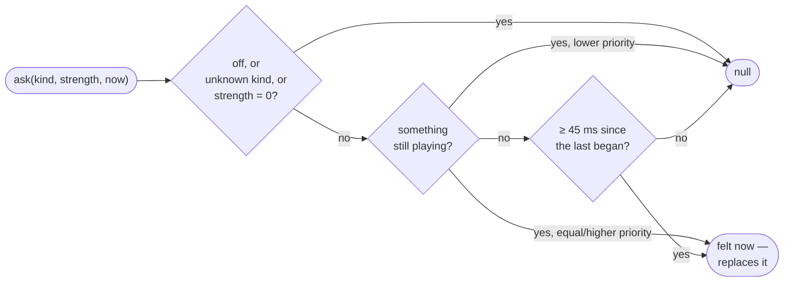

# Haptics — a phone's own motor, where there is one

_(`haptics.js`, `haptics-live.js`; see `docs/WILD.md` §2 and §3 for the fence and what a feature is.)_

The owner, 18 November 2026: "i want sounds and when availible heptic feedback like on the iphone if possible".
He plays this on an iPhone (iOS 26.7.3, Safari) and on a Mac laptop. Checked that night, before any of this was
built: Safari on iOS has never implemented `navigator.vibrate` — there is no API call a web page can make that
turns on that phone's motor. The one thing that ever stood in for it, a trick some games used (a hidden native
`<input type="checkbox" switch>` toggled from script, the `ios-haptics` library's whole idea), was closed by
Apple in iOS 26.5: since then a switch like that only plays its tick for the user's _own_ tap on a _visible_
control, which a game cannot arrange for every shot fired. So this feature does the one real thing there is —
asks `navigator.vibrate` where it exists, which today means Chromium on Android — and is careful to do nothing,
and say why, everywhere else. See "On an iPhone" below for that in full.

## What is felt, and when

Every kind this build knows, the event that asks for it, and the pattern it is felt as at full strength (a
number of milliseconds, one buzz, or `[on, off, on, …]` exactly as `navigator.vibrate` takes it — see "The
rules" below for how a weaker feeling scales that down):

- **carbine** — the player's own carbine, firing: 10 ms. One tick a round; on AUTO that is every ~94 ms, and
  every round ticks — that is the point of a stream fired that fast.
- **pistol** — the player's own pistol, firing: 14 ms.
- **shotgun** — the player's own shotgun, firing: a single 35 ms buzz. A shell calls the game's `shot()` eight
  times, once a pellet, in the one step it is fired; this feature counts one shot a step, not eight.
- **knife** — a knife connects, killing or not: 25 ms.
- **charge** — a charge is armed: `[30, 40, 30]`.
- **hurt** — the player is hit: a single 70 ms buzz, the sharpest of the player's own ordinary feelings.
- **kill** — a kill is made, by any means: 18 ms. (A kill made by the cascades going off is still a kill — but
  `blast`, below, outranks it, so the two are never felt as two separate buzzes for the one event.)
- **alarm** — the site's alarm is raised (not when it stands down): `[40, 70, 40, 70, 40]`.
- **emp** — an EMP goes off: `[60, 30, 30]`, scaled by distance (see below) from how far the player is from it.
- **blast** — the cascades go up: `[200, 60, 200, 60, 300]`, scaled by distance from the hall.
- **aftershock**, **crush**, **slide**, **land** — raised by what causes them, not from here (wired at the merge,
  18 November 2026): an aftershock by its strength (`aftershock-live.js`), a lodestone's crush by how near it
  was (`lodestone-live.js`, nothing past twenty metres), the slide as it begins (`slide-live.js`), and a landing
  by how hard the feet came down — that one is read off the player here: nothing under four metres a second (a
  jump lands at 5.4, and is a light tick), all of it from ten. `aftershock` alone has no fixed pattern — its own
  feel is how pressed the
  mountain is, so it is given a range, 60…220 ms, and scaled by strength directly across that range rather than
  through the 0.4…1× rule every other kind uses.
- **wave**, **salvage**, **visor** — the same night's other features: a wave of machines on its way
  (`[30, 50, 30]`), one shut down to its last machine (`[15, 40, 15]`), a visor cracked (22 ms).
- **Nothing is asked of the browser until the player has touched the page** (added at the merge). Chromium
  refuses a vibration before any tap and logs an error for each one refused: a player hit before their first
  tap, or a fight staged by a test, filled the console with them.

`on.hit({ killed, zone })` is deliberately not wired to a kind of its own: every pellet that reaches it has
already ticked once through `shot()` (the gun firing is what is felt), and a hit that kills says so again,
more plainly, through `kill` — a buzz for every non-lethal hit on top of the gun's own tick would be noise
doubled for nothing new felt.

## The rules — a loop contract

A phone's motor is one crude actuator, not a speaker: it cannot play two feelings at once, and `navigator.vibrate`
gives it no notion of how loud, only a pattern of milliseconds. `src/wild/haptics.js`'s `ask(h, kind, strength,
now)` is the one door every feeling comes through, whether the game's own hand hands it a kind directly or
another feature calls `ctx.buzz`:

- **Entry.** Called with a kind and a strength (0…1) every time something asks to be felt.
- **Per-call state kept:** `h.last = { kind, pattern, at }`, the most recent kind accepted and when it began, and
  `h.count`.
- **Exit — felt:** the pattern is handed to `navigator.vibrate` (a fresh call, which cancels whatever the last
  one asked for — exactly as replacing `h.last` does here) when: nothing is currently playing and at least 45 ms
  (`RATE_MS`) has passed since the last one began; or something _is_ still playing (judged by its whole
  duration, on-and-off together, from when it began) but the new kind's PRIORITY is equal to or higher than the
  playing kind's — in which case it replaces it outright, **not** held to the 45 ms rest at all.
- **Exit — dropped (`null`):** haptics are off (`h.off`, or the live feature's own switch); the kind is not one
  this build knows; the strength is 0 (truly nothing to feel, not a floor); or something of a _higher_ priority
  is still playing and this kind's is lower.
- **Exhaustion / steady state:** there is no cap on how many times this loop runs — a round fired on AUTO asks
  again every ~94 ms, forever, for as long as the trigger is held; each asks fresh, and each either ticks or
  (only if a higher-priority feeling is mid-flight) is dropped. Nothing here ever throws or blocks; a drop is
  silent and correct, not a failure.

`scale(pattern, strength)` turns a strength of 0…1 into 0.4…1 of a kind's own milliseconds (a motor takes a
moment to start, so nothing is scaled under 5 ms); the gaps between buzzes are a silence and are left alone.
`near(strength, metres, reach)` gives an explosion's strength by distance, falling in a straight line to 0 at
`reach` and beyond — `emp` reaches 18 m, `blast` 45 m, both measured from the player to the event.

## The setting

A row on the Settings screen, labelled **Haptics**, built by `haptics-live.js` itself (`src/ui/menus.js`'s own
`settingRow`/`buildToggle` are not exported for a feature to call, so this one is hand-built to match: the same
`.m-row`/`.m-switch`/`[role=switch]` shape, reachable the same way by keyboard). On by default, wherever
`navigator.vibrate` exists. The player's own choice is kept under the storage key `lodestar.haptics.v1` (`'0'`
is off) and holds across a reload. `?haptics=0` in the address removes the feature entirely — nothing is built,
nothing is asked of the browser, exactly as `?voice=0` leaves no `voice-live.js` behind it.

When `navigator.vibrate` does not exist, the row is shown **disabled** rather than hidden, so the player knows
haptics were considered and not merely forgotten — with a line under it saying why: "Safari on iPhone does not
let a web page vibrate" when the device is a phone (`G.touch`) and the API is missing, or the plainer "not
available in this browser" otherwise (a phone was not assumed to be the only reason it might be missing — a
desktop browser without the API would see the same generic line). Turning the row on plays one short tick (20
ms, outside the rules above — not a kind, not rate-limited) so the player feels that the choice took.

Haptics are asked for only while a mission is being played (`G.state === 'playing'`), except that one settings
tick, which plays the moment the row is turned on regardless.

## On an iPhone

Nothing in this feature can make his iPhone's motor turn on, and nothing ever will through a web page in Safari,
on iOS 26.7.3 or any version after 26.5: `navigator.vibrate` was never implemented there, and the one page trick
that used to stand in for it was closed by Apple. There is no setting, no permission prompt, no clever pattern
of calls that gets around this — it is not a bug in this build, it is what the browser allows a page to do. So
on his iPhone: nothing is felt, ever, while playing; the Settings row shows Haptics disabled and says plainly
that Safari does not let a web page vibrate; and the sounds this build already makes are the whole of what the
game gives back when something happens.

It does work today in Chrome on Android, which does implement `navigator.vibrate` for a page that has had a
user gesture.

The only route to real haptics on his iPhone is to stop being a web page for that purpose: wrap the game in a
small native app (even a thin one — a `WKWebView` with a native bridge that calls `UIImpactFeedbackGenerator` or
similar when the page asks it to) and let that wrapper do what Safari itself cannot. That is a separate piece of
work, with its own cost (an app to build, sign and keep running), and is not something this branch attempts or
stubs out — only something he would have to ask for, knowingly, as its own project.

## What is known and left

- **No real phone of any kind has run this.** Every check this branch made was in a headless, scripted
  Chromium — a real device's own quirks (how a browser's `navigator.vibrate` behaves under low power mode, a
  user gesture requirement enforced more or less strictly than a desktop build, a motor that feels different
  than the numbers above suggest) have not been felt by a hand holding the phone.
- **Desktop Chromium's own `navigator.vibrate` does nothing physical.** It is a real function there (which is
  exactly why the test suite can stub and unstub it safely — see `test/wild/haptics.test.mjs`'s own header
  comment for why that stub must be set up the way it is), but calling it on a laptop with no motor to turn on
  is not proof of anything felt — only proof that the call was made, with the pattern this document says it
  should be.
- **Chrome on Android has not been driven by hand either.** The rules above (and the browser suite) establish
  that the right call is made at the right time; whether it reads well on skin, held in a hand, mid-mission, is
  untested.
- **Three of the kinds other features raise are wired and not tested where they are raised** — an aftershock, a
  lodestone's crush, the slide: one line each, by reading. The landing, a wave and a visor are held by the
  browser suite.

## Tests

- `test/unit/wild-haptics.test.mjs` — the rules, without a browser: every kind has a pattern and a priority,
  `scale`, the 45 ms rest, the priority drop/replace/resume above, AUTO fire ticking every round, `off`, and
  `near`'s falloff by distance.
- `test/wild/haptics.test.mjs` — the built game: a real round fired ticks the carbine's pattern; a real hurt and
  a real blast tick theirs, the blast overriding a lesser tick mid-flight and letting one through again once its
  own length is up; `ctx.buzz` reachable through the feature itself; `?haptics=0` leaves nothing to call;
  `navigator.vibrate` made absent throws nothing and disables the Settings row with the words above (both the
  generic line and the phone's own); the row toggles, remembers the choice across a reload, and silences
  everything while off; and, at a phone's shape, the row still fits its panel.
