# The lodestone — a thrown magnet that sticks, clamps, holds, and crushes

The whole design of the lodestone; `docs/WILD.md` (section 4, "The lodestone") has the short of it. Rebuilt
17 November 2026 — the owner, of the
round shipped the day before: **"the lodge stone doesn't seem to do anything fix it"**.

## Why it was rebuilt

The old lodestone was tested only against machines staged 2 m from a stone thrown at the player's own feet — a
case that never once asked it to fly, bounce, or miss. Measured instead the way a player actually throws it (the
script `.work/v10/lodestone-repro.mjs`), the real bugs showed at once:

1. **It bounced.** Thrown at the gate/road sentry pair where a mission really puts them, it bounced off a crate
   and rolled back past the player. Cover any crate's height hid whichever of the pair stood behind it — the old
   field's line of sight started 0.3 m off the floor, below most crates — so only one of two was ever held.
2. **It overshot.** Thrown at three sentries 9–11 m away in the open, it flew 5 m past them: the old pull dragged
   each a few metres but at a range the blow's own 3 m radius never reached, so nobody died.
3. **It missed entirely.** In the cascade hall it bounced off a casing straight back past the player, holding
   nothing.

Nothing died in any of the three. This file is the rebuild: it no longer bounces, it reaches as far as it holds,
and low cover no longer hides a machine from it.

## The loop, end to end

```mermaid
stateDiagram-v2
  [*] --> flight: 4 (or a phone's LODE button) — thrown from the eye, an EMP grenade's own arc
  flight --> stuck: STICKS — the first solid thing it meets (floor, wall, crate, casing): stops dead, no bounce
  flight --> stuck: CLAMPS — within 0.9 m horizontally of a running sentry (0…1.9 m), or 0.8 m in 3D of a drone
  flight --> stuck: out of time — flightMax 1.6 s since it left the hand, wherever that then is
  stuck --> awake: wakeDelay 0.35 s later
  awake --> awake: every eligible machine newly in reach is taken — close (≤3 m), or a clear line to it
  awake --> gone: awake 2.6 s later — THE CRUSH: every machine it holds is hurt by how close it got; survivors released
  gone --> [*]
```

A **clamp** is the same `stuck` state as a normal stick, reached by a different door: the one case the pure rules
file cannot see for itself (it knows no machines) is resolved by the live wiring scanning for a close machine
every step a stone is still in flight, and calling the same `stickLodestone` the moment one is found. From that
point on a clamped stone _rides_ the machine it clamped onto — its position is copied onto the stone's every
step, so the stone's visual, its tether and the field it opens when it wakes all sit where the machine actually
is, even if the machine was still walking when it was hit (acceptance test G: a direct hit is held "at once",
visibly riding that machine, well before the field would otherwise have woken).

## The numbers (`src/wild/lodestone.js`, `LODESTONE`)

- **Carried**: 2 at the start of a mission, +1 from each ammunition cache, never more than 3 — unchanged from
  before. The chip at the foot of the screen counts them; a press (or phone touch) with none left says so; not
  thrown with a hand full, nor while a drone is being flown (test H1).
- **Thrown** exactly as the EMP grenade's arc (13 m/s, gravity 12) — unchanged — a little up, out of the left
  hand (or the head, if that would put it in a wall).
- **STICKS**, dead, no bounce, sub-stepped so it cannot pass through a one-cell-thick wall in a single step: on
  the floor it stops at its own radius (≈0.06 m) off the ground; on a wall or a casing, at whatever height it had
  reached when it met it.
- **CLAMPS** onto a machine passed close to in flight: within 0.9 m horizontally of a sentry while the stone is
  between the floor and 1.9 m (a sentry's own height), or within 0.8 m in full 3D of a drone wherever it is.
- **WAKES** 0.35 s after it sticks or clamps. If it is somehow still in flight 1.6 s after leaving the hand (every
  floor in the game is well within that fall — this is a safety net for a gap or a pit, not a path any acceptance
  test takes), it is forced to stick exactly where it then is, and wakes 0.35 s after _that_ — see "Known limits"
  below for the one place this reading of the brief could be argued either way.
- **AWAKE for 2.6 s.** Every running, eligible machine within `reach` 10 m is taken the moment it is in reach — at
  close range (≤3 m, the EMP grenade's own `close` rule, no line needed) or with a clear line
  (`G.world.grid.sight`) from whichever is higher of 1.4 m off the floor or the stone's own height, to the
  machine's own middle (1.2 m for a sentry, a drone's own height). Cover under about 1.3 m no longer hides
  anything; a true wall still does (acceptance test E).
- **HELD** means: `unit.stunT` kept above nought every step, so it does nothing of its own (the contract above
  `const inner` in `src/enemies/index.js`); dragged towards the stone through `ctx.lib.moveBody` (so it slides
  along what is solid and never enters it) at up to 9 m/s, eased in over ≈0.3 s so nothing snaps to full speed
  the instant it is taken, and cut each step to the room left before a stop line 1.0 m short of the stone — never
  past it, at any frame rate (unit tests drive this at dt = 1/20, 1/60 and 1/120 and check the final position
  agrees within 5%). A drone held is also drawn down to about 1.1 m (`unit.carried = true`).
- **THE CRUSH**, when the 2.6 s run out: every held machine is hurt by `G.enemies.damage(unit, amount, stone.x,
stone.z)`, `amount` 130 at 1.5 m or nearer from the stone, falling in a straight line to 50 at the 10 m reach
  itself (so a 100 hp sentry held within ≈4.7 m is destroyed outright; a 55 hp drone always is, however far out
  it was taken from). A machine never held gets nothing. Survivors are released (`carried` cleared, `stunT` left
  to decay for a further 0.8 s). Heard 20 m off (`G.enemies.noise`). The player is never hurt by it.

## Not taken, ever

- The machine in the player's arms (`G.enemies.held`, the shield).
- A drone the player is currently flying (`unit.piloted`) — and, kept from before: a drone the field already
  held when the player took it to fly is **not** let go of with the rest when the crush comes; its height and its
  hands stay the pilot's (test H1b).
- A sentry the player has turned (`unit.turned`).
- Wrecks, and anything already someone else's: at most one field holds a given machine at a time.

## Seen and heard

While awake: a thin additive tether of light from the stone to each machine it holds, flickering (aimed fresh
every frame, since the stone sits still but what it holds is being dragged); one ring on the floor, expanding out
to the 10 m reach the instant it wakes; sparks at each held machine as it travels. At the crush: a flash, a ring,
sparks at every machine actually destroyed, and a shake of the camera within 15 m of the stone. Under the
crosshair (`ctx.note`), about half a second after waking, `LODESTONE — N HELD` or `LODESTONE — NOTHING IN REACH`;
the instant the crush lands, `LODESTONE — N CRUSHED`, or `… N CRUSHED · M HURT` if any held machine survived it.
Three sounds, unchanged by this rebuild (`lodestoneWake`, the loop `lodestoneField`, `lodestoneBlow`; the throw
and the stick reuse the grenade's own `grenadeThrow`/`grenadeBounce`) — another agent is redoing the game's
sounds, and nobody has heard any of these three played: they were made, like the rest of the game's sounds, by
what a program can measure.

## A phone

No `4` on a phone: LODESTONE is a button of its own (the game's own `tb`, class `w-lode`), a row under the pause
button and NV, labelled LODE with the count carried on its face — it stands for the key, through
`G.input.poke('Digit4', true/false)`, so a touch does exactly what the key does. Placed at `top: calc(var(--t) +
96px); right: var(--r)` (row three — swap/EMP are row two) — checked empirically to overlap nothing of the HUD's
own buttons or any other feature's, at all four phone shapes `test/wild/dress.test.mjs` tries (844×390, 667×331,
932×430 sideways; 402×714 upright). Its line is in the phone's briefing (`brief(touch)`) and the button is named
in the Controls row's phone cell.

## Loop contract (written at the head of `src/wild/lodestone.js`, held by `test/unit/wild-lodestone.test.mjs`)

> thrown → in flight for at most `flightMax` seconds → stuck (the first solid thing it meets, or clamped onto a
> machine passed close to in flight, or simply out of time) → awake exactly `wakeDelay` seconds later → awake for
> exactly `awake` seconds → gone.
> `wake` fires exactly once per stone and `crush` fires exactly once per stone, however long a single `step()`
> is — a huge dt must not skip either, and must not repeat either.
> Everything the stone is holding when it goes is let go of (stunT released to decay) before the stone itself is
> removed: never a machine left frozen with nothing left holding it.
> Never more than `LODESTONE.carry` stones alive in the world at once, independent of how many are carried as
> ammunition (a cache taken while that many are already in the air must not allow a fourth).
> A mission that ends, or begins again, leaves no stone behind and nothing still `carried`.

## Known limits, and one reading of the brief worth flagging

- **The 1.6 s flight cap's exact effect on the wake clock.** The brief says it "WAKES 0.35 s after it sticks or
  clamps (and at the latest 1.6 s after leaving the hand, wherever it then is)". This build reads the 1.6 s as
  the latest a stone may still be _flying_ — forced to stick, wherever it then is, the instant that time is up —
  with the 0.35 s wake delay still counted from that forced stick, so the very latest a stone actually wakes is
  1.95 s, not 1.6 s. In practice this almost never matters: every floor in the built game is well inside a 1.6 s
  fall, so a thrown stone sticks naturally, long before the cap, in every acceptance test and very likely in any
  real throw — the cap is a safety net for a gap or a pit with no floor near enough, not a path any of the tests
  below exercise. Flagged here rather than silently picked, since the brief's own parenthetical could be read
  the other way (wake unconditionally by 1.6 s even if still airborne); tuning it either way is a one-line change
  to `stepLodestone` with no other effect, should the lead prefer the stricter reading.
- **The cascade hall's own repro script.** `.work/v10/lodestone-repro.mjs`'s fourth case throws along x = 47.5,
  which looks like a clear aisle on a casual read of the map but is not: `node -e "import('./src/world/map.js')
.then(m => console.log(m.printSite(m.buildSite())))"` shows that column is inside the cascade hall's casing
  block, cut by a solid band every few metres (at roughly z 20–21, 25–26, 30–31, 35–36). Under the new stick
  rule a level throw down it correctly sticks on the first band it meets, a metre or two in, rather than reaching
  a sentry 10 m off — this is the repro script's own test geometry, confirmed independently with direct physics
  probes against the map and the rules file, not a defect in this rebuild. The true clear aisles are the gaps
  around and between the two casing blocks (x 31–33, x 50–52, x 69–71); acceptance test D below uses x = 51. The
  repro script lives outside `src/wild/`, `test/` and `docs/`, so per the fence it was not touched; its fourth
  `after:` line will still show the hall sentry alive when run verbatim (see the final summary). **At the
  merge** the lead, whose mistake the staging was, moved that fourth throw to the middle aisle (x = 51.5, a
  sentry ten metres up it) and ran all four against the merged build: every machine thrown at was held and died.
- **Nobody has played it.** Every number above is checked by a test against the built game's own map and
  physics, not by a person with a mouse. The three sounds are unchanged and, likewise, unheard by anyone.
- Wrecks are still not dragged (as before): `enemies.damage` leaves a wreck for the game's own systems to move.

## The tests, and what each proves

**`test/unit/wild-lodestone.test.mjs` — 40 tests, pure rules, no browser.** The flight and the stick against a
made-up room (no bounce, floor height vs. the height struck on a wall); the clamp geometry for a sentry and a
drone; the clock (wakes once 0.35 s after sticking, forced to stick at the 1.6 s cap, awake for exactly 2.6 s,
`wake`/`crush` each exactly once even for one dt spanning the whole loop, never skipped nor repeated); who is in
the field (reach, the close radius, sight raised to 1.4 m clearing low cover, a true wall still blocking it); the
drag's law (eased in, never past the stop line at dt = 1/20, 1/60, 1/120, ending in the same place within 5%
regardless of frame rate); a drone's height drawn down the same way; the crush's damage by distance (130 near,
50 at reach, a straight line between, a 100 hp sentry dead within ≈4.7 m, a 55 hp drone always); carrying, spent
and given back, never past `carry`. Dated 17 November 2026, quoting the owner at its head.

**`test/wild/lodestone.test.mjs` — 14 tests, the built game, the real `4` key, `look=1` except where stated,**
every throw made the way a player makes it, at the mission's own named machines, on the game's own clock
(`__G.mission.time`), waiting on conditions (`page.until`), never a fixed sleep for game time:

- **A** — the gate/road pair where the mission puts them, thrown level from 12 m north: both destroyed inside 6
  mission-seconds. Proves the crate that used to save one of the pair no longer does.
- **B** — the same pair, thrown at their feet from 8 m (pitch −0.25): both destroyed. Proves the fix holds for a
  grounded throw, not only a level one.
- **C** — three sentries in the open, 9–11 m out: all three destroyed; the `crushed` tally rises by 3; the HUD
  says `3 HELD` on waking and `3 CRUSHED` at the blow. Proves the old overshoot is gone, and that the count in
  both notes is the real one.
- **D** — the cascade hall, a real clear aisle (x = 51, see "Known limits" above for why not x = 47.5): a level
  throw 10 m down it sticks (does not bounce back towards the player) and drags the sentry there to its death.
  Proves a stone thrown down a genuine corridor reaches the far end and holds what it finds.
- **E** — a sentry behind a true wall, 3–5 m from a stone stuck in the service corridor (z 43–45): neither held
  nor hurt. Proves a wall still hides a machine even though low cover no longer does.
- **F** — a drone 3 m up, within 8 m of where the stone sticks: drawn down, destroyed. Proves the vertical reach
  and the drone-specific drop both work together.
- **G** — thrown straight at a sentry 6 m off: the stone's own `state.rides` names that sentry, held the instant
  it clamps (`awake` still false at that point — proving this is the clamp path, not the slower field capture),
  destroyed. Proves a direct hit is immediate, not merely eventual.
- **H1/H1b** — `4` does nothing while a drone is flown; a flown drone is neither taken by a field nor let go of
  mid-flight by one; a drone the field already held keeps the player's hands on it if flown before the crush.
  Proves none of today's piloting rules regressed.
- **H2** — a sentry the player has turned is neither held nor hurt. Proves the turned exclusion holds.
- **H3** — a mission begun again under an awake stone leaves no stone and nothing still `carried`, checked on
  the very unit the stone had been holding. Proves the loop contract's last clause end to end, in the browser.
- **H4** — with `wild=0`, the key does nothing and `__G.wild` stays null.
- **H5** — the same cycle (sticks, wakes, crushes) runs in the second look with no error logged.
- A final check that `page.problems()` is empty across every test that ran on the shared page.

**`test/wild/dress.test.mjs` — the phone button (test I),** added to the per-shape loop already run at all four
phone shapes: `.w-lode` is in `COLLISIONS`'s `ours` list and overlaps nothing of the HUD's at any of the four; a
real touch on it throws a stone exactly as `4` does (the count on its face falls by one, a stone appears, and is
let to finish its own cycle before the rest of that test continues).

**`.work/v10/lodestone-repro.mjs`** — the lead's repro of what the owner said, re-run after this rebuild: of its four staged
cases, the three that stage a machine somewhere the map actually leaves open now end with every staged machine
`dead` (see the final summary for the pasted `after:` lines); the fourth is the x = 47.5 geometry issue above,
not a defect in this file (and, moved to the middle aisle at the merge, it too ends `dead`).

**Screenshots** — `.work/v4-eval.mjs`, both looks, the three-in-the-open scene (test C's staging): one at the
instant the field wakes (the ring, the tether reaching towards the held sentries, the carried count on the
HUD falling to 1), one at the instant of the crush (`LODESTONE — 3 CRUSHED` under the crosshair, the flash, the
mission's own kill counter advancing to 3). Looked at directly in both looks; the effect reads clearly as a
still in each.
