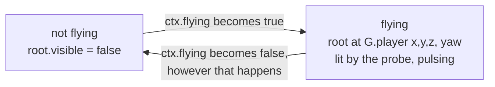

# The body, seen from outside

_(`operator.js`, `operator-live.js`; see `docs/WILD.md` §3 for what a feature is and the fence it keeps to.)_

The owner, 17 November 2026: "when a drone fpv is flying we can't see the chrachter of the player". Until this,
Wraith had never been drawn from outside — only two hands and a gun, in first person. The uplink's own words
already said it (`docs/WILD.md` §4, The uplink): "the body stands where it was left — it can be seen, found and
shot by machines." It could be shot at; it could not be _seen_, by the one pair of eyes that was looking straight
at it — the player's own, from the drone. This feature draws what was always true of the fiction and never true
of the screen.

## What it is

A `THREE.Group` named `wild-operator` (`operator.js`, `buildOperator`), built of boxes, cylinders and spheres
alone — no textures, no files, 952 triangles. Named parts: `head`, `torso`, `pack`, `antenna`, `antennaTip`,
`slate`, `slateFace`, `rifle`, `armL`, `armR`, `legL`, `legR`, `hips`, `legs`, `upperBody`, `root`. Standing,
feet at y = 0, about 1.8 m to the crown (`STAND_HEIGHT`, the player's own: `src/player.js` `PLAYER.height`);
crouched, about 1.2 m (`CROUCH_HEIGHT`) — a lower pose, knees bent, the waist dropped and driven forward, the
whole upper body scaled down a little as well, rather than a true crouch animation.

Boots and gloves dark, a plate carrier and pouches over a dark jacket, a helmet with night-vision goggles tipped
up, a carbine slung across the chest, and the left forearm raised holding a slate whose face glows — he is flying
the drone. A pack on the back carries a short whip antenna; its tip glows (the uplink: `docs/WILD.md` §4). The
antenna tip and the slate pulse slowly together, 0.55…1.35 on a sine a little over a second long
(`PULSE_SPEED`/`PULSE_LOW`/`PULSE_HIGH` in `operator-live.js`) — a sign of a live link, not a dead one.

**Colours, taken by reading, not importing.** `operator.js` is fenced to `three` alone (`docs/WILD.md` §2's
IMPORT RULE), so it cannot pull in the first-person arms' own paint table. Its `PAINT` constants are copied by
eye from `src/gfx/models.js`'s `PAINT.sleeve`/`glove`/`knuckle` (and the carrier/pouch tones nearby) — the same
person, drawn twice, by two files that do not know of each other. **Against a sentry** (`docs/WILD.md`'s own
machines: tan, boxy, flat-topped) the figure reads differently on purpose: darker cloth, a narrower frame, a
rounder helmeted head, cyan/mint accents instead of a sentry's orange — checked side by side in a picture before
any test was written (see Pictures, below).

## When it is drawn — the loop contract

`frame(real)` (`operator-live.js`), called every frame like any other feature:

- **Exactly while `ctx.flying` is true**, and never otherwise. Nothing else gates it — not whether the body is
  in a light, not whether a machine is looking, not whether the second look is on. Whether a machine _can see_ a
  flown-from body is the game's own rule (`docs/WILD.md`'s uplink and `enemies/`), unchanged and not this
  feature's to judge.
- **Position and pose, every flying frame:** `root.position.set(player.x, player.y, player.z)`,
  `root.rotation.y = player.yaw` — it stands exactly where the body is and faces the way it does, read fresh
  each frame (so a body that is still being simulated under the drone, even though it is given no input, is
  followed exactly). Crouch is read once a frame too (`player.crouched`) and only touches the group's pose on
  the frame it changes.
- **Lit like everything else of the wild chunk:** `G.world.probe(player.x, player.z, tint)` then
  `ctx.lib.setProbe(mats, tint)` — the same two calls `lodestone-live.js` makes (`docs/WILD.md` §3). No light of
  its own beyond the two glows, which are shader-driven emissive quads, not scene lights.
- **It ends with the link, however the link ends.** `pilot-live.js`'s `end(why)` covers `spent`, `hit`, `lost`,
  `blown`, and the mission itself ending under a flight that had not dropped first (`wild.emit('end')` —
  `docs/WILD.md`'s review of 16 November 2026); in every one of those `ctx.flying` goes false on the very frame
  `end` runs, and so does `root.visible`. A checkpoint or a retry (`G.debug.start()`, `wild?.reset()` in
  `main.js`) does not need a rule of its own: `operator-live.js` is rebuilt once, at startup, and is never torn
  down and rebuilt again — a mission begun again simply finds `ctx.flying` false, as any fresh mission does, and
  draws nothing. One `wild-operator` group exists for the life of the page, never two.

## What is known and left

- **No walking animation.** The figure stands; it does not shift weight, breathe, or otherwise move beyond the
  pulse and the crouch pose. The body under a flown drone takes no input (`docs/WILD.md`'s uplink: "the hands
  are on the drone, the body is asked for nothing"), so there is nothing to animate _to_ — but a still figure
  for up to 22 seconds is a plainer thing than it might be.
- **It is not drawn in the first-person view.** It exists only to be seen from outside, by the drone's own eye;
  the player's first-person camera, when not flying, stands where the figure would be and would see it from
  inside out if it were ever shown then. It never is — `root.visible` is false whenever `ctx.flying` is false,
  which is the whole of first-person play.
- **Mirrors do not show it — checked, not assumed.** The second look's metal reflections (`src/look/mirror.js`)
  capture only `world.group` and, separately, the key lights' own fittings (`src/look/index.js`,
  `also: [keyLights.fittings]`) — a fixed, explicit list, tagged once at startup. `wild-operator` is a sibling of
  `world.group` (both are children of the scene), never in that list, so its meshes are never put on
  `MIRROR_LAYER`: a drum or a wet floor that reflects the room will not reflect the figure, even while it stands
  in view of it. This is of a piece with `mirror.js`'s own exclusions — "machines and smoke, which move" are
  left out of a capture that is taken once and kept; a figure that comes and goes with a flight is no different.
- **Phone.** Part 2 of this round — buttons so a flown drone could be raised, lowered and blown up by touch —
  was not built; `docs/WILD.md` §5's "**Not on a phone:** … a flown drone's height and its being blown up"
  still holds. The figure itself needs no phone-specific handling (it is drawn the same for a touch session as a
  desk one), but nobody has driven a flight from a touch screen to confirm that in play.
- **Nobody has looked at this on a real phone, or a real headset, or any device but the one these tests run on.**
  Every number and every picture in this document comes from a desktop Chromium at 1280×720 (and the four phone
  shapes `test/wild/dress.test.mjs` already covers for layout, which this feature does not touch).

## Pictures

Taken with `.work/v4-eval.mjs`: the drone 7 m from the body, looking back at it, chest height
(`pilot.flight.yaw = 0`, `pitch = atan2(0.9 − droneY, 7)`), `grain = 0` so the film-grain post effect
(`src/gfx/post.js`) does not stand in for a real change between two shots.

- `operator-look1.png` — first look. The figure reads at a glance as a person: a rounded helmeted head, the
  antenna's cyan glow just behind it, the slate's glow on the raised forearm, a plain dark silhouette against
  the lit wall and the lamp's pool of light on the ground. Neither black nor blown out.
- `operator-look2.png` — second look. The same figure, the same distance and pose, against the second look's
  finer wall texture and sharper shadow; again neither black nor glowing — lit the same way, by the same probe.

## Tests, and what each proves

- **`test/unit/wild-operator.test.mjs`** (no browser): the group's name and height standing (≈ `STAND_HEIGHT`,
  feet at 0) and crouched (≈ `CROUCH_HEIGHT`); the triangle count is between 600 and 6 000 (952, as built); every
  named part the brief calls for exists; it faces −Z (the slate and the rifle are in front of the root, the pack
  behind — checked by local-space z); every lit mesh is one `ownMaterials` would find.
- **`test/wild/operator.test.mjs`** (the built game, real keys, the game's own clock):
  - _not flying → nothing; flying → position, yaw and crouch follow the body_ — proves the live wiring to
    `ctx.flying`/`G.player` the unit test cannot reach, and that the body is moved first so the match is not a
    coincidence of a shared default.
  - _however the link ends, and a mission begun again_ — proves all four of `end`'s reasons, the mission ending
    under an undropped flight, and a restart all hide the figure, and that a restart never leaves a second
    group in the scene.
  - _with the experiment off_ — proves `wild=0` builds no such object at all (not merely an invisible one).
  - _from the drone's eye the figure is seen — first look and second_ — the drone 7 m from the body, one picture
    with the figure drawn and one with it hidden (same frame otherwise: `frame()` itself stubbed out so it
    cannot put the figure straight back), decoded and compared pixel by pixel. Changed pixels are grouped into
    touching patches (a flood fill) and it is the _largest_ patch that must be at least 12×40 px and not spread
    far beyond the figure — because the ground has its own twinkling glint, a pixel here and there, every frame,
    on top of whatever the figure changes, and a scattered twinkle never touches enough of its own neighbours to
    grow into one patch the size a figure makes. Proves the figure is not merely _in the scene graph_ but
    actually visible from where it matters: the eye that was never able to see it before.

Between the two screenshots of each of those last two tests, the game's boot screen (`index.html#boot`, the
"LODESTAR" wordmark) was found still fading — `window.__ready` is set the instant its 0.5 s opacity transition
_begins_, not when it ends, 0.7 s later when it is removed — which alone was enough to make every pixel of two
back-to-back screenshots differ. Both tests wait for `#boot` to be gone before staging anything.
