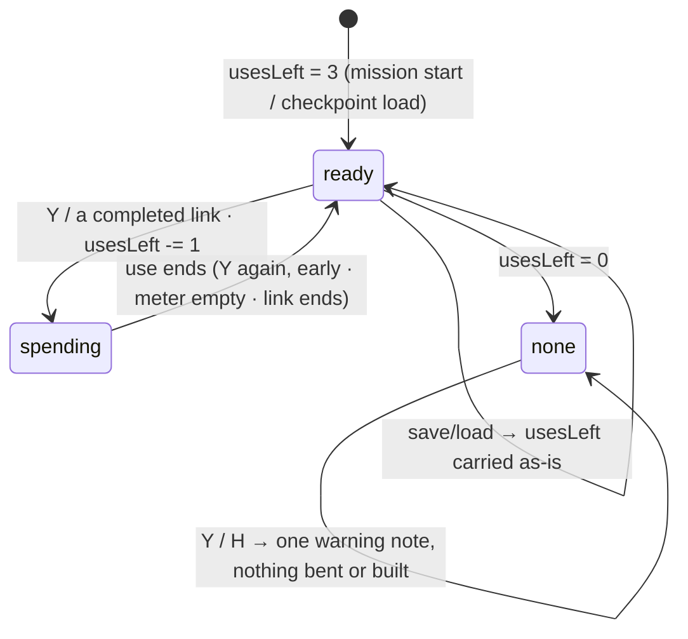
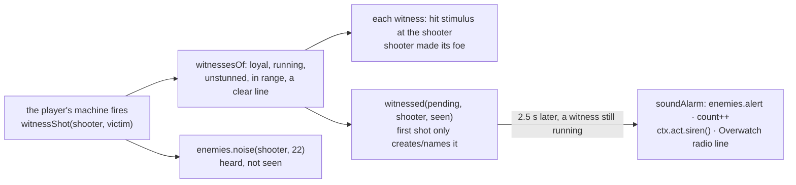

# Lodestar — limits, witnesses, and the alarm that is heard

> **At the merge (the lead, 17 November 2026).** This is the helper's own account, kept whole. Two things in it
> are out of date: the alarm a witness raises now also says a line of WARDEN's (`witnessed`), and that it is
> heard — which this account says was not proven by a test — is now held by one
> (`test/wild/uplink.test.mjs`, "the alarm a witness raises is HEARD"): the machine fired at dies of the first
> hit and the one that watched is stopped where it stands, so that nothing but this rule can raise the alarm.

The owner, 17 November 2026: _"also limit the number of focus and uplinks a use can do … and once uplink fire is
being used the alarm still should be triggered once other robots see that their friends are being fired at."_

Two changes to features already in `docs/WILD.md` §4. Nothing here is a new feature or a new file under
`src/wild/` — `focus.js`/`focus-live.js` and `uplink.js`/`uplink-live.js` are the only files touched, plus their
tests. A third, wilder idea (a sentry's own overload, blowing itself and its neighbours up) was drafted and its
pure logic unit-tested, but was the lead's idea, not the owner's, and was dropped whole under a hard deadline
before it had live wiring or a browser test — nothing of it is on this branch.

## 1. Limits — three of each, a mission

**The rule.** FOCUS and UPLINK were each unlimited before (FOCUS refilled itself; UPLINK only cost 28 seconds of
recharge). Now each is `uses: 3` a mission (`FOCUS.uses`, `UPLINK.uses`), kept in `usesLeft` on each feature's own
state (`createFocus()`, `createUplink()`), and in the checkpoint (`save`/`load`) with everything else of the
feature — a mission begun again has three of each, as it did before this change existed at all.

- **FOCUS.** `Y` with `usesLeft > 0` spends one at once and bends time exactly as before (world 0.3, player 0.55,
  a full meter five seconds) for as long as that use's own meter lasts. `Y` again ends it early — what was left
  of that use is lost, not banked. What is done well while it is on (today's `earn`: a takedown 30%, a head shot
  that kills 25%, any other kill with a gun in hand 10%) puts time back on the **running use's own meter**, never
  above a full one, and does nothing at all while FOCUS is off — the meter no longer fills itself over time. With
  `usesLeft === 0`: `Y` says `NO FOCUS LEFT` (`ctx.note(…, 'warn')`), once a press, and bends nothing. The REFLEX
  is untouched: free, its own 25-second rest, exactly as `docs/WILD.md` already describes it — it does not read
  or spend `usesLeft` at all.
- **UPLINK.** A use is spent when a link **completes** — a sentry turned, or a drone taken to fly — not when the
  hold merely starts; a let-go before 1.1 seconds still costs nothing, as before. The 28-second recharge between
  two links is unchanged. With `usesLeft === 0`: holding `H` on a machine builds nothing at all and says
  `UPLINK SPENT` once a press; on a phone the second contextual button no longer offers UPLINK there (it falls
  through to whatever else wants it, or nothing). The OVERSPEED (`H` at the firing point) is not a use of
  UPLINK's and is explicitly proven to still work with `usesLeft === 0`.
- **Shown.** The chips at the foot of the screen (`chip()`) count down `×3`, `×2`, `×1`, and go to the 'out' tone
  at `×0`; FOCUS's own chip, while a use is on, shows that use's running meter as its level instead of the count.
  On a phone, FOCUS's own button (`.w-btn`, `focus-live.js` / `wild.css`) shows the count the same way. The
  briefing lines and the Controls rows for both now say "three times a mission" inside their existing length
  limits (`test/wild/dress.test.mjs` holds a briefing line to one line of ≤ 50 letters, a Controls row's first
  cell to ≤ 76).

- **Loop contract (the one thing here that still runs over time: a running FOCUS use's meter).** Belongs to
  exactly one use; starts at 1 (a full meter) when that use is spent; drains at the existing rate while on; is
  raised by `earn` events, capped at 1, only while that same use is still on; reaching 0, or `Y` pressed again,
  ends the use (whatever is left is lost either way) and returns both clocks to 1. Never runs when FOCUS is off;
  never refills on its own. `usesLeft` itself does not run — it only ever steps down by exactly 1, on exactly the
  events above, and is restored to 3 only by a fresh mission or a loaded checkpoint.
- **Known, and left.** Nobody has played a full mission against the three-use limit by hand; the numbers (3 and 3) are the owner's own instruction read literally, not separately play-tested for feel. A checkpoint saved
  mid-use (FOCUS on, meter partway) is not specially handled beyond what `save`/`load` already did for the
  meter/target fields — loading mid-use restores the meter and `usesLeft` as they were saved, including a use
  already spent for one still running; this was not a new case introduced by this change, so it was not
  re-tested beyond the existing checkpoint test for each feature plus the new one proving `usesLeft` itself
  survives a checkpoint.
- **Tests.** `test/unit/wild-focus.test.mjs` and `test/unit/wild-uplink.test.mjs`: the old tests for the meter's
  own refill, the 15% floor, and unlimited links were **replaced** (not loosened — removed because the rule
  they held no longer exists) with the new rule, each replacement carrying a comment quoting the owner and 17
  November 2026. `test/wild/focus.test.mjs` (7): three real `Y` presses taking effect and a fourth refused, once,
  loud; the chip counting `usesLeft` down; a kill extending a _running_ use's meter past where it would otherwise
  have run out, never past a full one; the REFLEX firing and resting normally after all three FOCUS uses are
  gone; a checkpoint keeping `usesLeft` across a mission ending and beginning again. `test/wild/uplink.test.mjs`
  (9, shared with §2 below): three real `H`-holds completing links and a fourth refused, once, loud, building
  nothing; the chip counting `usesLeft` down; the OVERSPEED still working with UPLINK's `usesLeft` at 0.
  `test/wild/dress.test.mjs` (7): the briefing and Controls rows for both features still fit their limits with
  the new wording. None of this was watched by a person; it is proven only by what the suites above assert.

## 2. Witnesses — the alarm no longer needs to be hit first

**The rule.** Before this change, a loyal machine only turned on a turned one (or fired back at a flown drone)
after being hit itself — a turned sentry, or a flown drone's gun, could empty a room of loyal machines one at a
time and the alarm never rose, because nothing had _seen_ it happen, only felt it. The owner, 17 November 2026,
again: the alarm must be triggered once other machines **see** their friends fired at, not only once they are
hit themselves.

- **A shot.** Whenever a machine that is the player's (`unit.turned` — a turned sentry; `unit.piloted` — the
  drone being flown) fires at a loyal machine, hit or miss, `ctx.witnessShot(shooter, victim)` is called (from
  `uplink-live.js`'s own `fire()`/`turn()` and from `pilot-live.js`'s gun, the same way).
- **Who counts as a witness** (`witnessesOf(shooter, victim, units, sees)`, pure, in `uplink.js`): every loyal,
  running, unstunned machine within its own `spec.view × WITNESS.range` (1.3) of the victim **or** of the
  shooter, with a clear line (`sees`, `G.world.grid.sight` from its own eye height) to whichever of the two it is
  within range of. The victim itself always counts, "having felt it even where it saw nothing."
- **What a witness does.** Exactly what being hit already does to a machine — its mind's `hit` stimulus placed at
  the shooter, and the shooter made its `foe` — so every existing `foe()`/`alarmAt()` rule for a machine already
  fighting a turned target runs unchanged; nothing new was added to `enemies/index.js` or `ai.js` for this.
- **The alarm.** The first witnessed shot starts a clock (the machines' own `dt`); if any witness from it is
  still running `WITNESS.alarmDelay` (2.5) seconds later, the alarm sounds — named at the shooter, exactly as
  `alarmAt` already does for a loyal machine's own fight with a turned one, counted once in
  `G.enemies.alarm.count`. **Fix 2, the lead, after review, 17 November 2026** (quoted in `uplink.js` beside
  `witnessed()`): "the first such shot starts the clock" was true in the comment but not in the code — a second
  of the player's machines firing before the first alarm landed used to throw the clock away and rename the
  alarm, so two machines firing in turns faster than 2.5 seconds apart could hold the alarm off forever.
  `witnessed(pending, shooter, seen)` is now a pure function: it creates the pending record once, on the very
  first shot (keeping **that** shot's shooter — what the alarm is named at — and its own running `t`), and every
  later shot, from however many other machines, only ever adds its own witnesses to the same record.
- **The noise.** `G.enemies.noise(shooter.x, shooter.z, WITNESS.noise)` (22) once a burst, so machines with no
  line still come to look, exactly as any other gunfire already does.
- **No witness with a line → no alarm from this rule.** A wreck can still be found later by the game's own body
  rule — untouched by this change.
- **Fix 1, the lead, after review, 17 November 2026: the alarm was silent.** `enemies.alert(x, z)` is the
  scripted, machine-named alarm `lookForBodies` already uses — and by its own comment it deliberately does not
  call `hooks.alarm` ("whoever asked for this knows that they did"), so a witness-triggered alarm rang no siren,
  played no `alarmHit`, and said nothing on the radio: a player with sound on heard no change at all. `soundAlarm(at)`
  now matches the fence's own established pattern for exactly this problem (`overspeed-live.js`, `tripwires-live.js`:
  `if (enemies.alert(x, z)) ctx.act.siren();`): on a fresh alert it calls `ctx.act.siren()` (the `alarmHit` stroke
  and the looping `alarm` sound) and `ctx.act.radio('Overwatch', 'They saw your machine fire on their own. The
whole site is awake.', 5)`. The direct `ctx.say('alarm')` call this function used to make was removed on the
  same review: WARDEN's own voice now watches `G.enemies.alarm.active` for its own edge instead of being told
  twice.

- **Loop contract (the 2.5-second clock).** `pendingAlarm` is `null` until the first witnessed shot of a burst;
  from then it ticks the machines' own `dt` every step; it accumulates witnesses from every further witnessed
  shot without ever changing its `shooter` or restarting `t`; it ends exactly once, either by firing the alarm
  (if a witness it holds is still running once `t` reaches `WITNESS.alarmDelay`) or — implicitly, by nobody from
  it being left running at that point — by firing nothing; it is also cleared on a mission beginning again.
  Exhaustion behaviour: fail-soft — if every witness it held is dead by the 2.5-second mark, the rule simply
  does not fire that alarm (a later, separate shot starts a fresh clock of its own).
- **Known, and left.** The browser test for the silent-alarm fix (1(c) above) was attempted and **dropped**: the
  staged scene (a turned sentry firing on a loyal machine kept alive at high hp so it fights back) lets that
  victim independently reach the base game's **own**, pre-existing `think()`-driven `'alarm'` event
  (`hooks.alarmAt`, unrelated to this rule or to `WITNESS.alarmDelay`) once it has been fighting a turned foe for
  a while without ever seeing the player — and that path already calls `hooks.alarm(true)` directly, playing the
  same `alarmHit`/loop and its own, different Overwatch line, with no help from this feature at all. In two
  consecutive runs wrapping `G.audio.play`/`loop`, no `alarmHit` was captured even though the alarm did go
  active in time — strong evidence that base-game path won the race both times, not this one. So **the siren and
  radio code change is not proven by a browser-level sound assertion** — it is a direct, line-for-line match of
  the already-tested `overspeed`/`tripwires` idiom, read by hand against both call sites, but nobody has heard it
  go off in a test, and nobody has played it. A later redesign of the stage (most likely: freezing the victim so
  it cannot itself fight back and so cannot reach the base alarm path) could close this gap, but would first need
  checking that a turned sentry's own `pickFoe()` still targets a stunned loyal machine at all — not checked
  here.
- **Tests.** Unit, in `test/unit/wild-uplink.test.mjs` (15 total in the file): the pure part of who counts as a
  witness (range, a clear line, loyal, running, not stunned, the victim always counted) against a `watcher()`
  stage of machines at various distances and states; and, new for fix 2, `witnessed()` itself — a second shooter
  neither renames the pending record nor restarts its clock, and witnesses from both shots are kept together.
  Browser, in `test/wild/uplink.test.mjs` (9 total in the file, 4 of them this rule): (a) a turned sentry fires on
  loyal B while loyal C stands 10–12 m off with a clear line to B and its back to the fight — proves the alarm
  lands within 2.5 s of the first shot, counted once, named within 2 m of the turned machine and far from the
  (hidden) player, and that C is fighting though never fired at itself; (b) the same with B at 1 hp, dying on the
  first hit — proves the alarm still comes from C having _seen_ it, even though B cannot itself go on to widen
  who else gets hit; (c) B alone at 1 hp with every other machine behind real walls — proves no witness with a
  line means no alarm from this rule within six seconds (the game's own body rule is untouched and not tested
  here); (d) the flown drone's own gun firing on a loyal machine — proves the same rule holds for `unit.piloted`,
  not only `unit.turned`. `test/wild/wild.test.mjs` already proves none of this exists with `wild=0`, unchanged
  by this work. This file was re-run in full after both fixes (9/9) and again as part of the full required
  7-file, 41-test regression (41/41) — no regression from either fix.

## What was not verified, plainly

Nobody has played either change by hand. The browser suites above are real keys on a real stage, on the game's
own clock, but they are still staged scenes, not a played mission. Specifically not checked: the feel of three
uses a mission over a real playthrough; a checkpoint saved mid-FOCUS-use loaded back correctly beyond what its
existing test already covered; whether `ctx.act.siren()`/the Overwatch radio line is actually heard and seen by
a player when a witness raises the alarm (the code matches the established pattern and was read by hand against
both of its siblings, but the browser-level sound assertion that would have proven it was dropped as unreliable
— see "Known, and left" above); and the full 7-file required regression was run once, green (41/41), after both
fixes landed, but not watched by a person.
