# Lodestar — the wild build

Decision of 16 November 2026 — the owner: _"i like this version lock it in and use this branch … just go wild and
make it maximum fun of a game and maximum creative don't holdback … but allow me to rollback if i wouldn't like
it"_.

Decision of 17 November 2026 — the owner: _"i like the go wild example make it the main"_. Read as: the wild
build is the main Lodestar. The player is no longer
told that it is an experiment; this document and the code still call the fenced part "the experiment" where they
describe the fence, because that is what the fence is for: with the switch off, none of it is there.

Decision of 18 November 2026 — the owner, of the experiment: _"… i like it"_.
Read as: the wild build is not something the game carries beside itself, it is the game. The title no longer
says WILD BUILD and no longer has the switch, and what a browser kept of a choice once made there
(`lodestar.wild.v1`) is not read. Only the address can still say otherwise: `?wild=0` is the classic game, kept
because the suites written before the wild build hold the game underneath through it (section 6). The same
round the game got the first thing it has that is not a page: a database, for the scoreboard (section 4, "The
board"; `README.md`, "Hosting").

This is the design of what the wild build adds. Everything else — the game it is added to — is `docs/DESIGN.md`.

## 1. What is where, and the way back

**In place, the address is a switch.** `?armour=0` is round eleven's machines and round eleven's rounds, with
health still on the screen. `?wild=0`, and the game is the classic one: the wild build's file is not fetched
(nor its music, nor its voices, nor its sounds), nothing of it is drawn, and no key of it does anything
(`test/wild/wild.test.mjs` holds exactly that). Until 18 November there was a switch on the title too, which
was remembered; it went when the wild build stopped being an experiment. Smaller switches leave the rest on:
`?music=0` gives the game's own score back, `?voice=0` says nothing aloud.

## 2. The fence

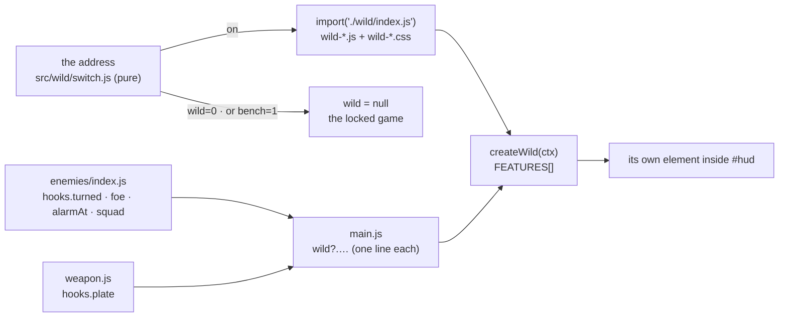

- **The switch** (`src/wild/switch.js`, `test/unit/wild-switch.test.mjs`): on unless the address says `wild=0`;
  never on the phone test page (`bench=1` measures the look). Until 18 November 2026 the player could turn it
  off on the title, and that was kept (`localStorage` `lodestar.wild.v1` = `0`); what is kept there is not read
  any more. It is the only piece of the wild build in the script everybody downloads, with the hooks below.
- **Which look.** Without the experiment exactly as it was (`look=2` asks for the second). With it, a desk is shown
  the second look unless the address says `look=1`; a phone keeps the first. The owner liked the second look each
  time it was shown; an experiment is where to find out whether it should be what a desk gets.
- **Off is the locked game.** Every place the game calls into the experiment is `wild?.…` on a `wild` that is
  null; every hook the machines have for it answers nothing; the three flags a machine can carry for it
  (`turned`, `piloted`, `carried`) are set by nothing else. What changed in the game's own files, all of it:
  - `main.js`: the switch and the fetch; `wild?.emit(…)` where things happen; two clocks in `frame()` (both 1
    without it); `wild.step` / `view` / `fov` / `frame` / `save` / `load` / `reset` / `screen` / `shot` / `grab`;
    `act` (what only main can do); `sendWave(c, again, turn)`.
  - `enemies/index.js`: `hooks.turned`, `hooks.foe`, `hooks.alarmAt`; `inner`; the three flags; since
    17 November 2026, `hooks.fired` (a round has been fired at the player: one line, after the shot's sound);
    and since the 18th, `hooks.squad` — a machine in a fight is offered a place in it before the game moves it
    as it always did (close in, back off, step aside; or go where the player was last known to be), and fires
    as it always did either way.
  - `weapon.js`: since 18 November 2026, `hooks.plate(struck)` — how much a round counts where it struck a
    machine. Answered with nothing, the machine's own figure stands (`test/wild/events.test.mjs` holds both
    seams: asked, obeyed, and without an answer the game as it was). The hub asks every feature with a word on
    it in turn, each told what the place counts so far (the visor, then the plating). And, the same day,
    `reset(rounds)` and `takeCache(rounds)`: how many times the table's rounds a mission starts with and a
    cache gives — one, unless `main.js` is told otherwise by `wild.plenty()` (Armour).
  - `input.js`: `intent.down` (keys held), `intent.hits` (keys pressed this frame), `input.poke(code)`.
  - `audio/audio.js`: `warp(k)` (how fast everything plays: 1), `extend({ sounds, loops })`; and, since
    17 November 2026, the three seams the wild build's sound goes through — `graph()` (the engine's clock and its
    three buses, once it runs), `setMix(mix)` (a mix is handed every voice as it starts and asked how far away a
    sound dulls), `setScore(score)` (a score told the scene instead of the game's own, which is then silent).
    Nothing in the game sets any of them (`test/wild/seams.test.mjs`).
  - `world/build.js`: `cascade.strain(k, t)`.
  - `ui/menus.js`, `ui/menus.css`: `on.screen(name, layer, data)`; `CONTROLS_ROWS` exported. (`.m-wild`, the
    switch on the title, was here until 18 November 2026.)
  - `ui/hud.js`: a turned machine's colour on the map.
- **The old suites are the locks of the locked game.** `test/helpers/harness.mjs` opens every page of theirs with
  `wild=0` — one place, said there, assertions untouched. The experiment's own suite (`test/wild`) writes its
  addresses itself. `npm test` runs it after the first suites and before the second look's, alone.

## 3. A feature

One thing the experiment adds. Its **rules** are a file with no drawing and no browser in it
(`src/wild/<name>.js`, held by `test/unit/wild-<name>.test.mjs`); a `create…(ctx)` joins them to the game and
returns an object — every member optional — that `src/wild/index.js` passes things on to. That file's header is
the contract, member by member; in short:

- `reset()` — a mission begins, or the title is shown: everything as it was built.
- `step(dt, own, intent)` — a step of the world in play: the world's seconds, the player's own, what is asked.
- `frame(real)` — every drawn frame, whatever the state of the game: what it shows.
- `on.{kill, spotted, alarm, found, hurt, hit, knife, lamp, emp, cache, charge, blast, beacon, phase, end, fired}` —
  things that happen in the game. (`fired(unit, { hit })`, since 17 November 2026: every round a machine fires
  at the player, and whether it struck — `test/wild/events.test.mjs`.)
- `shot(…)` — a round is flying: is something of this feature's in its way.
- `save()` / `load(state)` — what a checkpoint keeps.
- `chip()` — its piece of the bar at the foot of the screen.
- `pace`, `view`, `fov`, `grab`, `screen`, `turned`, `foe`, `alarmAt` — time, the eye, the menus, a phone's second
  button, the machines.

`ctx` is what `main.js` hands over (`G`, `ui`, `scene`, `params`, `store`, `act`) and what the features share:
`overlay` (their element), `tally` (counters for the debrief), `say(event)` (WARDEN), `note(text, tone)`.

**Moving a machine from outside** (a lodestone's pull, a pilot's hand): keep `unit.stunT` above nought — it then
does nothing of its own — and write `x`, `z` through `world/collide.js` `moveBody`, which never puts it in a wall.
A drone's height is its own flying's unless `unit.carried` is set. **Stopping one** is `enemies.stun(…)`, the
EMP's own; its `empX`, `empZ` may then be rewritten to say where what stopped it came from (the slide does).

**Loop contracts.** Every feature that runs over time says how it ends: in its section below.

## 4. The features

### Bent time — FOCUS and the REFLEX (`focus.js`, `focus-live.js`, `focus-sounds.js`)

For a moment you are faster than they are. The game has two clocks while this is at work: the **world's** —
machines, rounds in the air, doors, lamps coming back, the mission's own time, the exfil clock — and the
**player's own**: feet, hands, the gun, a grenade once thrown. Bent, the world's runs much slower than the
player's; the eye is turned by the hand on the mouse and by no clock, and is not slowed at all.

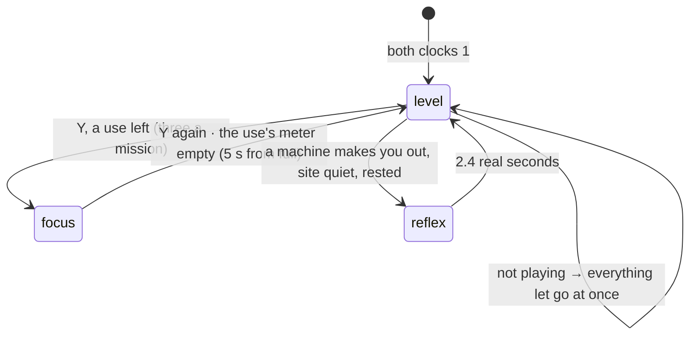

- **FOCUS** (`Y`, again to stop): the world at 0.3, the player at 0.55. **Three uses a mission** — the owner,
  17 November 2026: "also limit the number of focus and uplinks a use can do". A use begins with a full meter,
  which five seconds empties; stopped early, what was left of it is lost. Until that day the meter filled by
  itself and FOCUS could be had for ever; it no longer fills. What is done well while it is on puts time back on
  the use that is running, never over a full meter: a takedown by hand 30%, a head shot that kills 25%, any
  other kill with a gun in the hand 10%. With none left `Y` says NO FOCUS LEFT. The chip counts them (×3 … ×0)
  and shows the meter while a use runs; a checkpoint keeps the count; a mission begun again has three.
- **The REFLEX** is not asked for. When a machine makes you out **by itself** (not because you shot it) while
  the site is quiet, the world runs at 0.22 and the player at 0.6 for 2.4 real seconds — in which the machine
  that saw you has spent half a second of its own four on the way to calling the alarm. It is not a use and
  costs none; there is not another for 25 seconds from its start, and none while FOCUS is on.
- **What is seen and heard.** The edges of the picture go cold and close in, the view narrows by a twentieth,
  the chip at the foot of the screen says so; everything is played slower (to 0.62 at the hardest bend — far
  less than it runs, or a shot would be a groan), and a heart beats. Two sounds of its own (`focusIn`,
  `focusOut`): measured by the game's own checks, heard by nobody.
- **Loop contract.** The meter stays in 0 … 1 and belongs to one use: a use begins it at 1, it never fills by
  itself, and nothing of it is kept when the use ends; FOCUS cannot be asked for with no use left. A reflex
  ends by itself; both clocks
  stay between the hardest bend and 1 and are eased (rate 9 a second), never jumped — except that when the
  mission is not being played (paused: nothing runs at all; down, over: let go at once) nothing is bent.
- **Known, and left.** A grenade in the air and the knife are the player's (`weapon.update` takes the player's
  clock): bent, a thrown EMP crosses the room faster than the room runs. The frame in which a reflex begins is
  half bent: the player has already moved by the old clock when the machine's eye turns.
- **Tests.** `test/unit/wild-focus.test.mjs` (twelve: every number above, the meter's bounds, three uses and no
  fourth, that it does not fill by itself, what puts time back on a running use, the reflex's rest and that it
  is free, nothing bent when not playing); `test/wild/focus.test.mjs` (seven, in the built game: the two
  clocks measured against the real one, the key, the veil, the chip counting down, three real uses and a fourth
  refused; paused; the reflex from a real sighting, its rest, and that it still comes with no use left; a kill
  stretching a running use; a checkpoint keeping the count; a mission ending while time is bent).

### The uplink — a sentry turned, a drone flown (`uplink.js`, `uplink-live.js`, `pilot.js`, `pilot-live.js`)

The player carries a link into WARDEN's own net. Held on a machine in the sights it takes that machine; what
happens then depends on what the machine is.

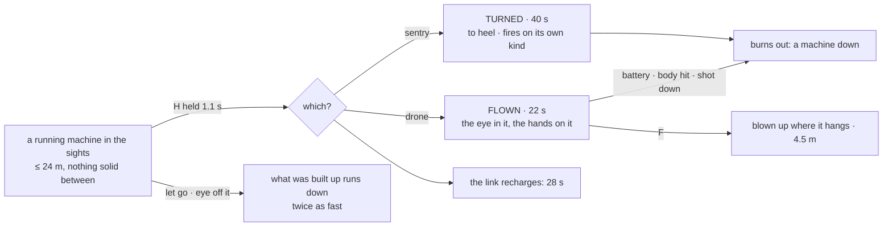

- **The hold.** `H`, held with a running machine in the sights (its hit volumes 2.2 times their size: the eye
  need not be exact) within 24 m and nothing solid between, for 1.1 seconds of the player's own clock. A ring
  round the crosshair fills, a tick is heard, quicker and higher. Let go — or the eye off the machine — and what
  was built up runs back down, twice as fast; the eye moved to another machine starts from nothing on that one.
  Not with a hand full (a shield, a wreck). Then the link recharges for 28 seconds, and a press meanwhile says so.
  **Three links a mission** (the owner, 17 November 2026: "also limit the number of focus and uplinks a use can
  do"): one is spent when a link completes — a sentry turned, a drone taken — not when a hold is let go. With
  none left the hold builds nothing and says UPLINK SPENT; the chip counts them (×3 … ×0); a checkpoint keeps
  the count. The overspeed, which is on the same key at the firing point, is not a link and costs none.
  On a phone the second contextual button says UPLINK when nothing else has a use for it, and one press holds
  for as long as the machine stays in the middle of the screen.
- **A sentry is turned** for 40 seconds. It is given a fresh mind (nothing of what it knew), the eye of a machine
  that is held (blue), and a place on the map in its own colour. It does not think for itself: `enemies/index.js`
  hands it to `hooks.turned` instead of stepping it. With one of its own kind in sight — the nearest running one
  within 30 m with a clear line — it turns on it and fires: bursts of three, 30 a round, three in four landing
  (four rounds are a sentry). With none, it comes to heel, 3.5 m from the player. Then it burns out: a machine
  down, counted on the roll like any other.
- **Its own kind do not know.** A loyal machine does not fire on a turned one until one of its own has fired on
  it: being hit puts it in a fight (as being hit always did), and a machine that is fighting and cannot see the
  player now asks `hooks.foe` whether there is a turned machine in sight to fight instead — and fights it where
  it stands, 14 a round, three in five landing. **The alarm it then calls names the turned machine**, not the
  player it never saw (`hooks.alarmAt`; without the experiment the alarm names the player, as it always did). It
  is a machine's alarm, and it counts.
- **And those that watch, do.** The owner, 17 November 2026: "once uplink fire is being used the alarm still
  should be triggered once other robots see that their friends are being fired at". Until then only a machine
  that had itself been hit answered; one of its own could be shot down beside it and it stood and watched. Now
  when a machine that is the player's — a turned sentry, a flown drone — fires on a loyal one, hit or miss,
  every loyal machine that is running, not stopped, within 1.3 times its own sight of the shooter or of the one
  fired at, and with a clear line to one of them, has seen it (`uplink.js` `witnessesOf`): it fights the
  shooter from then on, and **the site's alarm goes up no later than 2.5 seconds after the first shot that was
  seen** (the machines' clock), named at the shooter and counted once — provided one who saw it is still
  running then. The clock is started by the first shot and by no later one (`witnessed`). The burst is also
  heard 22 m off, so that machines with no line come to look. With nobody to see, no alarm comes of it. The
  alarm is heard — the stroke, the siren, Overwatch saying why ("They saw your machine fire on their own"), a
  line of WARDEN's and the public address. _Found in review:_ as first written this alarm was raised and counted
  and not sounded, and the 2.5 seconds began again whenever another of the player's machines fired; both were
  put right by the helper who wrote it, and the first is held by a test in which nothing but this rule can
  raise the alarm. The whole of it is `docs/WILD-uplink.md`.
- **What a turned machine is not.** Not a takedown's target, not a shield, not a finder of wrecks, not a contact
  on the compass, not the site waking up (its mind is a fresh one: `patrol`, awareness nought). It IS still on
  the roll — the site is not clear while it runs — and the player's own rounds still stop on it.
- **A drone is flown** (`pilot.js`): the eye goes into it, facing the way the player was looking; `W A S D` fly it
  at 7.5 m/s, `Space` and `C` lift and lower it at 3.6 (never under 1.95 m — what a drone flies over it must stay
  over — nor nearer a roof than 0.35 m, nor higher than 8.5 m in the open), the trigger fires its gun (16 a
  round, eight a second, 60 m), and `F` blows it up where it hangs: 90 at the middle falling to 25 at 4.5 m, on
  every machine with a clear line to it — and half that on the body, if it stands under it. The link lasts 22
  seconds; it ends at once if the body is hit, or the drone is shot down. However the link ends in play, the
  drone is done for; a mission that ends under it lets it go unharmed — a machine of WARDEN's again.
- **The body stands where it was left.** While the hands are on the drone the body is asked for nothing
  (`wild.step` hands `main.js` an idle intent for the player, the gun and whatever can be used); it can be seen,
  found and shot, and what it has in hand is not drawn. Night vision still works; so does FOCUS.
- **Loop contracts.** The hold: progress in 0 … 1, belonging to one machine, reaching 1 or running back to 0;
  nothing builds while recharging. A turned machine: 40 seconds, then dead — it never goes back. A flight: at
  most 22 seconds, one drone, ended by exactly one of five things (`blown`, `spent`, `hit`, `lost`, `over`); when
  a mission ends or begins again nothing is left flown, turned or hidden. (The review of 16 November found that
  last to be untrue of one case: a shot that kills the body lands after the experiment's step and before the
  mission's, so a death in the air always ended the flight as `over` — which left the drone the player's for the
  million seconds a flight gives it, fighting on over the body. Whatever ends a flight now takes that off it.)
- **Tests.** `test/unit/wild-uplink.test.mjs` (fifteen: the hold, the run-down, the recharge and its one word a
  press, a new machine in the sights, whom a turned machine fires on and whom a loyal one fires back at; three
  links and no fourth; who is a witness — by range, by line, loyal, running, not stopped, the one fired at
  always — and that a second shooter neither starts the clock again nor renames the alarm);
  `test/unit/wild-pilot.test.mjs` (eight: the flight by the hand, at any frame rate; how high; the gun's and the
  blast's numbers); `test/wild/uplink.test.mjs` (ten, in the built game: the real key on a real machine — too
  short, long enough, recharging; three links, a fourth refused, the chip counting down; a turned sentry among
  its own kind, their answer, and the alarm naming IT, fifteen metres and more from a player nobody saw; to
  heel, and burnt out after forty seconds; a mission begun again, and a checkpoint keeping the count; a
  watcher with its back to the fight calling the alarm inside 2.5 s though never fired at; the same when the
  one fired at dies of the first hit; **that alarm heard**, staged so that no machine could have called it
  itself; nobody with a line, and no alarm in six seconds; the flown drone's gun seen the same way);
  `test/wild/pilot.test.mjs` (three: the real key on a real drone, the eye, the body, W, Space, C, a wall;
  its gun and its end by F; the link dropped by a hit, by the battery, by a mission ending or beginning again —
  and a mission ending under a flight that had not dropped, which leaves the drone nobody's but WARDEN's).

### The overspeed — the cascades brought down from the control room (`overspeed.js`, `overspeed-live.js`, `overspeed-sounds.js`)

The other way to do what the mission is for. A centrifuge is a rotor turning at the edge of what its metal will
bear; the drives that turn it are told how fast by the control room, and the uplink can tell them something
else. Fiction, like everything in the game: nothing here is how any real facility is worked or broken.

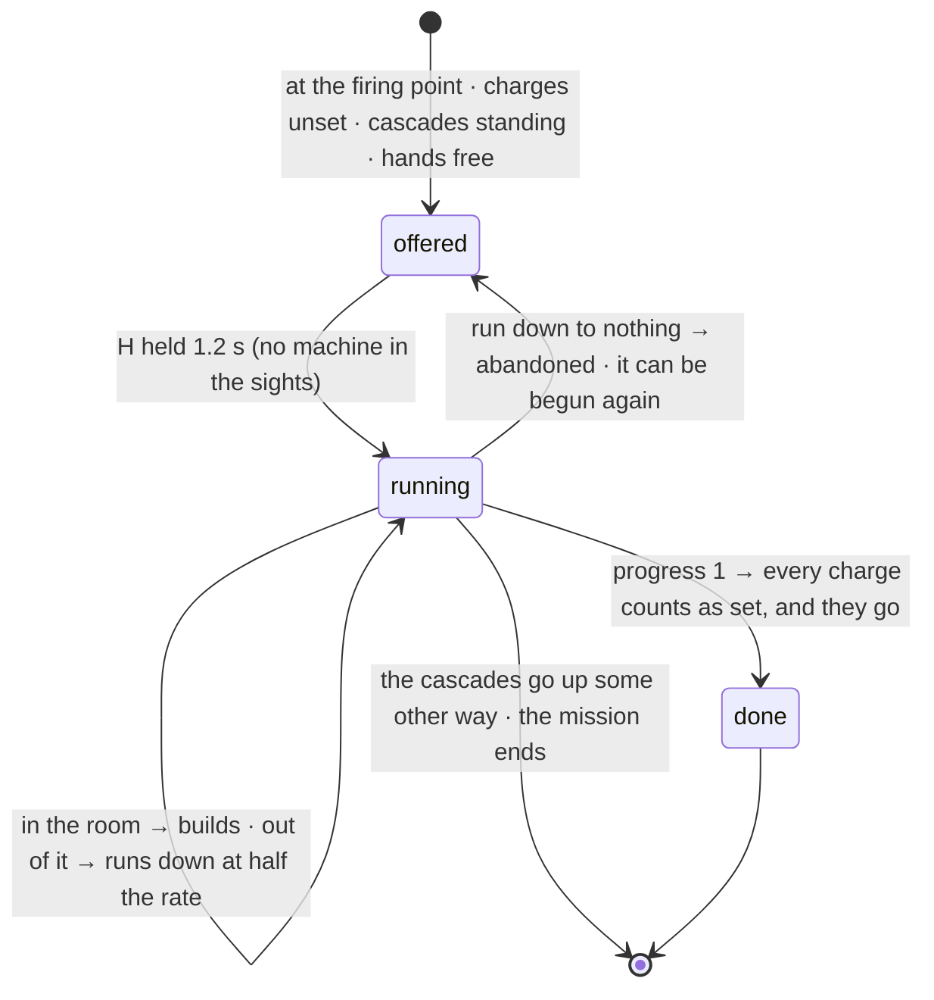

- **Where and when.** At the firing point in the control room (the same metre and a half the detonator is fired
  from), while there is still a charge unset and the cascades stand. `H`, held for 1.2 seconds — with a machine
  in the sights it is the uplink that is meant, and the overspeed waits. On a phone the second contextual
  button says OVERSPEED there. With all four charges set it is not offered: `F` fires them, as always.
- **What it costs.** The room must be held: 32 seconds with no charge set, six fewer for each one that is (never
  fewer than ten) — within seven metres of the firing point, and alive. Out of the room it runs back down, at
  half the rate it builds; back in, it builds again from where it is. Run all the way down, it is abandoned and
  can be begun again from nothing.
- **What the site does about it.** WARDEN feels it at once: the site's own alarm, as a charge raises it (not a
  machine's: it is not counted against the grade), and three waves of machines sent to the firing point — at
  12%, 45% and 78% — by the same sending a charge set by hand has (`sendWave`). At 50% the drives pull the
  hall's own lamps down, for as long as an EMP would.
- **What is seen and heard.** A bar across the top: the drives in turns a second, 1 064 climbing to 1 410, how
  far along, how many seconds are left — or that it is running down. In the hall the skins are seen to turn up
  to six times as fast, and from a quarter of the way the casings shake in their seats and glow
  (`cascade.strain` in `world/build.js`: the casings' own matrices and their own emissive, put back exactly when
  it is let go). The hall's hum climbs; a whine of the drives' own (`overspeedWhine`, a loop) climbs over it.
- **Its end is the game's own.** At 1 every charge counts as set and they go: from there it is the blast, the
  checkpoint, the exfil and the debrief the game always had (`act.bringDown()` is the path a test's
  `debug.rig` + `debug.blow` takes). **It replaces the charges — the walk into the hall, four times — and not
  the fight**: the machines still have to be dealt with, and more of them come.
- **Loop contract.** Progress stays in 0 … 1; a run ends in exactly one of two ways (done, once a mission; or
  abandoned, after which another can begin) unless the mission itself ends under it or the cascades go up some
  other way — then nothing runs. Each thing on the way (three waves, the dark) happens once a run. Every casing
  stands as it was built whenever nothing is running.
- **Tests.** `test/unit/wild-overspeed.test.mjs` (seven: how long, by charges set; each mark once and at its
  place; the run-down and the return; abandoned and begun again; the bounds at any frame rate; the pitch, the
  turning and the shaking growing with it); `test/wild/overspeed.test.mjs` (four, in the built game: the real key
  at the real firing point through to the blast with no charge set by hand — the alarm, the waves, the dark, the
  bar; the skins measured turning faster, the room left and the casings back as built; charges already set, and
  not offered with all four; a mission ending or beginning again while it runs).

### WARDEN speaks (`warden.js`, `warden-live.js`)

Until now WARDEN was a name in the briefing and a word in Overwatch's mouth. The experiment gives the player its
machines to wear and its drives to break, and it is not a thing that would say nothing.

- **What it is.** Twenty-seven things that can happen, each with one to three lines (`LINES` in `warden.js`, 35
  in all): the
  alarm, a wreck found, the third lamp shot out, a charge set, the lodestar raised, the player badly hurt (under
  35), three machines or fewer left — and everything the experiment does to it: a machine turned and burnt out,
  one of its own seen fired on by a turned one, a drone flown, blown up or lost, a tripwire, a lodestone, a
  sentry staggered, the reflex, the first aftershock, the overspeed from its beginning to either of its
  ends — and, since 18 November 2026, a wave sent ("The site answers") and a visor cracked ("Visors").
- **How it speaks.** On the radio line the game already has, under its own name, in its own colour (red, where
  Overwatch is the HUD's) — and, since 17 November 2026, **aloud** ("Voices", below): the sentry's blare an
  octave down that was all of its voice is now only the line opening. Each line once a mission, in order.
- **It does not chatter.** Six seconds of the mission between two things it says; a thing that happens inside
  that goes unsaid and its line is kept for the next time it happens. Two are said whatever came before: the
  last word of the overspeed, and what it says when it is over.
- **Whose business it is.** A feature says `ctx.say(event)` and knows nothing more; with WARDEN not built that
  is a no-op. The game's own happenings reach it through the `on` hooks, like any feature's.
- **Loop contract.** None runs: it is asked, and answers or does not. A new mission is a new WARDEN, and what it
  said in the last one is taken off the screen.
- **Tests.** `test/unit/wild-warden.test.mjs` (five: each thing's lines in order and none twice; the six
  seconds, and that a line unsaid is not saved up; the two that are always said; a new mission; every line a
  short sentence that shouts nothing); `test/wild/warden.test.mjs` (four, in the built game: the alarm said on
  the radio in its colour, and counted; a machine really raising the alarm, and Overwatch's lines beside
  WARDEN's staying Overwatch's — the case the review found the first test claimed and could not have failed;
  two things inside six seconds; a machine turned, a drone flown, the third lamp — and a new mission starting
  clean).

### The slide (`slide.js`, `slide-live.js`, `slide-sounds.js`)

Crouch asked for at a run used to do nothing (a run stands you up). Now the body drops and is carried on.

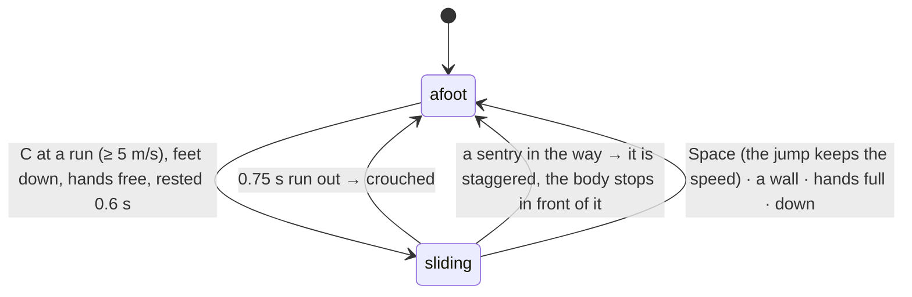

- **The slide.** `C` (or the phone's CROUCH) at a run: 0.75 seconds of the player's own clock, from 8.8 m/s let
  run off to 3.2 — a little over five metres — the way the body was going. It cannot be steered or stopped; the
  eye and the gun are free. The eye goes a quarter of a metre lower than a crouch, the view widens by a
  twentieth, and it is heard six metres off (a walk is 3.5, a run 9). It ends in a crouch — which a run still
  held stands up out of, as it always did. `Space` jumps out of it and keeps its speed.
- **A sentry in the way** — within a metre and ahead, not the player's own, not already stopped — is
  **staggered**: stopped for 2.5 seconds exactly as an EMP stops one (`enemies.stun`: it does nothing, it spits
  sparks, and it can be shut down by hand **from any side**), and shoved 0.6 m on. The body stops there, in
  front of it, with no speed left: `F` is offered at once. When the machine comes round it looks to where that
  came from. Nothing is harmed by the slide itself; a drone is flown over, and passed under.
- **The body's side of it** is one member in `src/player.js`: `slide`, `{ vx, vz }` — while it is set the body is
  carried at that, whatever is asked of it, and takes no steps. Nothing in the game sets it
  (`test/unit/player.test.mjs` holds both halves). Everything else — when, how fast, what is met — is here.
- **Loop contract.** A slide lasts at most 0.75 s and ends by exactly one of: run out, a sentry met, the feet off
  the ground, a wall (under 35% of the speed it should have), a hand filled, the player down or flying a drone.
  Another cannot begin for 0.6 s. A mission beginning again leaves nothing carried.
- **Known, and left.** There is no animation of a machine going over: it is staggered where it stands. The
  player's body has never been stopped by a machine's (nothing in the game does that), so a slide that began
  inside a metre of a sentry and to one side of it passes it.
- **Tests.** `test/unit/wild-slide.test.mjs` (five: the speed from first to last, the length, when it can begin,
  what is in the way, the numbers); `test/unit/player.test.mjs` (one: a carried body goes where it is carried,
  takes no steps, is stopped by a wall, and is its own again); `test/wild/slide.test.mjs` (five, in the built
  game with real key events: the slide measured frame by frame; a sentry staggered, helpless from the front,
  shoved, the body stopped, WARDEN's word, `F` shutting it down, and one beside the line only hearing it; the
  jump out; a walk only crouches; and with the experiment off, nothing).

### Threads of light — tripwires (`tripwires.js`, `tripwires-live.js`)

WARDEN's own sensors: a thin red thread of light across a doorway or a corridor, at one of two heights. Not an
obstacle — a question the site asks of the player's body. Built by a helper on a branch of its own
(`wild-tripwires`, b8cf779) and merged; read, run and adapted by the lead.

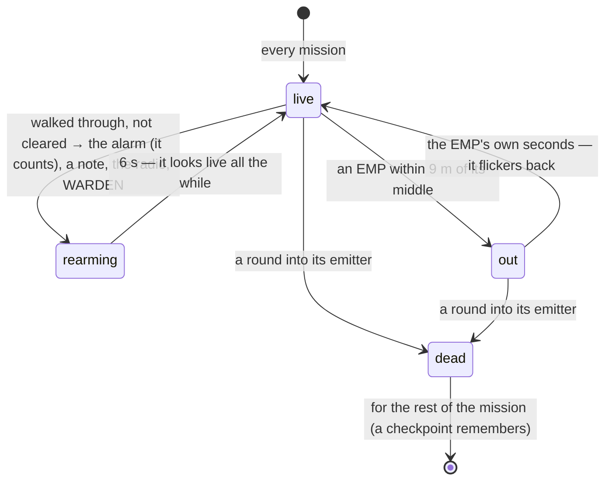

- **Two heights.** A LOW thread (0.45 m) is passed by jumping it — the feet above it as the body crosses. A HIGH
  one (1.35 m) is passed by going under it crouched — and so by the slide, which is a crouch. Where there is one
  of each on the same line (the lobby's front door) no posture passes both: one must be put out.
- **Where.** Seven places, eight threads, each from solid to solid across bare floor and none within 12 m of
  where the mission starts: the service corridor at x = 57.5 (low) and at x = 73.5 (high); the passage between
  the control room and the switchgear (low); the door from the service corridor into the cascade hall (high);
  the door between the hall and the feed room (low); the north passage (high); the lobby's front door (the
  pair). The unit test proves each against the site the mission really builds — which is how it was found that
  the coordinates the lead first wrote down were one row out — and that with every pair walled up the start,
  the four cascades, the firing point, the pad and the pickup can still all be reached.
- **Putting one out.** A round into its emitter — a small box on the wall at one end, at the thread's height —
  puts it out for the mission, and is heard eight metres off. An EMP within nine metres puts it out for as long
  as the EMP lasts. Night vision shows the threads brightly; to the bare eye they are faint.
- **What a trip does.** The site's alarm at the thread's middle, counted against the grade as a machine's is;
  TRIPWIRE under the crosshair; Overwatch naming the place; WARDEN's word; the debrief's count. And, since
  18 November 2026, the first time a doorway's thread is broken, a wave of machines for it — Overwatch says who
  is coming in the same line ("The site answers", below).
- **What never trips one.** Machines (they walk through); a body that is hidden, down, or not being played; a
  step of more than three metres (a test's teleport, not a walk); a thread that is out, dead or re-arming.
- **Loop contract.** A thread is live, re-arming, out or dead and nothing else; re-arming and out end by
  themselves; dead ends only with the mission. A new mission makes every one live.
- **Known, and left.** An emitter can be hit only from inside the passage its thread crosses (a round carries
  0.15 m past the face it strikes, as it does for a lamp). The "point of light" on an emitter is its own glow:
  nothing in the game adds a real light, and this does not either. Nothing watches the flicker itself.
- **Tests.** `test/unit/wild-tripwires.test.mjs` (32: what is a crossing and what is not; what clears each
  height, and that nothing clears a pair; the ray on an emitter; every placement against the real grid; the
  route proof; the clocks; the teleport guard; an EMP's reach; a checkpoint); `test/wild/tripwires.test.mjs`
  (eleven, in the built game: a walk through a low thread — alarm, count, note, Overwatch naming the place,
  WARDEN's word; held above it, nothing; a real jump at a walk clears it; the slide goes under a high one;
  crouched under a high one and standing through it; a real round into an emitter, and a checkpoint keeping it
  dead; an EMP and its clock; a hidden body; nothing at all with the experiment off; the second look).

### The lodestone — a thrown magnet (`lodestone.js`, `lodestone-live.js`, `lodestone-sounds.js`)

Machines are iron. A lodestone is a fist of magnet thrown with `4` (on a phone: LODE): it sticks where it
lands, drags every machine it can reach to itself, holds them, and crushes them. Where the EMP stops machines
and harms none, this kills what it holds.

**Rebuilt on 17 November 2026** — the owner, of the one shipped the day before: "the lodge stone doesn't seem to
do anything fix it". He was right, and the suite that passed it was the reason nobody knew: it staged machines
two metres from a stone thrown at the player's own feet. Thrown the way a player throws it — at the gate pair
where the mission puts them, at three sentries nine metres off, up an aisle of the hall — the old stone bounced
off a crate and rolled away, let a crate's height hide half a pair from it (its line began 0.3 m off the floor),
flew five metres past what it was thrown at, and at its best took 40 from machines that have 100. Nothing died
in any of it. **The whole design, its numbers, its loop contract and what each test proves are
`docs/WILD-lodestone.md`**; in short:

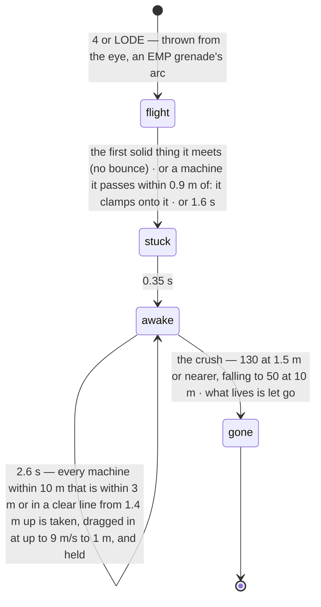

- **Never taken:** the machine in the player's arms, a drone the player is flying, a sentry the player has
  turned, a wreck. Cover lower than about 1.3 m hides nothing from it; a wall still does. **And one it holds
  already that the player then flies or turns is let go of at once** — not held, not stopped, not crushed.
  _Found in review:_ it went on holding such a machine; the crush hurt the very drone the player was flying,
  and a sentry turned in its grip stood stopped with its forty seconds not running until it was crushed (a
  test that gave the drone 500 of health "because the crush is not what is asked about" had hidden the first).
- **Told:** `LODESTONE — 3 HELD` half a second after it wakes (or `NOTHING IN REACH`), `3 CRUSHED` when it goes;
  tethers of light to what it holds; counted at the mission's end.
- **Checked by the lead, apart from its own suite:** the four throws that found the fault
  (`.work/v10/lodestone-repro.mjs`, a scratch script) against the merged build — the gate pair two ways, three
  in the open, a sentry ten metres up the hall's middle aisle: every machine thrown at was held and died. (The
  fourth throw as first written was the lead's mistake — aimed into a block of casings, not up an aisle — and
  the helper who rebuilt the lodestone found it.)
- **Known, and left.** It wakes at the latest 1.95 s after leaving the hand (1.6 s of flight and the 0.35 s),
  not 1.6 s. Its three sounds are the old ones. Nobody has played it.
- **Tests.** `test/unit/wild-lodestone.test.mjs` (40) and `test/wild/lodestone.test.mjs` (15, every throw made
  as a player makes it, at the mission's own machines where it puts them); `test/wild/dress.test.mjs` holds the
  phone's LODE button clear of every other at four shapes of phone, and throws one with a real touch.

### The body, seen from outside (`operator.js`, `operator-live.js`)

The owner, 17 November 2026: "when a drone fpv is flying we can't see the chrachter of the player". While a
drone is flown the eye is the drone's, and where the player stood there was nothing. Now there is the player: a
figure of 952 triangles — helmet, carrier, pack, carbine, the uplink's antenna and its slate, both glowing —
standing where the body was left, facing as it faced, crouched if it was, lit by the place it stands in. It is
drawn while a drone is flown and at no other time (`ctx.flying`), however the link ends. It is not drawn in the
second look's mirrors. **The whole design is `docs/WILD-operator.md`.** Tests: `test/unit/wild-operator.test.mjs`
(7: its size, its triangles, its parts, which way it faces, that every part of it takes the site's light),
`test/wild/operator.test.mjs` (5: it follows the body; it goes however the link ends and a mission begun again
leaves one, hidden; and from the drone's own eye seven metres off the picture with it and the picture without
differ in one patch where it stands, in both looks). **Not done:** on a phone a flown drone still cannot be made
to climb, dive or blow itself up — there are no buttons for it, as there were none in the build that was liked.

### The room in the sound (`mix.js`, `mix-live.js`)

Until 17 November 2026 a shot in the cavern and a shot in a corridor were the same buffer at the same level:
every sound carried its own short tail and was nowhere. Now what happens in the site is heard IN it.

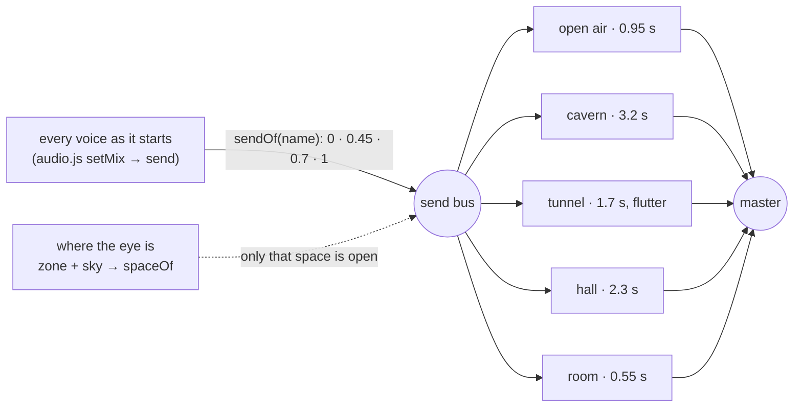

- **Five spaces.** Under the sky: the open air. The main cavern and the shaft cavern: the cavern. The adit and the
  road tunnel: a tunnel. The cascade hall, the loading dock and the drone bay: a hall. Everything else: a room. A
  space is what it answers to one click (`impulse`): noise that dies away over its `decay` and darkens as it
  dies, a few single reflections standing out of its beginning, in a tunnel the flutter of two facing walls
  (46 ms apart), and nothing before `pre` — the nearest wall is that far. Each answer holds exactly the click's
  energy, so one number (`wet`: 0.16 … 0.5) says how loud a space is. Built once, when sound first runs.
- **Which space** is the one the EYE is in (the drone's, when one is flown); walking from one into the next they
  give way to each other over about half a second.
- **What is sent round it.** Everything that happens in the site, by how much it would fill a space: a blast, a
  machine's gun, the alarm all of it; most things 0.7; a footstep, a casing, a magazine 0.45. **Not:** the menus,
  the radio in the ear, the heart and the hurt, the goggles, bent time — and the beds (wind, hum, the hall's
  whir), which are the room already.
- **Far off is duller**, as well as quieter (`cutAt`): nothing is cut within a sixth of how far a sound
  carries; at the edge of its reach only what is under about 2.4 kHz is left. Behind something solid it is cut
  at 700 Hz, as it always was.
- **It goes through the seams** (`audio.js` `graph`, `setMix`) and nothing else: with the switch off no mix is
  set and the engine is the one it was.
- **Known, and left.** One space at a time, the listener's: a shot fired in the hall and heard from the corridor
  rings like the corridor. Nothing is worked out from the shape of the rooms. Nobody has heard it.
- **Tests.** `test/unit/wild-mix.test.mjs` (six: every place of the site is one of the five; each space rings
  for the time it is given, in the order of their size, measured the way a room is; an answer is the same every
  time, finite, different in each ear, a click's energy, and silent before its first reflection; the tunnel's
  flutter; what is sent and what is not; the dulling by distance); `test/wild/mix.test.mjs` (four, with sound
  running in the built game: the space follows the eye through five real places; three menu sounds send
  nothing, two site sounds send; the game's own carbine shot laid through each space — a second on it is within
  30 dB of itself in the cavern and more than 70 dB down in a room; with the switch off nothing is set).

### Music a scene (`music.js`, `music-live.js`, `music/*.mp3`)

The owner, 17 November 2026: "music more appropriate and wild per scene". The game's own score (`audio/score.js`)
is one tune written out in notes and played by oscillators, thinner or louder by mood. With the switch on, eight
pieces of music take its place — one a scene, fetched when its scene first comes.

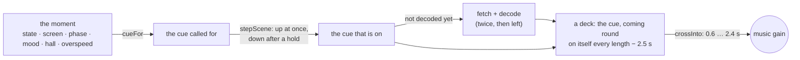

- **Which cue** (`cueFor`): on a mission the run out is over everything, then the drives being pushed, then a
  fight, then wariness, then — nothing being wrong — the cascade hall's own quiet or the site's. The title has
  one; the ending and the debrief share one; a lost mission goes back to the title's. Paused and dying say
  nothing: what is playing plays on (under a pause at 0.45 of itself).
- **Up at once, down after a hold** (`stepScene`): a fight's music holds 7 s after the fight is over and
  wariness's 5 s, so a machine that loses and finds the player does not chop the music about. Anything that is
  not on that ladder (the run out, the title, the ending) is at once.
- **How one gives way** (`crossInto`): the fight comes in over 0.6 s, the run out and the overspeed over 0.9 s,
  wariness over 1.4 s, quiet over 2.4 s.
- **A cue comes round on itself** by its next playing being laid over the last 2.5 s of the one before
  (`MUSIC.loop`), each scheduled 0.4 s before it is due. Loop contract: entered when a cue is on; each round
  starts one playing and lets the one before it end; ends when another cue is on or the game is reset; there is
  never nothing sounding and never more than two playings of one cue; a playing that is over is taken out of
  the engine's graph (found in review: they were being left connected, one more each time a cue came round).
- **Fetched, not bundled.** Each cue is `src/wild/music/<name>.mp3` (seventy-odd seconds, 96 or 112 kbps,
  0.8–1.0 MB; 7.4 MB all eight), fetched and decoded the first time it is called for, and what is likely next
  ahead of its time (on the title: the site's quiet; on a mission: wariness and the fight). Decoded, a cue is
  some twenty megabytes, so only the one playing, the one wanted and two more are kept (`MUSIC.keep`). A cue
  that cannot be had is asked for twice and then left: what was playing plays on. Until the first cue sounds the
  game's own score is the score; from then on it is told nothing (`audio.js` `setScore`). `?music=0` leaves the
  game's own score in place.
- **Where they came from.** `tools/sound/music.mjs` asked a music model (`lyria-3.5`) for two or three takes of
  each (what was asked: `tools/sound/manifest.json`); each take was measured (onsets a second, tempo, loudness)
  and described blind by a model that listens; `tools/sound/cut.mjs` cut the chosen ones to a common loudness
  (the quiet ones −24 … −21 LUFS, the fight −17, the run out −16.5). Two were not used for what they were asked
  as: the cue called `tense` is a take asked for as the site's quiet (it had a beat; the takes asked for as
  wariness had none), and `end` is a take asked for as the title (slow, strings and brass).
- **Known, and left.** No person has heard any of it: the choices rest on measurement and on a listening model
  which, in its cheaper form, described the same file differently twice and preferred whichever of two it
  heard second (only choices that survived being asked in the other order were kept; the dearer model agreed
  with itself). Fetching and decoding mid-game is in the suites for Chromium only; `tools/webkit-smoke.mjs` does
  the same in Playwright's WebKit (17 November 2026, WebKit 26.6, at a desk's shape and an emulated iPhone's:
  every cue and every clip was decoded and played, nothing logged) — which is Safari's engine on a Mac, not a
  real iPhone. The cues do not follow the bar: one gives way to the next wherever it happens to be.
- **Tests.** `test/unit/wild-music.test.mjs` (six: the cue for every state the game has; the ladder and its
  holds; what is at once; the crossings; every cue has a file). `test/wild/music.test.mjs` (five, with sound
  running in the built game: the title's music is fetched, played and the game's score handed over, the
  mission's comes in and the fight's is ready before it is needed; the alarm brings the fight in inside 1.5 s,
  the hall has its own, the run out is over everything, and no more than three are kept decoded; a cue comes
  round with never fewer than one nor more than two playings; a missing file is asked for twice and left with
  nothing thrown; with the switch off or `?music=0` no music is fetched).

### Voices (`voice.js`, `voice-live.js`, `voice/*/*.mp3`)

The owner, 17 November 2026: "make the sound wild and more elaborate and realistic". Until then nothing in this
game had a voice: WARDEN's lines were read off the radio to the blare of a sentry. Now two things in the
mountain speak aloud.

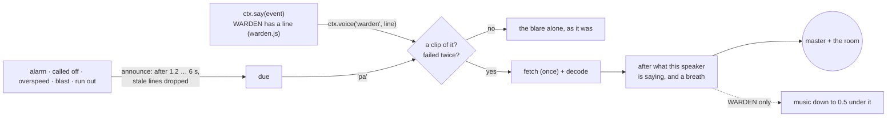

- **WARDEN** says every line it has (`warden.js`, 35) as the line is put on the radio. The blare under it is
  turned down to the line opening (0.14 for 0.45) when there is a clip to be heard, and is all of its voice, as
  it was, when there is not. The music gives way under it (to half) and comes back when it has spoken.
- **The public address** is a recording, made long ago for people who are no longer there, that still reads
  its alerts out to empty halls (`voice.js` `SPOKEN.pa`, six lines): the alarm (two lines, by turns), the alarm
  called off, the drives pushed, the cascades gone, the run out. It watches the alarm itself (`enemies.alarm`),
  not the word a machine's alarm sends round: whatever raised it — a machine, a charge, a tripwire, one of its
  own seen fired on — is read out. It waits its turn (`ADDRESS`: 2.6 s after the
  alarm, so that the siren and WARDEN come first; 6 s into the run out) and does not say what has gone stale
  (an alarm called off before it was read out; any alert once the hall is gone).
- **A speaker never talks over itself**: a line waits for the one before it and a breath (0.35 s). The two
  speakers may be heard together — one is in your ear, the other is the building.
- **Where they are heard.** Both go to the engine's master and round the room the listener stands in (`mix-live`
  `send`): WARDEN a little (0.3), the address all of it (1) — it IS the room. Levels were set by measurement,
  not by ear (`VOICE.level`): WARDEN's loudest 0.4 s is −16 dBFS, the siren as the game plays it −22, the
  address −21.
- **Fetched when first said**, one clip a line (1.2 … 6.5 s, 8–33 kB, 0.81 MB all 41), kept as it was fetched
  and decoded each time it is said. A clip that cannot be had is asked for twice and then left; a line with no
  clip is only on the radio. A line asked for in one mission is not said into the next. `?voice=0`: nothing is
  said or fetched.
- **Where they came from.** `tools/sound/voice.mjs` has a speech model (`gemini-3.8-flash-tts`; WARDEN the
  voice "Charon", the address "Kore") say each line, gives it its colour with ffmpeg (WARDEN: a tenth lower, a
  short doubled echo, more bass; the address: a loudspeaker's narrow band, squeezed, a slap of echo), and has a
  model that listens write down the words it hears in the finished clip. A clip is kept only if those are the
  line's words; what was heard is kept beside it (`voice/<who>/lines.json`) and `test/unit/wild-voice.test.mjs`
  holds the two together — **a line that is reworded fails that test until its clip is made again.** No manner
  is asked for by default: asked "[cold, menacing] …" this model read the direction out about every other time
  (and "Say coldly: …" every time), and read one and a half to two times as slowly when it did not. Two lines
  are asked for with one ("Please." pleading; "Nine years." quiet, tired) and tried again when it is read out.
- **Known, and left.** No person has heard any of it. That the words are right is checked by a model; that
  WARDEN sounds like the mind of a mountain and not like a man reading is not checked by anything — asked how
  the speaker sounds, the dearer listening model says a man ("calm", "angry and demanding", "deep, resonant and
  commanding", "weary"), the cheaper one "a gravelly, menacing, robotic villain". A second voice a fourth
  under the first was tried and left out: it changed nothing for the dearer model and made the cheaper one say
  "monstrous creature", which WARDEN is not. The address is heard as what it is ("an urgent, authoritative
  security announcement over a PA system"). Overwatch
  has no voice: most of its lines are put together as they are said (bearings, counts, seconds), and half a
  voice is worse than none. Fetching and decoding mid-game: as for the music — Chromium in the suites, WebKit by
  `tools/webkit-smoke.mjs`, never a real iPhone.
- **Tests.** `test/unit/wild-voice.test.mjs` (six: the address waits its turn, says its lines by turns, drops
  what is stale, names only lines it has; every line has a clip made from the words it has now and heard as
  them; no clip is longer than the six seconds WARDEN keeps silent after speaking, and all are under 1.2 MB).
  `test/wild/voice.test.mjs` (six, with sound running in the built game: the alarm — the line on the radio,
  said, the music down under it and back, then the address, then called off, then its other line; WARDEN's
  line for the wave an alarm brings, said after the alarm's; two lines at
  once are said one after the other and a new mission cuts both off; a missing clip is asked for twice and
  left, the line still on the radio; every clip is in the build and decodes to the length it was made;
  with `?voice=0` nothing is fetched).
- **Suites that read the radio by the second run without the waves** (18 November 2026). An alarm, a wire or a
  task now brings a wave, whose note comes two and a half seconds later and WARDEN's line eight. A test that
  lists exactly what was said, or reads the last line a moment after, was racing that — two of them lost,
  once each, on a machine under load. The pages of `warden`, `tripwires`, `events` and `squad`, and the alarm
  test of `voice`, carry `response=0`; what a wave says is asked in `response.test.mjs` and in the voice
  suite's test of its own.

### Sounds made again (`pack-a-live.js`, `pack/guns.js`, `pack/impacts.js`, `pack/helpers.js`)

The owner, 17 November 2026: "make the sound wild and more elaborate and realistic". Every sound of this game is
made by a program, and until that night had been checked only by what a program can measure: nobody had heard
one. That night a model that takes sound in was asked, blind, what each is (`tools/sound/render.mjs`,
`listen.mjs`), and the answers were the first news anyone had: the carbine "a bullet passing close by", the
shotgun "a deep muffled explosion in the distance", a step on concrete "an electronic alarm", a round on steel
"a firearm being cocked".

- **How they were made again.** A helper to a family of sounds; each recipe built on what the thing is (a shot:
  a spike of noise under 3 ms, a body that is noise and not a note, the gun's own metal 15–60 ms later, the room
  it is fired in — never a sine that slides, which is what a laser is); rendered, listened to blind, changed,
  listened to again, four tries at most. A sound was to go in only if it was heard as the right thing and 7 of
  10 convincing — or, its tries used up, if it at least beat the one it would replace.
- **Two listeners, and the rule between them.** The cheaper model (`gemini-3.8-flash`) made the helpers'
  verdicts. At the merge the dearer one (`gemini-pro-latest`) heard the old and the new of every sound, blind,
  and the rule was written down before its verdicts were in: the new is kept if the dearer model finds it no
  less convincing than the old, or hears it as the right thing where the old was not; otherwise the game's own
  stays. Where the two disagree the game's own stays.
- **In the game: nine** (`PACK_A`; cheaper model old → new, then dearer model old → new; ✓ is the right thing):
  - `shot`, the carbine — "a bullet passing close by" 5 → "gunshot, suppressed" ✓ 3; "bullet impact on
    concrete" 5 → "gunshot, unsuppressed" 6.
  - `shotgunShot` — "a deep, muffled explosion" 2 → "gunshot, unsuppressed" ✓ 5; "user interface click" 4 →
    "bullet impact or ricochet on metal" 4.
  - `dry` — "shell casing" 2 → (wrong) 7; "shell casing" 6 → "user interface click" 6.
  - `reloadIn` — "user interface click" 6 → "gun handling" ✓ 6; "bleep" 5 → "noise burst" 5.
  - `boltRack` — "a bullet passing close by" 5 → "heavy machine footstep" 7; "gunshot" 5 → "bleep" 5.
  - `shotgunPump` — "footstep" 4 → "electric zap" 6; "user interface click" 3 → "gun handling" ✓ 5.
  - `weaponSwap` — not heard by the cheaper model; "user interface click" 6 → "gun handling" ✓ 6.
  - `hitMetal` — "a firearm being cocked" 2 → "bullet impact on concrete" 6; "bleep" 6 → "gun handling" 6.
  - `lampBreak` — "gun handling" 3 → "knife or blade" 5; "bleep" 4 → "bleep" 5.
- **Made, and not in the game.** `pistolShot`, `shotSentry`, `shotDrone`, `knifeHit`: better to the cheaper
  model (the sentry's gun 4 → 6 and right), worse to the dearer (the sentry's gun 5 and right → "a synthetic
  bleep" 3) — the recipes are still in `pack/guns.js` and `impacts.js`, for whoever takes them further. Three
  sounds the game never had — a casing landing, a round going by, a ricochet — were heard by the dearer model
  as "a bleep" 4, "a user interface click" 5 and "gun handling" 5, and were taken out with their wiring.
  (The game still tells the wild build of every round a machine fires, `on.fired`: nothing listens to it yet.)
  Seven the helper itself left as they were (`reloadOut`, `magSlide`, `shellIn`, `selector`, `hitMachine`,
  `hitWall`, `knifeSwing`); the seven blasts (`explosion` … `detonator`) were not begun.
- **Pack B — steps, the machines' voices, doors, the alarm, the beds — is not merged.** Thirty sounds were
  written and pass every measurement; eleven were heard once by the cheaper model and none was taken for what it
  is (a step on concrete: "a giant robot's stomp"); the dearer model, on eighteen of them, found none better
  than what it would replace (a step on dirt: the game's own "footstep" ✓ 8, the new one 6). The helper shipped
  it switched off, which was right; the lead left it out of the game altogether rather than carry two thousand
  lines nothing plays. It is the branch `wild-sound-b`.
- **What this says, plainly.** No sound of this game is 7 of 10 to either listener; the best are 6. An evening
  of making them again moved four or five of them and left the rest where they were, and the two listeners
  disagree with each other about as often as they agree. Noise and oscillators have a ceiling here that was not
  broken; **recordings would break it** — and none was brought in, because whose they are is the owner's to
  decide. What did change what is heard is elsewhere: the room (above), the music, the voices.
- **Measured on the way.** Where a sound's energy is does not depend on a listener. The old shotgun was 81%
  under 60 Hz — on a laptop or a phone all but silent — and the new one has 73% of it between 150 and 1000 Hz;
  the old round on steel was 99% in one band, which is what a bleep is, and the new is spread over four; the
  old carbine was two-thirds a thump at 60–150 Hz with 2% over 4 kHz, the new has a crack (13% over 4 kHz) on a
  body. And the game's own `explosion` is nine-tenths under 60 Hz: on a laptop or a phone it is
  a click and a hiss. Nothing was done about it this round.
- **Where the verdicts are.** `docs/WILD-sound-a.md` (the helper's own account of pack A, try by try);
  `docs/sound/pack-a.second-listener.json`, `pack-b.second-listener.json` (the dearer model's, word for word).
- **Tests.** `test/wild/pack-a.test.mjs` (three: what is in the pack is a sound the game had, carries as far,
  and is none of the ones turned down; with sound every take is made, passes the game's own checks, and a shot
  is no note, has a body and a crack, and is longer than the dry one it replaces; with the switch off the
  game's own are untouched).

### Aftershocks (`aftershock.js`, `aftershock-live.js`)

The owner, 17 November 2026: "make things even wilder". Until then the charges went off, the hall burned, and
the rest of the site stood as if nothing had happened to the rock it is cut into: the run out was a clock and a
corridor. Now, once the cascades are gone, the mountain does not hold still.

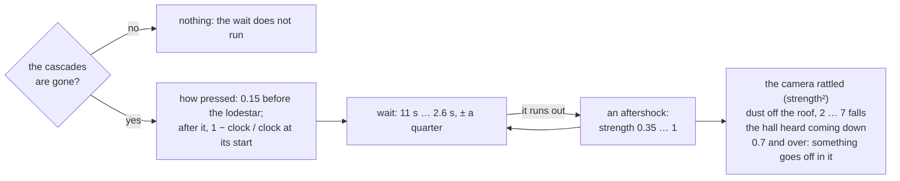

- **When, and how hard** (`stepAftershock`): the first comes six seconds after the blast; then one about every
  eleven seconds while nothing presses, and — once the lodestar is up — faster and harder as the strike nears,
  down to one every two and a half seconds at full strength when it is a moment away. The same seed gives the
  same aftershocks; a mission has its own. Loop contract: entered when the cascades are gone (by the charges
  or by the overspeed: `mission.blown`); each round waits, then makes one aftershock and draws its next wait;
  it ends with the mission. Nothing it does can fail or pile up: an aftershock is a fixed handful of effects.
- **What one is.** The camera is rattled — by the square of its strength, so that the early ones are felt and
  the last ones are meant (0.06 … 0.34, where a near miss is 0.2 and a blast at your feet 1). Dust comes down
  round the player (2.5 … 10 m off): off a built ceiling or the cavern's rock, never out of the sky and never
  inside a wall; pale, in stages down to the floor, and what it shook loose is heard landing. The hall is heard
  coming down again, from where the hall is (the game's own `cascadeBlast`, lower and smaller, a different pitch
  each time); from strength 0.7 up something goes off in it as well (`explosion`). The first says THE MOUNTAIN
  IS MOVING under the crosshair, and WARDEN has one line for it. They are counted at the mission's end.
- **It hurts nobody and stops nothing.** It does not move the player, break a line of sight or touch a machine.
- **It has no sound of its own, and why.** A rumble of the rock itself was made four times and a model that
  listens never once took it for what it was meant to be. The first two were nine-tenths under 60 Hz — where
  that model, a laptop's speaker and a phone's all say nothing — and were heard as "footsteps on gravel" and
  "twigs": the cracks alone. Put where it could be heard (half of it between 150 and 400 Hz), it was "wind"; made
  of seventy separate thuds, "a Geiger counter over a low rumbling background". Four tries were the limit set
  for any sound this round, so it was dropped rather than shipped unheard-as-itself. (The same measurement says
  the game's own `explosion` is nine-tenths under 60 Hz too.)
- **Known, and left.** In the second look the dust is darker than in the first (it takes the light of where it
  falls, and that look exposes for the lamps). Nobody has played a run out with it: whether seven seconds of
  shaking a minute is exciting or tiresome is a person's call.
- **Tests.** `test/unit/wild-aftershock.test.mjs` (five: still while the cascades stand; how pressed things
  are; seldom, then fast — two minutes of each counted; harder at the last — more shake, more dust, and only
  the hard ones set something off; the same from the same seed). `test/wild/aftershock.test.mjs` (four, in the
  built game: nothing for twenty seconds, then the first six seconds after the blast — the note, the hall heard
  from where it is and lower than the blast, dust that found a roof, what it shook loose landing, WARDEN's
  line; no puff of dust under the sky, inside a wall or higher than it can be seen; with the clock nearly out
  they are hard, rattle more than 1.8 times as much and something goes off in the hall; a checkpoint keeps the
  count, a new mission is still again).

### The site answers — waves (`response.js`, `response-live.js`)

Decision of 18 November 2026 — the owner: _"i want the game to be more causal every trip wire and every site
alarm and completion of a task needs to bring a significant amount of enemies"_. Read as cause and effect:
each of the three brings a wave of machines that are not on the mission's roll. Until then a wire and an alarm
brought nobody, and a task brought one to three.

```mermaid
flowchart LR
  wire["a wire broken<br/>(a doorway's first time)"] --> call
  alarm["an alarm raised afresh<br/>by a machine, or for a witness"] --> call
  task["a task done<br/>charge · blast · roll down · lodestar"] --> call
  call["call: the cause's figure,<br/>less what the game itself sent"] -->|"room in the queue"| queue[("queue ≤ the cap")]
  call -->|"no room"| shed["shed, and counted"]
  queue -->|"one a 0.8 s, while fewer<br/>than the cap are running"| door["a door out of sight,<br/>or the bay"]
  door --> fight["the wave"]
  fight -->|"its last machine down"| cache["a cache's worth of rounds"]
```

- **How many, in all** (Recruit / Operator / Ghost): a wire 2 / 3 / 4; an alarm 3 / 4 / 5; a task 3 / 4 / 6.
  What the game itself sends for a task counts towards the figure — a charge's own wave (1 / 2 / 3), the blast's
  drones (0 / 2 / 3), the lodestar's (2 / 3 / 4) — and the rest is made up, mostly on foot: of a whole wave one
  machine in three comes by air.
- **The causes.** A wire: the first time a doorway's thread is broken (the lobby's two beams are one doorway);
  later crossings raise the alarm as they always did and bring nobody. An alarm: each time a machine raises it
  afresh — it found the player, or a wreck — and when one is raised for a turned machine seen firing on its
  own (the uplink's witness alarm). While an alarm stands nothing raises it afresh, so a wire's or a charge's
  alarm does not bring a second wave. A task: each charge set, the cascades blown, the last machine of the roll
  shut down ("That was the garrison. WARDEN is sending its reserve"), the lodestar raised. Getting out ends the
  mission and brings nobody.
- **The loop, and what bounds it.** A cause puts its machines in a queue; one walks in every 0.8 s, and only
  while fewer than the cap are running — 6 / 9 / 12 machines of waves at once, and seven-tenths of that on a
  phone (4 / 6 / 8). The queue holds no more than the cap again; what does not fit is shed (it does not come,
  and `state().shed` counts it). So whatever is set off, and however often, there are never more than the cap
  running and the cap waiting. There is no limit on how many a whole mission brings: an alarm can be raised
  again once it has stood down, as often as the player lets machines find him.
- **Where they come in.** On foot by the doors of the building (`site.entries`): first a door the player cannot
  see and that is at least 14 m from him, then — for the next of the same wave — the door farthest round from
  those already used, as the place they are sent to sees them, so that a wave comes from more than one side. By
  air from the bay. They are sent to where the cause happened; a machine does not walk in to a quiet site, so
  a cause that has raised no alarm (the roll shut down) raises it — uncounted, as a charge's is.
- **What pays for it.** More machines want more rounds, and the site has three caches. A wave shut down to its
  last machine — by anything: a round, the knife, a turned machine, the cascades — gives a cache's worth: 30
  for the carbine, 12 for the pistol, 6 shells, an EMP if there is room (WAVE DOWN — AMMUNITION FROM THE
  WRECKS). The rubber duck asked for a cap on what a whole mission brings, for the rounds' sake; this was
  chosen instead, because a cap would have meant that late in a mission a wire or an alarm brings nobody, which
  is what the owner asked to end. `test/unit/wild-response.test.mjs` holds the arithmetic against the game's
  own tables: at a hit rate of one round in four on Recruit, three in ten on Operator and seven in twenty on
  Ghost, every wave's cache holds the rounds the wave took; what is carried and cached at the start is enough
  for the roll and a full cap; and a mission in which every wire is broken, every task done and an alarm
  raised every minute for half an hour can be shot through.
- **The fallen.** A wreck of a wave is cleared away forty seconds after it fell, once the player cannot see
  it or is 30 m off: a mission can bring a great many, and each is a thing to draw. The machines of the roll lie
  where they fell, as they always did — they can be found.
- **What the player is told.** A note when the first is on its way (INBOUND — 3), two and a half seconds
  after the cause, so that the cause's own note is read first. Overwatch says how many, what for and how
  ("Four coming for the alarm — three on foot from the east, one by air.") — in the wire's own line, or four
  and a half seconds after what the game says of an alarm or a task. WARDEN has three lines for it, said eight
  seconds after the cause. Two counts at the mission's end: waves sent, and waves shut down to the last machine.
- **A checkpoint** keeps which doorways have brought their wave. On a retry the game sends again what the
  checkpoint's task brought; the rest of that wave comes again with it, and nothing is said of it twice.
- **Switch.** `?response=0`: nothing answers, and a wire is what it was.
- **Known, and left.** Nobody has played it: the figures are arithmetic. An alarm that keeps being raised keeps
  bringing waves, which a player who cannot break contact may find relentless — that is what was asked for,
  and the cap is what bounds it. The doors are the six the building has; a wave sent to a place outside it
  walks a long way.
- **Tests.** `test/unit/wild-response.test.mjs` (fourteen: the figures; the mix; the game's own share; a wire
  once; one at a time; never more than the cap, forty minutes of everything at once, on a desk and a phone; a
  wave shut down; a checkpoint; the doors; the compass against `src/bearing.js`; what Overwatch says; and the
  three of "what pays for it"). `test/wild/response.test.mjs` (seven, in the built game: a wire walked through —
  three, by two doors he could not see and from the bay, one at a time, told, and once; an alarm a machine
  raises — four, and no second while it stands; a charge set by hand — four with the game's two, one wave, and
  its rounds when the last falls; a retry; the cap, with more waiting than may come; the fallen cleared away
  and the roll's left; `response=0`, and a phone's cap).

### Visors (`visor.js`, `visor-live.js`, `visor-sounds.js`)

Decision of 18 November 2026 — the owner: _"don't make it so easy to just remove robots will headshots i want to
feel i'm working for it"_. Until then one round of the carbine or the pistol to a sentry's head shut it down on
Recruit and Operator (the head counts three times, and 34 × 3 is more than a sentry has).

- **The rule.** A sentry's head is behind a visor. The first round to it cracks the visor and counts as a round
  to the body; from the second on the head counts three times, as it always did. So with the visor alone a
  sentry is two rounds to the head on every setting, with either gun — and three to the body (four on Ghost):
  the head is still the place to aim for, and it is never one round. (With the plating behind it — Armour,
  below, the same day — it is three to the head and five to seven to the body.)
- **A shell is one shot** (decided later the same day, with Armour). The shell that cracks the visor is stopped
  by it, every pellet: all eight count as to the body. Until then the first pellet cracked the visor and the
  other seven went through. With the visor alone that changes nothing a player would see — eight pellets to the
  body at arm's length shut a sentry down on every setting; with the plating, a shell to the face is two where
  it would have stayed one. The visor is told which pull of the trigger a round is of (`G.weapon.shots`).
- **What is as it was.** A drone (it has no head). The knife, and a takedown from behind: neither is a round.
  The classic game (`?wild=0`), and `?visor=0`.
- **What the player is told.** VISOR CRACKED, sparks at the head, a sound of its own (`visorCrack`: a knock, a
  bright crack, a ring), and what is left of the bar of light in the visor is short and to one side — a
  cracked one is told at a glance. WARDEN has a line for the first. A count at the mission's end.
- **How it is asked.** `weapon.js` asks `hooks.plate(struck)` for every round of the player's that strikes a
  machine (section 2); the feature answers 1 for the round that cracks the visor — and for every pellet of
  that shell — and nothing otherwise.
- **Tests.** `test/unit/wild-visor.test.mjs` (five, against the game's own tables: the first round and the
  next; the body and a drone; two to the head on every setting with both guns, more to the body, and one before
  this; a shell is one shot). `test/wild/visor.test.mjs` (three, with real rounds and the plating switched off
  on its pages — `armour=0` — since it asks what the visor does by the figure: the first cracks and no more —
  the health it took, the note, the count, the bar of light, WARDEN — and the second shuts it down; three to the
  body as before; the classic game and `visor=0`).

### Armour (`armour.js`, `armour-live.js`)

Decision of 18 November 2026 — the owner: _"the game is still too easy to shoot down drones and robots make it
more difficult and require more shoots to take them down"_. The visor had made a head two rounds that morning;
a sentry was still three or four rounds of the carbine to the body, a drone two, and a burst did for either.

- **The rule.** The machines are plated, and a round of the player's counts **half** against one
  (`ARMOUR.rounds`: sentry 0.5, drone 0.5). The head is still the place to aim for — half the rounds of the
  body, and never fewer than three. Rounds to shut one down, Recruit / Operator / Ghost — what it was with the
  visor alone in brackets:
  - carbine: a sentry's body 5 / 6 / 7 (3 / 3 / 4), its head 3 / 3 / 3 (2), a drone 3 / 4 / 4 (2);
  - sidearm: a sentry's body 6 / 7 / 8 (3 / 4 / 4), its head 3 / 3 / 3 (2), a drone 4 / 4 / 5 (2 / 2 / 3);
  - shotgun at arm's length: a sentry 2 shells, to the body or to the head (1).
- **The shotgun is not let off.** The plan had it as it was inside four metres, to keep its place among the
  guns; the critique of the plan said that was the very thing a player who finds the machines too easy does,
  and it went. It is still the gun for close in — two pulls, each with eight pellets that are hard to miss
  with, against six rounds of the carbine that all have to land.
- **How it is asked.** Through `plate`, after the visor — and the hub now asks every feature that has a word on
  a round **in turn**, each told what the place counts so far (`src/wild/index.js`). Until this the first
  answer was the last, and the visor's 1 for the round that cracks it would have gone through the plating in
  full: a head would still have been two. That round is seventeen from the carbine, not thirty-four
  (`test/unit/wild-armour.test.mjs` and `test/wild/armour.test.mjs` hold the figure, not only the count).
- **What is as it was, on purpose.** The knife and a takedown from behind, an EMP, a lodestone, a drone flown
  into them or its gun turned on them, a machine turned against its own, the cascades going up: none is a round
  of the player's, none goes through `plate`, and with rounds worth half each is worth more than it was. The
  classic game. `?armour=0`.
- **Twice the rounds** (`ARMOUR.plenty`). Rounds are finite (the owner, 12 November), and the arithmetic that
  says a mission can be shot through is not let go: there are as many times the rounds as a round is worth
  less. In reserve when a mission starts (180 / 72 / 36 where it was 90 / 36 / 18 — the screen says 210 TOTAL
  LEFT), in each of the three caches (60 / 24 / 12), and from a wave shut down. The EMPs are as they were. What
  is harder is how long a machine stands under fire and fires back — not whether there are rounds to finish
  it. `test/unit/wild-response.test.mjs` asks its three questions (a wave pays for itself; the worst mission
  there is can be shot through; what is carried covers the roll and a full cap) of the game with its plating
  and without.
  - This is the one thing of the feature's that is in the game's own files: `createArms(rounds = 1)` and
    `takeCache(arms, rounds = 1)` in `arms.js`, `reset(rounds)` and `takeCache(rounds)` in `weapon.js`, and
    `main.js` asking `wild?.plenty() ?? 1` when a mission starts and when a cache is emptied. Asked for
    nothing, as the classic game asks, everything is as the table says. The figure is the table's times two,
    not what is carried times two: a mission begun again, or left for the title and begun again, starts with
    the same (`test/wild/armour.test.mjs`).
- **A drone that is struck jinks.** Struck and still flying, it turns back the other way round the circle it
  flies about the player and jumps 0.9 of a radian along it — about seven metres — so that the round after the
  first has to find it again. Not again for 1.6 s, the time that stride takes at its best pace: a burst sends
  it one way, not to and fro. It is the place it makes for that jumps, not the drone; it flies there.
- **What the player is told.** A line in the briefing (ARMOUR — a round counts half, and you carry twice as
  many), a row in the Controls, and at the mission's end how many rounds their plating took.
- **Tests.** `test/unit/wild-armour.test.mjs` (ten, against the game's own tables and through the visor's own
  rule: the figures; the cracking round's seventeen; the rounds for the carbine and the sidearm, on every
  setting, beside what they were; the shotgun's two; every gun more than it was; the head still better and
  never under three; twice the rounds for half the worth; the jink). `test/wild/armour.test.mjs` (eight, with
  real rounds: a sentry's body, its head, a drone, the shotgun at arm's length to both; the hub asking the visor
  and then the plating; twice the rounds at the start and in a cache, and no more on a mission begun again; the
  jink, once and not at every round of a burst; `armour=0`). `test/unit/arms.test.mjs` (the seam).
- **Known, and left.** A drone has 55 by the table and sixty and a half on Ghost, and no visor: with every
  pellet of a shell on it (sixty-four), inside nine metres, it still comes down to one. Nobody has played it:
  the figures are arithmetic and staged rounds at a machine that stands still, and whether six rounds for a
  sentry is right — or eight, or five — is the owner's to say; it is one number.
- **The board does not know the plating.** No line of the score changed, so `RULES` is as it was — and a
  mission played with `?armour=0` is reckoned by the same rules and goes on the same board as one played
  against the plating, as one played with `?response=0` always has (the board believes any row that is shaped
  honestly: `docs/WILD-board.md`). What the plating does to a score is the time it takes: the bonus for getting
  out fast is harder to earn.

### The squad — machines that fight together (`squad.js`, `squad-live.js`)

Decision of 18 November 2026 — the owner: _"make the enemies smarter and coordinated with one another when
firing at me"_. Built by a helper on a branch of its own (`r11-squad`) and merged; read, run and changed by the
lead. All of it is in **`docs/WILD-squad.md`**; in short:

- Until then every machine fought for itself: each that saw the player closed, backed off or side-stepped at
  random, and each that did not ran to the same last-known point, in a file.
- Now the machines in a fight share where he was last seen. The sentries are given posts on a ring round him
  (7 to 15 m), spread as he sees them — an anchor and flanks, about 125° apart — kept with hysteresis and
  shifted within every few seconds. One under 35% of its health falls back out of sight and returns. Drones
  are spaced in their orbit. Bursts are staggered so that the fire does not let up. Overwatch says when one
  goes round, and which side.
- **What it does not do.** It changes where a machine stands and when it fires — never how hard or how truly it
  hits, nor how many may fire at once (1 / 2 / 3 by setting, as before). A machine that has not noticed the
  player is never touched: the four seconds there are to silence a machine before it raises the alarm are the
  game's, and stay.
- **A loop, and its bounds.** A plan at most twice a second, no more than 48 sight tests and two path searches
  in one; with twelve machines in the fight a plan was measured at under a millisecond.
- **At the merge.** A machine that sees him now keeps its front to him on the way to its post, as the game's
  own side-step does: left to face its path it was turned back each step and went at a fifth of its pace.
- **After the merge: round him, never through.** The full suite failed once; counted, three staged fights
  in sixteen left a machine shaking in place 4.5 m in front of him. Its post lay across him; inside 4.5 m it
  was handed back to the game's own rule, which backed it out; the squad sent it in again — four times a
  second. Now the squad keeps a posted machine 6 m off him and walks it round him on a circle of 7 m, a mark
  at a time, the short way — round where the squad last saw him, not by whether that machine sees him this
  step. Where no mark can be walked to it goes by its route; and one found inside the game's line in his
  sight — going by its route, or not out in a second and a half — is given back to the game for four seconds
  at a time, and planned a post on its own side meanwhile. It took two goes: the first had no net under it,
  and a review and a survey of twelve places that are not open ground found a machine stood at a corner and
  seven walked through him. Of 108 machines at those places: 9 left standing as merged, none now.
- **Switch.** `?squad=0`.
- **Tests.** `test/unit/wild-squad.test.mjs` (twenty-seven). `test/wild/squad.test.mjs` (twelve, in the built
  game: the same staged fight with it and without — the widest gap between two machines' bearings 130° to
  141° with it, 11° to 70° without, and as many rounds fired, 75 to 82 a fight against 78 to 81; nobody left
  standing still; a post on his far side reached round him, never within 5 m; a machine walked up to gives
  ground and stays out; his sight of it coming and going sends it one way, not two; one with no way round
  is the game's at the line, for seconds; at five places with no room to go round, nobody is walked through
  him; out of his sight they do not bunch; the stealth guard; a hurt one falls back and returns; `squad=0`;
  and a wave's machines given posts like the rest).
- **Known, and left.** Nobody has played against it. The way round needs open ground: in a hall with things
  in it about one machine in nine cannot get round and holds its own side instead. Every measure is against
  a player who stands still.

### Sounds from recordings a model made (`sfx.js`, `sfx-live.js`, `sfx/*.mp3`)

Decision of 18 November 2026 — the owner: _"add firing and explosion sounds drons and robots firing at me
cenrifuges spinning and blowing up i want sounds"_. Built by a helper (`r11-sfx`), re-judged and changed by the
lead. All of it is in **`docs/WILD-sfx.md`**, including what the helper's notes got wrong; in short:

- Every sound of the game was made by arithmetic, and the game's `explosion` had nine-tenths of its energy
  under 60 Hz, where a laptop's or a phone's speaker says nothing. These are samples: a model that makes video
  is asked for a few seconds of one thing, and only the sound is kept.
- **The gate**, written before the first was heard: a listening model, not told what the sound is meant to be,
  must name it in the right family; at least 35% of its energy between 150 and 4000 Hz; the game's own checks;
  and no less convincing than the sound it replaces.
- **In (six sounds, thirteen files, 0.24 MB):** a sentry's rifle; the explosion; the cascades going up — and
  three more blasts after the first, at the charges; the centrifuges spinning while the cascades stand, running
  down when they go; the player's pistol and shotgun.
- **Out, each after three tries or more:** a drone's gun (six: never heard as a gunshot); the rotors tearing
  loose; the player's carbine (heard as a gunshot, and as no better than the one the game has); and a round
  going past — let in by the helper under a gate widened for it, taken out when the lead listened again.
- Fetched after the game has started, most wanted first; a sample that cannot be had leaves the game's own
  sound in place. `?sfx=0`: the game's own sounds.
- **Tests.** `test/unit/wild-sfx.test.mjs` (five), `test/wild/sfx.test.mjs` (four, in the built game with sound).
- **Known, and left.** No person has heard any of it.

### Haptics (`haptics.js`, `haptics-live.js`)

Decision of 18 November 2026 — the owner: _"when availible heptic feedback like on the iphone if possible"_.
Built by a helper (`r11-haptics`); wired to what causes each feeling by the lead. All of it is in
**`docs/WILD-haptics.md`**; in short:

- **On an iPhone it is not possible from a web page, and nothing is felt.** Safari has never had
  `navigator.vibrate`, and the one trick that stood in for it (a hidden switch toggled from script) was closed
  in iOS 26.5; the owner's phone is on 26.7.3. The Settings row says so: _Safari on iPhone does not let a web
  page vibrate_. The way there is to wrap the game in an app, which this is not.
- **Where a browser can** (Chrome on Android): the player's own gun, the knife, being hit, a kill, a charge
  set, the alarm, an EMP and the cascades by distance, an aftershock by its strength, a lodestone's crush, the
  slide, a hard landing, a wave on its way, a wave shut down, a visor cracked. One feeling at a time, by
  priority; nothing asked for until the player has touched the page (Chromium refuses before that, and logs an
  error each time).
- A row of its own in the Settings (kept in the browser under `lodestar.haptics.v1`); `?haptics=0`.
- **Tests.** `test/unit/wild-haptics.test.mjs` (ten), `test/wild/haptics.test.mjs` (seven).
- **Known, and left.** No phone of any kind has had it in the hand: the suites hold that the right pattern is
  asked for at the right moment, not how it feels.

### The board (`score.js`, `board.js`, `board-live.js`, `board.css`; `rayfin/data/Score.ts`)

Decision of 18 November 2026 — the owner: _"add a score board feature and save it to a shared database …"_. Built by a helper (`r11-board`); the scoring and the link's address
tightened, by the lead. All of it is in **`docs/WILD-board.md`**; in short:

- **What the player sees.** SCOREBOARD at the foot of the title. When a mission ends — won or not — what it was
  worth, line by line, under the figures; and with a callsign it is posted, and its place said. The board: the
  best of each callsign, the first twenty, and the player's own row.
- **The score.** Each charge, the blast, getting out; every machine of the roll (a sentry more than a drone);
  machines of waves, less and counted to thirty; takedowns; a bonus for getting out fast and one for aim; less
  for every alarm and every retry; by the setting (0.7 / 1 / 1.4), and halved if the mission was not won. The
  most a mission can score on Ghost is 23,470.
- **Shared, and what that means.** One table in the app's database, which anyone with the page may read and add
  a row to, and nobody may change (`README.md`, "Hosting"). There is no sign-in, so a row can be added by hand
  with any name and any score the rules could give. What comes back is treated as hostile: it is checked field
  by field, a score above what the rules can give is refused, and everything is put on the screen as text.
- **Where it talks to.** The app's own database, and only when the page is served from a `fabricapps.net`
  address; anywhere else, and with `?board=0`, scores are kept on the device. A score that could not be sent is
  kept and sent later.
- **What the real service does, and no stand-in did.** The board is at the service's `/graphql`; asked at its
  root the service refuses, with a body that is JSON — and the first board took that for an empty board and a
  score posted. And the service does not hold the ranges of the numbers, only the lengths of the text
  (`docs/WILD-board.md`, "What the real service does").
- **A capacity over its allowance.** When an app's capacity is throttled the service holds every answer twenty
  seconds; the game gave up after six, and a request given up on is dropped — so the board was there and no
  game could read it or add to it. An answer is now waited thirty-five seconds for, one question for the list
  is out at a time, and while one has been out five seconds the screen says the board is slow, which it is, and
  not that it could not be reached. What the game cannot do is make a capacity carry more: that is set in
  Fabric (`docs/WILD-board.md`, "A capacity over its allowance").
- **Tests.** `test/unit/wild-score.test.mjs` (fourteen), `test/unit/wild-board.test.mjs` (twenty-three),
  `test/wild/board.test.mjs` (sixteen, against a stand-in for the database — four of them against one that
  holds its answers as the throttled service does, in real time).

## 5. What the player is told of it, and a phone

The wild build adds to five of the game's screens, has one of its own (the board) and adds to the HUD
(`index.js` `screen`, `wild.css`, `board.css`).

- **The briefing** gets a box under the four tasks: KIT AND HAZARDS (until 18 November 2026: WILD BUILD · KIT AND
  HAZARDS; until the 17th: THE EXPERIMENT · NEW THIS RUN), and a line a thing — the key
  it is on, its name, a few words (`brief`: fifty letters at most, so that each is one line and none is cut
  short). On a phone the lines are the phone's: a button's name where a desk has a key. It was first a paragraph
  of every feature's sentence, and was a wall (seen 16 November 2026, in the first picture taken of it).
- **The Controls screen** gets a row a thing after the game's own (`controls`). The first column of that table is
  never wrapped, so a row's first cell is no longer than the game's longest (76 letters); the first rows written
  were longer and squeezed the keys' column to 75 px (the same picture). The table is held to the width it has
  without the experiment.
- **The debrief, and the screen of a mission lost,** get the wild build's counts under the game's own figures
  (`tallies`), headed FIELD NOTES (until 18 November 2026: WILD BUILD) — only those that are not nought — and
  under them what the mission was worth, headed SCORE, with the callsign to post it under ("The board").
- **The title** has SCOREBOARD at its foot, and nothing else of it (until 18 November 2026 it said WILD BUILD
  under the game's name and carried the switch: section 1).
- **The Settings** get a group of their own, FEEL, with one row: Haptics ("Haptics").
- **In play, on a desk:** a bar of chips at the foot of the screen, one a feature that has a key (`chip`);
  FOCUS's and the uplink's count what is left of each (×3 … ×0).
- **In play, on a phone:** no bar (the thumbs are there, and there are no keys to be told of). FOCUS is a button
  of its own in the row NV and the pause are in, to the left of them, with the meter along its foot (it stands
  for the key: `input.poke`). The lodestone is a button of its own too — LODE, a row under them, with its count
  on its face. The uplink and the overspeed are on the second contextual button, where SHIELD
  is, which says UPLINK or OVERSPEED when the game has no use for it; one press holds for the player. The slide
  is CROUCH at a run, and a thread of light is jumped with JUMP and gone under with CROUCH. The reflex is not
  asked for. **Not on a phone:** a flown drone's height and its being blown up (it is flown with the stick,
  fires with
  FIRE, and ends when its battery does). The overspeed's offer and its bar go up under the compass — sideways,
  78 px down; held upright, 150 — because under the crosshair is where the buttons are.
- **Tests.** `test/wild/dress.test.mjs` (seven, in the built game: the briefing's lines, each one line and whole,
  and none of it with the experiment off; the Controls table against the same table without the experiment, on
  both of its pages; the counts on the screen of a mission lost; and at four phone shapes — three sideways, one
  upright — real touches: FOCUS's button bends time and lets it go, the second button begins the overspeed and
  takes a sentry, and nothing of the experiment's lies over a button or a panel of the HUD).

## 6. The suites written before it, with the experiment on

Not a gate, and nothing in `npm test`: a way to ask what the experiment changes for the game underneath it.
`WILD_COMPAT=1 node --test test/smoke.test.mjs test/phone.test.mjs` opens every page of those suites with the
experiment ON, in the first look (`test/helpers/harness.mjs` `withWild`); without the variable they are opened
with it off, as always.

- **16 November 2026, all eight things on:** smoke 60 of 60, phone 24 of 24. Nothing those eighty-four tests
  hold is changed by the experiment being there while nothing of it is used.
- **What that does not say.** Those suites mostly put the body where they want it — by a teleport, which a
  thread of light does not take for a walk, and often hidden, which nothing of the experiment's sees — so they
  seldom meet what the experiment adds. It says the game underneath is the game it was; it says nothing of how
  the game plays with eight new things in the player's hands, which nobody has tried.
- The second look's own suite, run the same way, is noted in the round's report, not here: it is a measure of
  pictures, and the experiment draws things in them.
